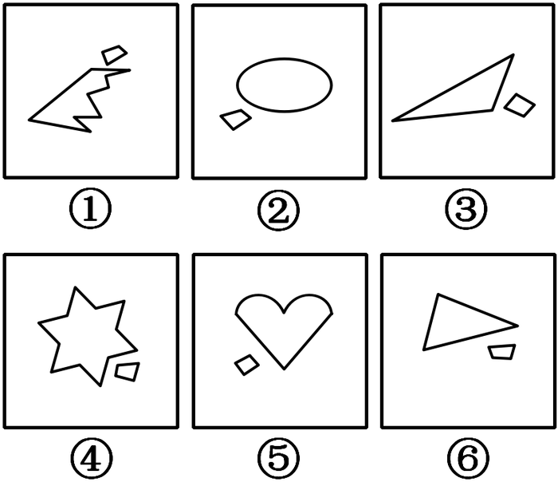

# 数量规律-线条数（大图形与小图形线条数比较分组）

考点：[[20-考点/判断推理/图形推理/数量规律-线条数（大图形与小图形线条数比较分组）|图形推理 / 数量规律-线条数（大图形与小图形线条数比较分组）]]

**问法模型**：『把图形分为两类，使每一类都有各自共同特征』→ 分组分类题：先确认各图共同构成（一大一小两图形），位置/功能无规律时转数大、小图形各自的数量特征，按3+3分组对照选项

## 推理链
1. 第1步：六幅图均由'一大一小'两个图形组成，小图形均贴在大图形外部，位置关系无明显规律，功能元素排除，考虑数量规律
2. 第2步：锁定稳定参照——六图的小图形均为四边形（4条线），再逐一数大图形的线条数作比较
3. 第3步：图①大图形为多段折线箭头形，线条数＞4；图④六角星轮廓12条线＞4；图⑤心形线条数与小图形相等（官方注明图⑤大小图形线条数相等），故①④⑤满足'大图形线条数≥小图形线条数'
4. 第4步：图②大图形椭圆仅1条曲线＜4；图③大图形三角形3条线＜4；图⑥大图形三角形3条线＜4，故②③⑥满足'大图形线条数＜小图形线条数'
5. 第5步：①④⑤一组、②③⑥一组，对照选项，B项'①④⑤，②③⑥'与之完全吻合，故选B

**最快解法**：⚡ 数线法+固定参照：先看小图形——六图小图形全是四边形（4条线），再快速数大图形线条数，'大≥小'的①④⑤一组、'大<小'的②③⑥一组，直接锁定B

## 易错点
- ⚠ 本题存在第二种规律（'角/边朝向'可得①③⑥与②④⑤即C项）与官方答案B冲突，考场上须以可严格量化的数线规律为准，警惕一题双规律的取舍
- ⚠ 图⑤心形线条数易数错，官方注明其大小图形线条数相等（均为4条），注意'大于等于'中'等于'的情形归属①④⑤组
- ⚠ 忽略'小图形均为四边形'这一稳定参照，把大小图形线条数混加求总数，导致无从分组

## 母题抽象
> 🧩 当一组图形均由'一大一小'两个图形组成且位置、功能元素无规律时，分别数大、小图形的数量特征（线条数、角数、交点数），常按'大≥小'与'大<小'两类完成3+3分组

**同类特征**：每幅图由一大一小两个图形组成、小图形均为四边形、大图形形状各异（箭头形/椭圆/三角形/六角星/心形）、功能元素位置无规律、分组分类问法（分为两类）

## 相关题
（暂无）

---

### 题干

把下面的图形分为两类，使每一类图形都有各自的共同特征或规律，分类正确的一项是：

### 选项
- A. ①②⑥，③④⑤
- B. ①④⑤，②③⑥　✅
- C. ①③⑥，②④⑤
- D. ①③⑤，②④⑥

### 官方解析
解析一：每个图形均由一大一小两个图形组成，且功能元素无规律，考虑数量规律。观察发现，图①④⑤中大图形的线条数均大于等于小图形的线条数，图②③⑥中大图形的线条数均小于小图形的线条数。
故正确答案为B。
解析二：每个图形均由一大一小两个图形组成，考虑图形间关系。观察发现，图①③⑥中小图形的角朝向大图形，图②④⑤中小图形的边朝向大图形。（注：有同学可能认为②④⑤中小图形线条与大图形平行，但图②大图形为曲线图，不符合规律。）
故正确答案为C。
注：本题为争议题，解析一和解析二均有不严谨的地方，解析一中图⑤大小图形线条数相等，解析二中图②③⑥无法严谨的界定小图形的边还是角朝向大图形，经过比较，解析二比解析一更不严谨，因此粉笔倾向于解析一。

### 给定材料
（无）

> [!note] 复核版本状态
> 原题不可计分（underdetermined；来源记录的答案键/竞争项：B、C）；仅当前明确标注的编辑版按答案B计分。
> 详细原题疑点、修订题面、解析和证据见下方独立复核记录。

<!-- CODEX-ANSWER-REVIEW:BEGIN -->
### 本次独立复核

**复核结论：** `resolved`（答案与解析已核定）

**原题计分状态：** 不计分（`underdetermined`：原题证据不足以唯一判定）。来源中记录的答案键/竞争项：B、C；这些记录不代表原题已核准答案。

**原题疑点与处理：**

湖南 2018 〔20-考点/判断推理/图形推理/数量规律-线条数（大图形与小图形线条数比较分组）〕 — 官方自注本题有争议：解析二'①③⑥小图形角朝向大图形、②④⑤小图形边朝向大图形'可推出C，与官方答案B矛盾；且解析一中图⑤大小图形线条数实为相等，'大≥小'表述…

**当前计分版本：** 明确标注的编辑版；未列出的题干、材料或选项沿用固定题源。答案不回填为原题答案。

**计分答案：** B（可计分）

**复核解析：**

按编辑题干给出的统一口径，曲线连续弧段算一段、折线按转折处分段。六个小图形均为四边形，各4段；大图形的轮廓段数依次为：①多段折线（多于4段）、②椭圆1段、③三角形3段、④六角星12段、⑤心形4段（2段曲线弧+2条直边）、⑥三角形3段。因此大图形段数≥4的为①④⑤，少于4的为②③⑥，唯一对应B。原题另有朝向规律可得C，所以仅编辑版按B计分。

**修订题干：**

【编辑修订】只比较每个组合中大、小图形各自的轮廓段数：折线按每条直边计，连续曲线按一段计（椭圆为1段、心形为2段曲线弧加2条直边，共4段）；大图形轮廓段数≥小图形的分为一类，大图形少于小图形的分为另一类。选择分类正确的一项。

**相关信息：**

图形推理—分组与数量比较。编辑版把计数单位规定为轮廓段：折线按直边逐段数，连续曲线按连续弧段数，心形明确计为2弧+2直边；相等情形归入“大于等于”组。

**核对依据与来源边界：**

- 固定题源：[原题文件](https://github.com/Mentat-Uran/kaogongzhentizhengliu/blob/84ab93d4b64b61d897bece8a1c0a5bab06b4feb2/10-%E7%9C%9F%E9%A2%98/%E5%88%A4%E6%96%AD%E6%8E%A8%E7%90%86/%E5%9B%BE%E5%BD%A2%E6%8E%A8%E7%90%86/2188862%20%E6%95%B0%E9%87%8F%E8%A7%84%E5%BE%8B-%E7%BA%BF%E6%9D%A1%E6%95%B0%EF%BC%88%E5%A4%A7%E5%9B%BE%E5%BD%A2%E4%B8%8E%E5%B0%8F%E5%9B%BE%E5%BD%A2%E7%BA%BF%E6%9D%A1%E6%95%B0%E6%AF%94%E8%BE%83%E5%88%86%E7%BB%84%EF%BC%89.md)；内容版本 `84ab93d4b64b61d897bece8a1c0a5bab06b4feb2`，源 Markdown blob `96fd19e899983957a4aac3b7bbd67ef5b19290a0`.
- **核心依据：** 固定题图逐项计数：大图形①>4、②1、③3、④12、⑤4、⑥3；六个小图形均4。按编辑版明确的轮廓段规则，唯一分组为①④⑤与②③⑥，即B。原图官方解析另提出可得C的朝向规律，故原题不唯一。
- **计数口径：** 小图形均4段；大图形依次>4、1、3、12、4、3；曲线按连续弧段计，心形为2弧+2直边。
- 固定题图/公式图：`90-图片/题目图/163389454f0c3f7.png`.

<!-- CODEX-ANSWER-REVIEW:END -->
