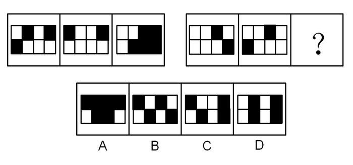

# 样式规律-黑白运算（定义叠加）

考点：[[20-考点/判断推理/图形推理/样式规律-黑白运算（定义叠加）|图形推理 / 样式规律-黑白运算（定义叠加）]]

**问法模型**：两组图且每图轮廓相同、内部为黑白块，'图1+图2=图3'提示叠加规律→先用第一组逐格归纳四种叠加组合的输出色，再逐格套用第二组排除选项

## 推理链
1. 第1步：两组图元素组成相似，每个图形轮廓与九宫分割完全一致、仅黑白分布不同，且出现黑白块，优先考虑样式规律中的黑白运算。
2. 第2步：逐格比对第一组图1与图2叠加成图3：第一行第一格'白+黑=白'，第一行第二格'黑+白=白'，得出异色相加得白。
3. 第3步：继续比对：第一行第三格'黑+黑=黑'，第二行第二格'白+白=黑'，得出同色相加得黑，完整规则为白+黑=白、黑+白=白、白+白=黑、黑+黑=黑。
4. 第4步：将规则套用到第二组：图1与图2左上角第一格均为白，白+白=黑；第一行第二格两图均为黑，黑+黑=黑，故问号处图形左上角两块均应为黑色。
5. 第5步：对照选项：A左上角两格均为黑；B、C第一行第二格为白，D第一行第一格为白，排除B、C、D。
6. 第6步：再用完整规则验证A其余格子（第一行第三格黑+黑=黑、第二行白+黑=白、白+白=黑、黑+白=白）全部吻合，锁定答案A。

**最快解法**：⚡ 黑白运算+排除法：由第一组归纳口诀'同色得黑、异色得白'（白+黑=白、黑+白=白、白+白=黑、黑+黑=黑），只先算第二组左上角两格——白+白=黑、黑+黑=黑，须均为黑色，四个选项中仅A满足，直接秒选A。

## 易错点
- ⚠ 黑白叠加规则不固定，本题是'同色得黑、异色得白'，若惯性套用其他题'同色得白/求同存异'的口诀会全盘算错
- ⚠ 只核对左上角第一格不够：B、C第一格也为黑，必须核到左上角第二格（B、C此处为白）才能排除
- ⚠ 误把本题当作位置规律（黑块平移/翻转）来做，本题实为样式类黑白运算而非位置移动

## 母题抽象
> 🧩 当题干出现'两组图、图形轮廓与分割完全相同且内部为黑白块'的特征时，用黑白运算：先以第一组逐格归纳黑+黑、黑+白、白+黑、白+白四种组合各自的输出色，再逐格套用第二组，优先核算左上角等特征格排除选项；叠加规则必须以第一组归纳结果为准，不可套用惯性口诀。

**同类特征**：两组式：第一组三图给规律，第二组两图加问号套用、每个图形轮廓与格子分割完全相同、内部填充为黑白色块、元素组成相似、问'填入问号处使之呈现规律性'、规则特征：同色得黑、异色得白

## 相关题
- [[10-真题/判断推理/图形推理/10297407 样式规律-黑白运算（定义叠加）|10297407]]（四川 2025，相关度3）
- [[10-真题/判断推理/图形推理/2387648 样式规律-黑白运算（定义叠加）|2387648]]（浙江 2019，相关度3）
- [[10-真题/判断推理/图形推理/5430354 样式规律-黑白运算（定义叠加）|5430354]]（浙江 2023，相关度3）
- [[10-真题/判断推理/图形推理/5676967 样式规律-黑白运算（定义叠加）|5676967]]（上海 2018，相关度3）
- [[10-真题/判断推理/图形推理/10204610 样式规律-加减同异（去同存异），九宫格列规律|10204610]]（辽宁 2024，相关度1）

---

### 题干

从所给四个选项中，选择最合适的一个填入问号处，使之呈现一定的规律性：

### 选项
- A. A　✅
- B. B
- C. C
- D. D

### 官方解析
元素组成相似，优先考虑样式规律。图形中出现黑白块，考虑黑白运算。第一组图，白+黑=白，黑+白=白，白+白=黑，黑+黑=黑。第二行图依照此规律进行运算，左上角两块应均为黑色，排除B、C、D选项。
故正确答案为A。

### 给定材料
（无）
