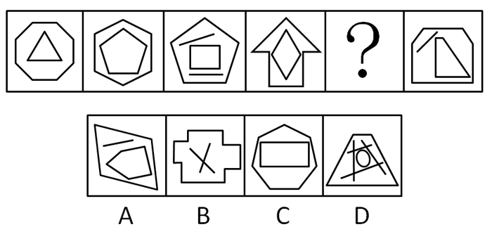

# 数量规律-数直线（线总数恒定）

考点：[[20-考点/判断推理/图形推理/数量规律-数直线（线总数恒定）|图形推理 / 数量规律-数直线（线总数恒定）]]

**问法模型**：题干为多幅递推式图形且元素组成不同、无明显属性规律→先属性后数量，本题定向数每幅图的直线总条数求常数规律

## 推理链
1. 第1步：题干图形均由'外层多边形轮廓+内部线条'组合而成，且出现单一直线（斜短线、平行短线），无对称/曲直/封闭等属性规律
2. 第2步：元素组成不同且出现单一直线→数直线总数；每幅图直线数=外框边数+内部线段数
3. 第3步：逐图计数：图1八边形8条+三角形3条=11；图2六边形6条+五边形5条=11；图3五边形5条+矩形4条+独立平行短线2条=11；图4箭头轮廓7条+菱形4条=11；问号右侧图切角外框7条+三角形3条+独立斜线1条=11
4. 第4步：规律确认：已知图形直线总数恒为11，'？'处也应为11条
5. 第5步：逐项计数：A项外框4条+五边形5条+短线1条=10；B项十字外框12条+内部交叉线2条=14；C项外框7条+内部矩形4条=11；D项直线共8条（圆为曲线不计入直线）
6. 第6步：仅C项为11条直线，符合规律，当选

**最快解法**：⚡ 数直线法：抓住'多边形+单一直线'特征信号，快速累计每图外框边数与内部线段数，验证常数11后直接排除A(10)、B(14)、D(8)

## 易错点
- ⚠ 漏数独立短线段：图3的两条平行短线、问号右侧图的斜短线均为直线，漏数则误判每图直线数
- ⚠ 把曲线误计为直线：D项内部的圆形是曲线，不计入直线数，误计会干扰排除判断
- ⚠ 外框边数数错：B项十字形外框边数多（12条）、C项外框为7条七边形，快速目测易漏角、错算边数

## 母题抽象
> 🧩 当图形元素组成不同、属性规律（对称/曲直/开闭）均不成立，且图中出现多边形嵌套外加孤立单一直线时，优先数直线总条数找常数规律，再逐项计数排除

**同类特征**：元素组成不同、无明显属性规律、出现单一直线、多边形嵌套组合、外框边数+内部线段、直线总数恒定

## 相关题
- [[10-真题/判断推理/图形推理/2187604 数量规律-数线（横线数恒定）|2187604]]（选调 2018，相关度3）
- [[10-真题/判断推理/图形推理/10204454 数量规律-部分数（黑白球连通区域数做和）|10204454]]（甘肃 2024，相关度2）
- [[10-真题/判断推理/图形推理/10297050 数量规律-特殊计数（线条穿过小白球的数量）|10297050]]（天津 2025，相关度2）
- [[10-真题/判断推理/图形推理/10297262 数量规律-面的形状种类（封闭面种类数分组）|10297262]]（浙江 2025，相关度2）
- [[10-真题/判断推理/图形推理/10297314 数量规律-交点数（曲直交点）|10297314]]（浙江 2025，相关度2）

---

### 题干

从所给四个选项中，选择最合适的一个填入问号处，使之呈现一定的规律性：

### 选项
- A. A
- B. B
- C. C　✅
- D. D

### 官方解析
图形元素组成不同，且无明显属性规律，考虑数量规律。观察发现，题干出现单一直线和多边形，考虑数直线。题干图形均有11条直线，则“？”处图形也应该有11条直线。A项有10条直线，排除；B项有14条直线，排除；C项有11条直线，当选；D项有8条直线，排除。
故正确答案为C。

### 给定材料
（无）
