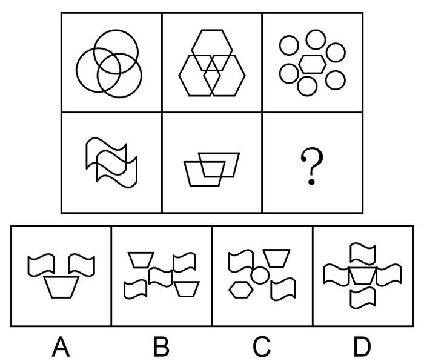

# 数量规律-面数量（封闭区域数）按行呈常数规律

考点：[[20-考点/判断推理/图形推理/数量规律-面数量（封闭区域数）按行呈常数规律|图形推理 / 数量规律-面数量（封闭区域数）按行呈常数规律]]

**问法模型**：九宫格'选择最适合的一个填入问号处，使之呈现一定的规律性'→ 先看属性规律，无属性规律时按行数面（封闭区域数）找常数规律

## 推理链
1. 第1步：九宫格优先按行观察，题干元素组成不同，曲直、对称、开闭等属性无统一规律，转向数量规律
2. 第2步：题干图形'窟窿'特征明显（相交圆、重叠多边形、多个独立封闭形状），优先数面（封闭区域数）
3. 第3步：数第一行——图1三圆两两相交：3个独占区+3个两两重叠区+1个中心重叠区=7个面；图2三个六边形相交同样为7个面；图3为6个圆+中心1个六边形互不相离相加=7个面，第一行面数恒为7
4. 第4步：数第二行——图1两个波形图形相交产生3个封闭区域，图2两个四边形相交产生3个封闭区域，第二行前两图面数均为3，故问号处应选3个面的图形
5. 第5步：逐项数面——A项为2个旗形+1个梯形，互不重叠，共3个面；B项约5个面；C项约5-6个面；D项4个旗形+1个梯形（部分相邻重叠）超过3个面
6. 第6步：只有A项面数为3，满足第二行面数恒为3的规律，故选A

**最快解法**：⚡ 数面法+按行常数规律：第一行三图均数出7个面，第二行前两图均数出3个面，直接在选项中找'3个面'——A项三个独立封闭形状恰好3个面，秒选A

## 易错点
- ⚠ 图3的6个圆排列紧密易误判为相交而多算重叠区，实际各封闭形状互不相交，直接相加1+6=7
- ⚠ 数面时漏数图形两两相交产生的重叠小面（如三圆相交的中心面、两图相交的中间面），导致行内规律数不准
- ⚠ 粗看选项只数'图形个数'不数'封闭区域数'，或忽略D项旗形与梯形间的重叠关系而错数面数

## 母题抽象
> 🧩 当九宫格（或两组）图形元素组成不同、无统一属性规律且封闭区域特征明显时，按行数面找'每行面数量为常数'的规律，再在选项中挑选相同面数的图形

**同类特征**：九宫格、元素组成不同、窟窿多/封闭区域明显、相交与相离图形混合、面数量按行恒定（第一行7、第二行3）、问号处补全行的常数规律

## 相关题
- [[10-真题/判断推理/图形推理/2188249 数量规律-数面（封闭区域数，九宫格行等差规律）|2188249]]（江西 2018，相关度3）
- [[10-真题/判断推理/图形推理/11367791 属性类-对称性（对称轴方向与条数、轴对称+中心对称）＋数量类-面数量（九宫格横行复合规律）|11367791]]（江苏 2025，相关度2）
- [[10-真题/判断推理/图形推理/11881082 属性规律-对称性（对称轴方向）|11881082]]（黑龙江 2024，相关度2）
- [[10-真题/判断推理/图形推理/12881896 属性规律-曲直性（九宫格横行遍历）|12881896]]（新疆 2025，相关度2）
- [[10-真题/判断推理/图形推理/14993416 数量规律-点数量（黑点个数按行求和恒值）|14993416]]（选调 2024，相关度2）

---

### 题干

从所给4个选项中，选择最适合的一个填入问号处，使之呈现一定的规律性：

### 选项
- A. A　✅
- B. B
- C. C
- D. D

### 官方解析
元素组成不同，无明显属性规律，考虑数量规律。观察发现，题干图形中窟窿比较多，考虑数面。第一行面数量都是7，第二行前两个图形面数量都是3，故？处找一个3个面的图形，只有A项符合。
故正确答案为A。

### 给定材料
（无）
