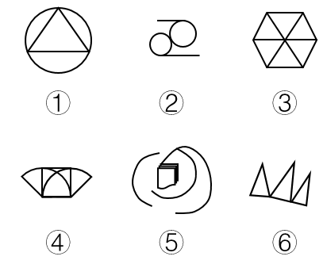

# 属性规律-对称性（轴对称与非轴对称分组）

考点：[[20-考点/判断推理/图形推理/属性规律-对称性（轴对称与非轴对称分组）|图形推理 / 属性规律-对称性（轴对称与非轴对称分组）]]

**问法模型**：六图两两分类题，图形组成元素各不相同 → 优先检验属性规律，先用最粗粒度的'是否轴对称'尝试二分

## 推理链
1. 第1步：六个图形组成元素完全不同（圆+三角形、双圆+横线、六边形分割、扇形组合、书本+弧线、三角形组），无共同线段或相同元素，排除样式类与位置类，优先考虑属性规律。
2. 第2步：对每个图形做轴对称检验——寻找是否存在一条直线，使图形沿该线折叠后两侧完全重合。
3. 第3步：①圆内接三角形，沿过三角形顶点与圆心的竖直对称轴折叠两侧重合，为轴对称；③正六边形被过中心的分割线均分为六个三角形，具有多条对称轴，为轴对称；④扇形组合沿中间竖直线折叠，两侧弧线与折线一一对应重合，为轴对称。
4. 第4步：②两个圆与上下两条横线呈错位排布，整体找不到任何对称轴；⑤中间五边形书本歪斜、外围弧线环绕方向不定，无对称轴；⑥三个三角形高矮不一且底线微倾，无对称轴。
5. 第5步：据此①③④为轴对称图形一组，②⑤⑥为非轴对称图形一组，与选项B（①③④，②⑤⑥）完全吻合。

**最快解法**：⚡ 对称性筛查法：逐图想象'沿某条直线对折'，能完全重合的①③④归为一类，重合不了的②⑤⑥归为另一类，直接锁定B。

## 易错点
- ⚠ ②中两个圆各自是轴对称的，易被局部对称误导而误判整体为轴对称，实际两圆与横线错位排布、整体无对称轴。
- ⚠ ⑥由三个三角形排列而成，易凭'三角形数量对称排布'的直觉误判，忽略三角形高矮不一、底线倾斜的细节。
- ⚠ 检验④时只看外部扇形轮廓不看内部弧线与折线是否也沿对称轴对应，可能漏判或多判。

## 母题抽象
> 🧩 当六个图形组成元素各不相同、且无明显数量规律时，先检验'轴对称/非轴对称'这一最粗粒度属性，若能将六图恰好二分即得答案；检验时必须整体折叠验证，不能凭局部元素对称下结论。

**同类特征**：图形组成不同、六图分类分组题、无相同构成元素、存在对称与非对称的明显差异、优先属性规律

## 相关题
- [[10-真题/判断推理/图形推理/2172151 属性规律-对称性（轴对称与非轴对称分组）|2172151]]（广州市考 2018，相关度2）
- [[10-真题/判断推理/图形推理/2015314 数量类-面数量（封闭区域个数分组）|2015314]]（重庆 2016，相关度1）
- [[10-真题/判断推理/图形推理/2021832 数量规律-交点数（分组分类）|2021832]]（吉林 2016，相关度1）
- [[10-真题/判断推理/图形推理/2037764 数量规律-数三角形个数（可重合计数，等差递增）；辅以一笔画属性验证|2037764]]（浙江 2016，相关度1）
- [[10-真题/判断推理/图形推理/2037766 属性规律-对称性（中心对称判定）|2037766]]（浙江 2016，相关度1）

---

### 题干

把下面的六个图形分成两类，使每一类图形都有各自的共同特征或规律，分类正确的一项是：

### 选项
- A. ①③⑥，②④⑤
- B. ①③④，②⑤⑥　✅
- C. ①②⑤，③④⑥
- D. ①②⑥，③④⑤

### 官方解析
图形组成不同，优先考虑属性规律。通过观察发现，①③④为轴对称图形，②⑤⑥为非对称图形。
故正确答案为B。

### 给定材料
（无）
