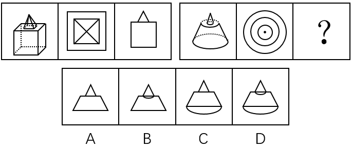

# 三视图规律（立体图-俯视图-主视图对应，正投影画法）

考点：[[20-考点/判断推理/图形推理/三视图规律（立体图-俯视图-主视图对应，正投影画法）|图形推理 / 三视图规律（立体图-俯视图-主视图对应，正投影画法）]]

**问法模型**：两组图呈现'立体图→俯视图→主视图'的对应关系 → 先由第一组归纳视图类型对应，再按正投影规律画出第二组立体图的主视图

## 推理链
1. 第1步：第一组图1为立体图（正方体顶部叠放锥体），图2为俯视图（外方内方加对角线），图3为主视图（三角形叠于正方形之上）
2. 第2步：归纳规律——每组三图依次为'立体图、俯视图、主视图'的投影对应关系
3. 第3步：第二组图1为'圆锥叠放于圆台'的组合体，图2俯视图为中心点+两层同心圆，与锥顶、锥底（圆台顶面）、圆台底面一一对应，问号处应为主视图
4. 第4步：按正投影规律分析主视图：圆锥投影为等腰三角形，圆台投影为等腰梯形；底面圆与锥台交界圆在正视方向均投影为直线段，不出现椭圆弧
5. 第5步：逐项对照——A为三角形+梯形且轮廓全为直线；B在锥台交界处多画弧线；C、D把底边画成椭圆弧（属斜二测直观图画法而非主视图）
6. 第6步：只有A符合主视图正投影画法，故选A

**最快解法**：⚡ 三视图口诀法：'主视图是正投影，圆面投影成线段'——组合体为圆锥+圆台，主视图=三角形叠等腰梯形，底边和交界处都必须是直线，凡带弧线/椭圆的B、C、D一律排除，秒选A

## 易错点
- ⚠ 受立体图中椭圆轮廓的视觉干扰，把底边误画成椭圆弧而误选C或D（混淆正投影与直观图）
- ⚠ 忽略锥与圆台交界处的圆在主视图中投影为直线，误选多画交界弧线的B
- ⚠ 未先用第一组建立'立体-俯视-主视'的对应框架，转而数面、线、点找数量规律而误入歧途

## 母题抽象
> 🧩 当题目出现'立体图+两个投影图+问号'的三图组结构时，先由第一组确定各图对应的视图类型，再按正投影规律（圆投影为线段、可见轮廓为实线）画出所求视图，并排除含多余弧线或椭圆轮廓的选项

**同类特征**：两组图对比、立体图形、俯视图、主视图、正方体与圆锥圆台组合体、同心圆俯视

## 相关题
- [[10-真题/判断推理/图形推理/12881941 三视图-俯视图（正投影规律）|12881941]]（广东 2025，相关度1）
- [[10-真题/判断推理/类比推理/2172444 语义关系-几何对应（平面图形与立体图形的面组成关系）|2172444]]（江苏 2018，相关度1）
- [[10-真题/判断推理/图形推理/2374815 三视图-立体图形俯视图（选非题）|2374815]]（广东 2019，相关度1）
- [[10-真题/判断推理/图形推理/5510126 分组分类-阴影部分形状属性（三角形判定）|5510126]]（新疆 2023，相关度1）

---

### 题干

从所给四个选项中，选择最合适的一个填入问号处，使之呈现一定的规律性：

### 选项
- A. A　✅
- B. B
- C. C
- D. D

### 官方解析
先观察前一组图形，第一个图为立体图形，后两个图分别为立体图形的俯视图和主视图。同理后一组图形第一个图为立体图形，后两个图分别为立体图形的俯视图和？，则立体图形的主视图应为A项所示图形。
故正确答案为A。

### 给定材料
（无）
