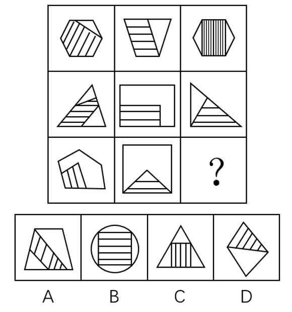
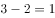

# 数量规律-特殊线段计数（外框与阴影的公共边数）+ 九宫格列向加减运算

考点：[[20-考点/判断推理/图形推理/数量规律-特殊线段计数（外框与阴影的公共边数）+ 九宫格列向加减运算|图形推理 / 数量规律-特殊线段计数（外框与阴影的公共边数）+ 九宫格列向加减运算]]

**问法模型**：九宫格'选择最合适的一个填入问号处使之呈现规律性'→ 先找每图共同的结构特征（外框+阴影相交出公共边）并计数，横向无规律时转为竖列找'图1=图2+图3'型运算规律

## 推理链
1. 第1步：观察题干九宫格，每个图形均由'外框+内部阴影'复合而成，且阴影与外框相交产生公共边（如第一行第一图六边形与斜条纹阴影共用边），故计数目标锁定为'外框与阴影的公共边数量'
2. 第2步：横向逐行看公共边数无规律，改按竖列数：第一列为5、3、2，第二列为3、2、1，第三列为2、2、？
3. 第3步：单独数无规律，对每列做数量运算，发现恒有'图1=图2+图3'：5=3+2，3=2+1
4. 第4步：将规律代入第三列：2=2+？，得？=0，即问号处图形外框与阴影的公共边数应为0
5. 第5步：逐项对照：A项阴影两边贴外框、C项竖条纹阴影贴底边与腰、D项阴影贴上方两边，均有公共边；只有B项外框为圆（曲线），内部阴影矩形与圆仅在两点接触，直线边与曲线边构不成公共边，公共边数为0
6. 第6步：只有B项满足公共边数为0，故选B

**最快解法**：⚡ 特征计数+列向运算法：抓住'外框与阴影相交产生公共边'这一特征，快速数出各列公共边数（5/3/2、3/2/1、2/2/?），套用'图1=图2+图3'得?=0，再用排除法找'阴影与外框无公共边'的图形——只有圆形外框（曲线）与直边阴影点接触不成公共边，秒选B

## 易错点
- ⚠ 惯性思维只横向找规律，未在横向无解时及时转竖列观察
- ⚠ 计数对象搞错：把阴影内部的条纹线、图形交点误当成'公共边'，公共边专指阴影与外框重合共用的边线
- ⚠ 对B项误判：阴影矩形看似'嵌在'圆中，但圆形外框是曲线，与直边只能点接触，公共边数为0而非2

## 母题抽象
> 🧩 当九宫格每幅图都呈'外框+阴影'复合结构且相交时，数'外框与阴影的公共边数'；横向无规律则竖列做加减运算（常为图1=图2+图3），再按所得数量排除选图

**同类特征**：九宫格、外框+内部阴影复合图形、外框与阴影相交产生公共边、横向无规律需转竖列、列内数量加减运算、正确项公共边数为0（圆形外框点接触）

## 相关题
- [[10-真题/判断推理/图形推理/10204610 样式规律-加减同异（去同存异），九宫格列规律|10204610]]（辽宁 2024，相关度1）
- [[10-真题/判断推理/图形推理/10297349 样式规律-黑白运算|10297349]]（浙江 2025，相关度1）
- [[10-真题/判断推理/图形推理/10297407 样式规律-黑白运算（定义叠加）|10297407]]（四川 2025，相关度1）
- [[10-真题/判断推理/图形推理/10975255 数量规律-元素个数与部分数（黑白球连通堆数）|10975255]]（江苏 2024，相关度1）
- [[10-真题/判断推理/图形推理/11367791 属性类-对称性（对称轴方向与条数、轴对称+中心对称）＋数量类-面数量（九宫格横行复合规律）|11367791]]（江苏 2025，相关度1）

---

### 题干

从所给四个选项中，选择最合适的一个填入问号处，使之呈现一定的规律性：

### 选项
- A. A
- B. B　✅
- C. C
- D. D

### 官方解析

观察题干图形特征，每个图形均为外框和内部阴影相交，且相交产生了公共边，因此考虑公共边数量。九宫格横着看无规律，考虑竖着看，第一列图形中外框和阴影相交的公共边数量分别为5、3、2，第二列分别为3、2、1，第三列分别为2、2、？，单独数无规律，考虑运算。由、可知：每列第一个图形中公共边数量第二个图形中公共边数量第三个图形中公共边数量，则“？”处图形外框和阴影相交的公共边数应为0，只有B项符合。

故正确答案为B。

### 给定材料
（无）

> [!warning] 疑点（官方解析可能有误，待人工复核）
> 官方解析中'由、可知'处疑似缺失图形序号引用（排版遗漏），但运算逻辑自洽（5=3+2、3=2+1、2=2+0），结论无误，不影响答案

<!-- CODEX-ANSWER-REVIEW:BEGIN -->
### 本次独立复核

**复核状态：** `confirmed`（独立复算确认答案）

**计分答案：** B（可计分）

**复核解析：**

逐格统计外框与阴影区域重合的公共边线段数，而不把图形内部的条纹线算作外框公共边。第一列各图为5、3、2，满足5=3+2；第二列为3、2、1，满足3=2+1。第三列前两格为2、2，故缺项须满足2=2+0，即阴影区域与外框没有公共边。四个选项中只有B的矩形阴影区位于圆形外框内且不与圆周共边；A、C、D均与外框有公共边，故答案B。

**相关信息：**

图形推理—相邻/公共边数量；相交、点接触、内部纹理线与边界重合需分别判别，按同一计数口径逐图核对。

**题源依据：** [固定版本原题](https://github.com/Mentat-Uran/kaogongzhentizhengliu/blob/84ab93d4b64b61d897bece8a1c0a5bab06b4feb2/10-%E7%9C%9F%E9%A2%98/%E5%88%A4%E6%96%AD%E6%8E%A8%E7%90%86/%E5%9B%BE%E5%BD%A2%E6%8E%A8%E7%90%86/2261751%20%E6%95%B0%E9%87%8F%E8%A7%84%E5%BE%8B-%E7%89%B9%E6%AE%8A%E7%BA%BF%E6%AE%B5%E8%AE%A1%E6%95%B0%EF%BC%88%E5%A4%96%E6%A1%86%E4%B8%8E%E9%98%B4%E5%BD%B1%E7%9A%84%E5%85%AC%E5%85%B1%E8%BE%B9%E6%95%B0%EF%BC%89%2B%20%E4%B9%9D%E5%AE%AB%E6%A0%BC%E5%88%97%E5%90%91%E5%8A%A0%E5%87%8F%E8%BF%90%E7%AE%97.md)；固定内容 commit `84ab93d4b64b61d897bece8a1c0a5bab06b4feb2`，Markdown blob `1405093b3cf58aefc098078d3948779bcc5fd7db`。
<!-- CODEX-ANSWER-REVIEW:END -->
