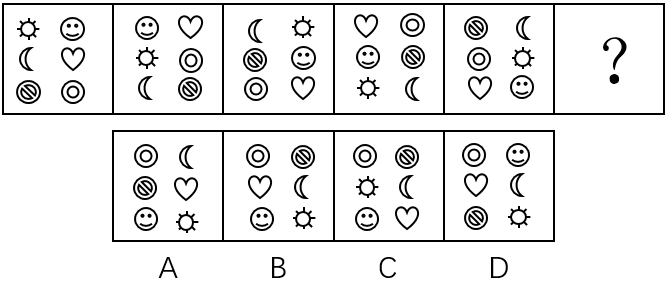

# 位置规律-平移（环形循环走位+步数递增、顺逆交替）

考点：[[20-考点/判断推理/图形推理/位置规律-平移（环形循环走位+步数递增、顺逆交替）|图形推理 / 位置规律-平移（环形循环走位+步数递增、顺逆交替）]]

**问法模型**：五幅图组成元素完全相同且求'？处规律'→ 将3×2网格外圈视为6格环形，考查元素的循环平移（方向顺逆交替、步数1/2/3/4/5递增）

## 推理链
1. 第1步：五幅图均由太阳、月亮、笑脸、爱心、条纹圆、同心圆6个相同元素组成，仅位置改变→考虑位置规律
2. 第2步：把3×2网格沿外圈顺时针编号1~6：左上→右上→右中→右下→左下→左中，构成环形
3. 第3步：图1→图2验证：太阳由左上移到左中、笑脸由右上移到左上、条纹圆由左下移到右下，所有元素沿环逆时针平移1格，成立
4. 第4步：图2→图3顺时针移2格（太阳左中→右上、月亮右上→左上、条纹圆右下→左中）；图3→图4逆时针移3格；图4→图5顺时针移4格（月亮右上不变位→左上？实为月亮右中→右上）；规律确认为'方向顺逆交替、步数依次+1'
5. 第5步：依规律，？处=图5各元素逆时针平移5格；6格环形中'逆时针5格'等价于'顺时针1格'
6. 第6步：将图5全体顺时针移1格落位：同心圆→左上、条纹圆→右上、爱心→左中、月亮→右中、笑脸→左下、太阳→右下
7. 第7步：对照选项：B为上排（同心圆、条纹圆）、中排（爱心、月亮）、下排（笑脸、太阳），完全吻合；A中月亮仍在右上、条纹圆在左中，不符，故选B

**最快解法**：⚡ 环形编号+双元素追踪排除法：外圈顺时针编号1~6，只跟踪月亮（图5在右上，逆时针5格=顺时针1格→应到右中）与条纹圆（应到右上），两元素同时命中的只有B（A中月亮未移动，排除）。

## 易错点
- ⚠ 只看出元素在动、却忽略步数逐次+1（1、2、3、4、5），误按恒定平移1格选答案
- ⚠ 把'逆时针平移5格'在6格环形中误算成'顺时针5格'，实际等价于顺时针1格
- ⚠ 只追踪太阳一个元素：A、B中太阳恰好都在右下，无法排除，必须再用第二元素（如月亮、条纹圆）验证

## 母题抽象
> 🧩 当一组图形组成元素完全相同、仅整体位置变化时，把网格外圈编号成环形，按'方向顺逆交替+步数递增'测试平移规律，再让元素落位对照选项。

**同类特征**：组成元素完全相同、3×2六宫格（6个位置成环）、元素整体循环平移、步数1、2、3、4、5递增、顺/逆时针方向交替、求问号处下一状态

## 相关题
- [[10-真题/判断推理/图形推理/1758958 位置规律-旋转（双线段不同步逆时针旋转-两线夹角等差递减45°）|1758958]]（上海 2016，相关度1）
- [[10-真题/判断推理/图形推理/18649981 位置规律-平移（黑球循环下移）|18649981]]（选调 2025，相关度1）

---

### 题干

从所给四个选项中，选择最合适的一个填入问号处，使之呈现一定的规律性：

### 选项
- A. A
- B. B　✅
- C. C
- D. D

### 官方解析
图形组成元素相同，考虑位置规律。观察发现，第一个图形到第二个图形，各元素逆时针平移一格；第二个图形到第三个图形，各元素又顺时针平移两格；后面每次分别：逆时针平移三格、顺时针平移四格。则？处各元素应逆时针平移五格。
故正确答案为B。

### 给定材料
（无）
