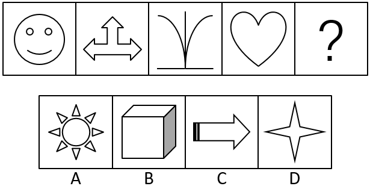

# 属性规律-对称性（对称轴数量递进辨析）

考点：[[20-考点/判断推理/图形推理/属性规律-对称性（对称轴数量递进辨析）|图形推理 / 属性规律-对称性（对称轴数量递进辨析）]]

**问法模型**：图形元素组成不相同且无明显数量特征 → 优先考虑属性规律，先判断是否轴对称，再递进数对称轴条数

## 推理链
1. 第1步：题干四幅图（笑脸、三向箭头、曲线与底线、心形）元素组成各不相同，排除样式类和位置类，优先考虑属性规律
2. 第2步：检验对称性——四幅图均为轴对称图形，且逐图验证都只有1条对称轴，方向均为竖直（笑脸竖轴、三向箭头竖轴、曲线竖轴、心形竖轴）
3. 第3步：逐项检验选项——A太阳有多条对称轴；B立体正方体透视图在平面上不成轴对称；C向右箭头仅1条（水平）对称轴；D四角星有多条对称轴
4. 第4步：以'有且仅有1条对称轴'为规律对照，A、D多条、B零条，只有C项满足，故选C

**最快解法**：⚡ 对称轴计数法：第一步用'是否轴对称'排B；第二步数条数，题干每图均只有1条对称轴，A（太阳）、D（四角星）明显多轴，直接排除，唯一只剩C

## 易错点
- ⚠ 只停留在'是轴对称图形'这一级，忽略对称轴数量的二级辨析，误选有多条对称轴的A或D
- ⚠ 纠结C项对称轴为水平方向、与题干竖直方向不一致而错排C，本题规律落点在对称轴条数而非方向
- ⚠ 把B项立方体透视图误当成轴对称图形，漏排B

## 母题抽象
> 🧩 当题干图形元素组成不同且都能看出轴对称特征时，按'是否轴对称→对称轴条数→（必要时）对称轴方向'三级递进验证，若条数呈现唯一规律（如均为1条）则按条数锁定选项

**同类特征**：元素组成不相同、属性规律优先、均为轴对称图形、每图仅1条对称轴、对称轴均为竖直、选项需二级辨析对称轴数量

## 相关题
- [[10-真题/判断推理/图形推理/2376756 属性规律-对称性（对称轴数量）|2376756]]（黑龙江 2019，相关度2）
- [[10-真题/判断推理/图形推理/2377141 属性规律-对称性（轴对称且对称轴为竖直方向）|2377141]]（选调 2019，相关度2）
- [[10-真题/判断推理/图形推理/11367775 属性规律-对称性（对称轴数量等差递减）|11367775]]（江苏 2025，相关度1）
- [[10-真题/判断推理/图形推理/12561860 数量规律-面数量与属性规律-对称轴数量的复合对应规律|12561860]]（浙江 2024，相关度1）
- [[10-真题/判断推理/图形推理/16095265 属性规律-对称性（轴对称+对称轴方向旋转）|16095265]]（江苏 2024，相关度1）

---

### 题干

从所给四个选项中，选择最合适的一个填入问号处，使之呈现一定的规律性：

### 选项
- A. A
- B. B
- C. C　✅
- D. D

### 官方解析
图形元素组成不相同，优先考虑属性规律。题干每幅图都是轴对称图形，排除B项；继续观察，题干每幅图都是竖轴对称，但A、D两项都有多个轴对称，没有唯一竖对称轴；题干每幅图都只有一条对称轴，只有C项有一条对称轴。
故正确答案为C。

### 给定材料
（无）

> [!warning] 疑点（官方解析可能有误，待人工复核）
> 官方解析存在标准切换不严谨处：先用'竖轴对称'标准排除A、D（称其'没有唯一竖对称轴'），但A、D实际也含竖直对称轴（只是不唯一），最终真正起决定作用的规律是'对称轴只有1条'；而C项唯一对称轴为水平方向，与题干竖直方向并不一致，即若严格按'唯一竖对称轴'标准C也应被排除。解析实际落脚于对称轴数量，答案C无误，但表述上方向与数量两个标准混用。

<!-- CODEX-ANSWER-REVIEW:BEGIN -->
### 本次独立复核

**复核状态：** `confirmed`（独立复算确认答案）

**计分答案：** C（可计分）

**复核解析：**

本题考查对称轴数量。逐一检查四个选项，A、D均有不止一条对称轴，B没有对称轴，C恰有一条对称轴。题干图形的共同属性是每图恰有一条对称轴，故选C；对称轴的具体方向不影响这一计数结论。

**相关信息：**

判断推理—图形属性；判断对称轴条数时需考虑图形整体，轴的方向可不同，但条数必须一致。

**题源依据：** [固定版本原题](https://github.com/Mentat-Uran/kaogongzhentizhengliu/blob/84ab93d4b64b61d897bece8a1c0a5bab06b4feb2/10-%E7%9C%9F%E9%A2%98/%E5%88%A4%E6%96%AD%E6%8E%A8%E7%90%86/%E5%9B%BE%E5%BD%A2%E6%8E%A8%E7%90%86/2261866%20%E5%B1%9E%E6%80%A7%E8%A7%84%E5%BE%8B-%E5%AF%B9%E7%A7%B0%E6%80%A7%EF%BC%88%E5%AF%B9%E7%A7%B0%E8%BD%B4%E6%95%B0%E9%87%8F%E9%80%92%E8%BF%9B%E8%BE%A8%E6%9E%90%EF%BC%89.md)；固定内容 commit `84ab93d4b64b61d897bece8a1c0a5bab06b4feb2`，Markdown blob `034af2768d0b95a9452e76b5420b22c944917031`。
<!-- CODEX-ANSWER-REVIEW:END -->
