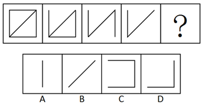

# 样式规律-线段增减（去线位置规律）

考点：[[20-考点/判断推理/图形推理/样式规律-线段增减（去线位置规律）|图形推理 / 样式规律-线段增减（去线位置规律）]]

**问法模型**：一组图从左到右选最合适填入问号 → 元素组成相似，优先考虑样式规律，比较相邻图形找'去掉哪条线'的位置顺序

## 推理链
1. 第1步：图1为正方形加一条左下-右上的对角线，共5条线（上边、下边、左边、右边、对角线）
2. 第2步：五个图形元素组成相似，优先考虑样式规律，逐个对比相邻图形的线条差异
3. 第3步：图1→图2减少上边线（剩左、右、下、对角线，呈三角形加右侧竖线）
4. 第4步：图2→图3减少下边线（剩左、右两条竖线加'/'对角线）；图3→图4减少右边线（剩左边线加'/'对角线）
5. 第5步：去线位置依次为'上、下、右'，按此顺序问号处应为图4再减少左边线
6. 第6步：图4去掉左边线后仅剩一条左下-右上'/'对角线，对照选项，只有B项为单条'/'斜线，故选B

**最快解法**：⚡ 去线位置法：先数图1共5条线，发现每图依次少1条，再看被去掉线的位置顺序为上→下→右，推出下一刀去'左'，图4去左线后只剩'/'，直接锁定B

## 易错点
- ⚠ 只看到线条总数递减（5→4→3→2），忽略'去哪条线'有位置规律，误选同为1条线的A
- ⚠ 对角线方向看错：本题对角线为左下-右上'/'，误看成'\'会排除B导致错选
- ⚠ 只数数量不做相邻图形逐线比对，漏掉去线顺序'上、下、右'的循环提示

## 母题抽象
> 🧩 当一组图元素组成相似且线条数量依次递减时，逐对比较相邻图形找出'被去掉的那条线'的位置序列，按序列推出最后应去掉的线，剩余线条与选项逐一验证

**同类特征**：元素组成相似、线条数依次递减（5→4→3→2）、去线位置呈顺序（上、下、右）、图形含边线与对角线、一组图顺推规律

## 相关题
- [[10-真题/判断推理/图形推理/10204610 样式规律-加减同异（去同存异），九宫格列规律|10204610]]（辽宁 2024，相关度1）
- [[10-真题/判断推理/图形推理/10297349 样式规律-黑白运算|10297349]]（浙江 2025，相关度1）
- [[10-真题/判断推理/图形推理/10297407 样式规律-黑白运算（定义叠加）|10297407]]（四川 2025，相关度1）
- [[10-真题/判断推理/图形推理/11226895 图形推理-样式规律（叠加求同-保留相同部分）|11226895]]（上海 2025，相关度1）
- [[10-真题/判断推理/图形推理/11226896 样式规律-加减同异（分区域：上圆内部求异+下椭圆内部求同）|11226896]]（上海 2025，相关度1）

---

### 题干

从所给四个选项中，选择最合适的一个填入问号处，使之呈现一定的规律性：

### 选项
- A. A
- B. B　✅
- C. C
- D. D

### 官方解析
本题为一组图题目，元素组成相似，优先考虑样式规律。观察发现，题干图形从左到右，依次减少一条直线，减少的直线位置依次为上、下、右，因此“？”处图形应该为第四个图形减少左边直线，符合题干的只有B项。
故正确答案为B。

### 给定材料
（无）
