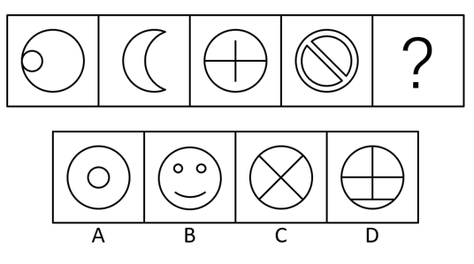

# 数量规律-交点数（等差递增）

考点：[[20-考点/判断推理/图形推理/数量规律-交点数（等差递增）|图形推理 / 数量规律-交点数（等差递增）]]

**问法模型**：'根据所给图形的现有规律，选出一个最合理的答案'→ 元素组成不同且无属性规律时，转向数量规律，本题按'数交点→找等差规律→选交点数等于下一项'的模型

## 推理链
1. 第1步：题干五幅图形元素组成各不相同，也无对称、曲直、封闭等一致属性规律，排除位置与样式规律，考虑数量规律
2. 第2步：图1为圆内小圆与大圆相切、图2为月牙两弧相交，图形中存在明显的点接触与线交叉特征，优先数'交点数'（切点、线线交点、线圆交点均计入）
3. 第3步：逐图清点交点：图1小圆与大圆相切=1，图2月牙两弧交点=2，图3=3，图4双圆加斜杠、斜线与内外两圆相交=4，构成公差为1的等差数列
4. 第4步：按等差规律外推，'？'处图形的交点数应为5
5. 第5步：逐项计数验证：A项同心圆无交点=0；B项笑脸中两小圆与嘴部弧线互不接触=0；C项圆内两条斜线交叉：中心线线交点1+两线与圆的交点4=5；D项竖线与两横线组合交点=7（官方口径），大于5
6. 第6步：只有C项交点数为5，是等差数列1、2、3、4的下一项，故选C

**最快解法**：⚡ 交点计数+等差外推法：快速数出题干交点1、2、3、4后直接锁定目标值5，优先验证C项——圆内X形交点=中心1+圆上4=5，当场锁定；A、B无交点、D交点过多，均可秒排

## 易错点
- ⚠ 漏数切点：图1小圆与大圆的切点也是交点，漏掉会导致数列起点错、误判无规律
- ⚠ 穿圆线条的端点易漏数：每条穿过圆的直线贡献2个线圆交点（如C项X形两线共4个圆上交点），漏数会算错选项交点数
- ⚠ B项笑脸的两个小圆和嘴部弧线看似'有点'，实则各元素互不接触、交点为0，易被误当作强干扰项纠结

## 母题抽象
> 🧩 当题干图形元素组成不同且无明显属性规律、图形中出现相切或线条交叉特征时，优先数交点数；若交点数构成等差数列，则选交点数等于'末项+公差'的选项

**同类特征**：元素组成不相同、无明显属性规律、圆与内部线条/小圆的组合、存在相切与交叉特征、交点数依次递增1、问号处求第5项

## 相关题
- [[10-真题/判断推理/图形推理/12561847 数量规律-交点数（等差数列）|12561847]]（浙江 2024，相关度2）
- [[10-真题/判断推理/图形推理/2262882 数量规律-面数量（九宫格逐行等差）|2262882]]（选调 2016，相关度2）
- [[10-真题/判断推理/图形推理/2262884 数量规律-元素种类（每幅图仅由一种小元素组成）|2262884]]（选调 2016，相关度2）
- [[10-真题/判断推理/图形推理/2391876 数量规律-交点数（等差递增）|2391876]]（黑龙江 2016，相关度2）
- [[10-真题/判断推理/图形推理/2615983 数量规律-交点数（等差递增）|2615983]]（云南 2020，相关度2）

---

### 题干

根据所给图形的现有规律，选出一个最合理的答案：

### 选项
- A. A
- B. B
- C. C　✅
- D. D

### 官方解析
图形元素组成不相同，且无明显属性规律，考虑数量规律，图1中交点数明显，优先考虑交点数量，题干中图形交点数量从左到右依次为：1、2、3、4，所以？处的交点数量应该为5，只有C项符合。A、B项交点数均为0，D项交点数为7，均排除。
故正确答案为C。

### 给定材料
（无）

> [!warning] 疑点（官方解析可能有误，待人工复核）
> 官方计数口径与严格计数略有出入：若图3为完整圆内十字，按'线线交点+线圆交点'常规口径应计5个（中心1+圆上4），官方记为3；D项若竖线贯穿圆并配两横弦严格应计8个，官方记为7（可能是竖线未贯穿圆或计数口径特殊所致）。但按官方口径数列1、2、3、4→5成立，且C项严格计数恰为5个交点（中心1+圆上4），与官方结论一致，答案C不受影响。

<!-- CODEX-ANSWER-REVIEW:BEGIN -->
### 本次独立复核

**复核状态：** `confirmed`（独立复算确认答案）

**计分答案：** C（可计分）

**复核解析：**

按线与线、线与圆周的交点总数：图1相切1点，图2为2点，图3水平线与圆周相交2点并与内部竖线相交1点，共3点；图4斜线与内外两圆相交共4点。C中两条线交1点并与圆周交4点，共5点，继续1、2、3、4、5。原解析曾把图3竖线顶端误看成触及圆周；固定图显示其止于圆内。

**相关信息：**

图形推理—交点数；分别统计线—线与线—曲线交点，判断端点是否实际落在圆周上。

**题源依据：** [固定版本原题](https://github.com/Mentat-Uran/kaogongzhentizhengliu/blob/84ab93d4b64b61d897bece8a1c0a5bab06b4feb2/10-%E7%9C%9F%E9%A2%98/%E5%88%A4%E6%96%AD%E6%8E%A8%E7%90%86/%E5%9B%BE%E5%BD%A2%E6%8E%A8%E7%90%86/2262871%20%E6%95%B0%E9%87%8F%E8%A7%84%E5%BE%8B-%E4%BA%A4%E7%82%B9%E6%95%B0%EF%BC%88%E7%AD%89%E5%B7%AE%E9%80%92%E5%A2%9E%EF%BC%89.md)；固定内容 commit `84ab93d4b64b61d897bece8a1c0a5bab06b4feb2`，Markdown blob `09c5c08dfd064dbf9bfc10617cb131db3ca6dc47`。
<!-- CODEX-ANSWER-REVIEW:END -->
