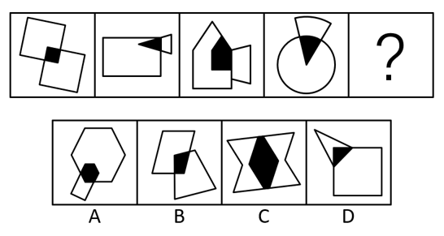

# 图形间关系-相交（黑色阴影区域与其中一个原图形形状相同）

考点：[[20-考点/判断推理/图形推理/图形间关系-相交（黑色阴影区域与其中一个原图形形状相同）|图形推理 / 图形间关系-相交（黑色阴影区域与其中一个原图形形状相同）]]

**问法模型**：题干图形元素组成不同且均含明显黑色相交区域 → 优先考虑图形间关系，比对黑色区域的形状规律

## 推理链
1. 第1步：题干四幅图均由两个图形相交构成，相交处为黑色区域，元素组成不同，考虑图形间关系
2. 第2步：观察图1，两个矩形（正方形）相交，黑色区域为小正方形，与其中一个原图形形状相同
3. 第3步：验证后续图形——图2黑色三角形与外框三角形相同，图3黑色'房子形'五边形与外框五边形相同，图4黑色扇形与外框扇形相同，归纳出规律：每幅图黑色部分的形状与其中一个图形相同
4. 第4步：将规律应用到？处：黑色区域形状必须与两原图形之一相同
5. 第5步：逐项对照——A项黑色六边形与外框大六边形形状相同，符合规律
6. 第6步：B项黑色区域为不规则四边形，与外框两个平行四边形类图形形状均不同；C项黑色菱形与两外框图形形状均不同；D项黑色区域与三角形、正方形形状均不同，排除B、C、D
7. 第7步：只有A项符合规律，故选A

**最快解法**：⚡ 图形间关系口诀（相交看阴影）：直接比对每幅图黑色公共区域与外框图形的轮廓形状，A项黑影恰为六边形、与大六边形同形，秒选A

## 易错点
- ⚠ 只停留在'两图相交有阴影'的表象，未进一步比对阴影与原图形的形状关系
- ⚠ 误把规律理解为阴影与两图形的面积、公共边或位置有关，偏离正确方向
- ⚠ 辨析D项时误以为黑色区域是三角形的一部分就'与三角形同形'，忽略其整体轮廓并非三角形

## 母题抽象
> 🧩 当题干图形均由两个图形相交且带黑色公共区域时，观察'黑色区域的形状是否与其中一个原图形相同'，据此逐项排除选答案

**同类特征**：元素组成不同、两个图形相交、黑色公共区域明显、阴影形状与原图形一致、图形间关系

## 相关题
- [[10-真题/判断推理/图形推理/17097275 图形间关系-点相交（点接触 vs 线接触）|17097275]]（山西 2024，相关度2）
- [[10-真题/判断推理/图形推理/19526427 图形间关系-公共边数量（黑白块拼接相邻关系）|19526427]]（国考 2026，相关度2）
- [[10-真题/判断推理/图形推理/10204454 数量规律-部分数（黑白球连通区域数做和）|10204454]]（甘肃 2024，相关度1）
- [[10-真题/判断推理/图形推理/10204604 数量规律-线数量（汉字横线数）|10204604]]（辽宁 2024，相关度1）
- [[10-真题/判断推理/图形推理/10297050 数量规律-特殊计数（线条穿过小白球的数量）|10297050]]（天津 2025，相关度1）

---

### 题干

根据所给图形的现有规律，选出一个最合理的答案：

### 选项
- A. A　✅
- B. B
- C. C
- D. D

### 官方解析
元素组成不同，图形均有明显相交的黑色区域，优先考虑图形间关系。观察发现，题干每幅图中的黑色部分与其中一个图形的形状相同，故？处图形黑色部分与其中一个图形的形状相同，只有A项符合。
故正确答案为A。

### 给定材料
（无）
