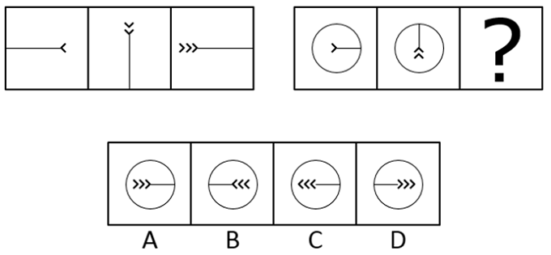

# 位置规律（线条逆时针旋转90°）＋小元素数量递增（尾端箭头依次+1）

考点：[[20-考点/判断推理/图形推理/位置规律（线条逆时针旋转90°）＋小元素数量递增（尾端箭头依次+1）|图形推理 / 位置规律（线条逆时针旋转90°）＋小元素数量递增（尾端箭头依次+1）]]

**问法模型**：两组各三幅、问号处求第三幅 → 两段式规律迁移：先在第一组归纳'旋转方向+尾端小元素数量递增'，再原样套用到第二组

## 推理链
1. 第1步：第一组三幅图元素组成相同（一条直线+尾端小箭头），优先考虑位置规律，同时关注小箭头这一可数元素的数量变化
2. 第2步：第一组规律——线条及尾端位置'右端→上端→左端'，每次逆时针旋转90°；尾端小箭头数量1→2→3，依次增加一个
3. 第3步：第二组验证——图1圆内横线尾端（偏左端）1个小箭头，图2线条逆时针转90°成竖线（自由端到圆顶）、尾端移到下端且有2个小箭头，与第一组规律完全一致
4. 第4步：迁移到问号处——线条再逆时针旋转90°变回横线（自由端转到左侧圆边），尾端移到右端，小箭头增至3个
5. 第5步：尾端箭头朝向也随线条同步逆时针转90°（图1向右→图2向上→图3向左，指向线身），据此排除D（尾端在右但箭头朝右）
6. 第6步：A、C的尾端仍停在左端，不满足'逆时针旋转90°'的位置规律，排除；B项'横线+右端3个向左小箭头'与推导完全吻合，当选

**最快解法**：⚡ 排除法+双规律口诀'先转后加'：盯住尾端箭头——第一组逆时针转90°且箭头逐次+1；第二组照搬：图2尾端在下、2个箭头，则图3尾端逆时针转回右端、3个箭头且朝向左。先排尾端在左的A/C，再比B/D箭头朝向（应朝左），直接锁定B

## 易错点
- ⚠ 只盯箭头数量1→2→3递增，忽略线条及尾端位置的逆时针旋转，误选尾端仍在左端的A或C
- ⚠ B与D尾端位置相同，漏比箭头朝向——朝向也应逆时针转90°（向右→向上→向左），从而错选D
- ⚠ 第二组外加一个圆圈背景，误以为圆圈也参与旋转或数量变化，把不变背景当成干扰规律而纠结

## 母题抽象
> 🧩 当两组图形构图骨架相同（线条+尾端小元素，外加不变背景圈）时，先在第一组锁定'旋转方向+尾端小元素递增'双规律，再原样迁移到第二组；若选项尾端位置相同，再比小元素朝向定答案

**同类特征**：元素组成相同、两段式（两组各3幅）、线条+尾端小箭头、箭头数量1→2→3递增、线条逆时针旋转90°、第二组外圈圆为不变背景

## 相关题
- [[10-真题/判断推理/图形推理/2172768 位置规律（旋转-翻转）|2172768]]（海南 2021，相关度1）
- [[10-真题/判断推理/图形推理/10204458 位置规律-平移（特征交点沿内圈循环平移）|10204458]]（甘肃 2024，相关度1）
- [[10-真题/判断推理/图形推理/10204614 图形推理-位置规律（旋转+翻转交替循环）|10204614]]（黑龙江 2024，相关度1）
- [[10-真题/判断推理/图形推理/10297399 位置规律—平移（多黑块分组循环平移）|10297399]]（四川 2025，相关度1）
- [[10-真题/判断推理/图形推理/11226892 位置规律-九宫格小元素沿固定循环链移动|11226892]]（上海 2025，相关度1）

---

### 题干

从所给的四个选项中，选择最合适的一个填入问号处，使之呈现一定的规律性：

### 选项
- A. A
- B. B　✅
- C. C
- D. D

### 官方解析

元素组成相同，优先考虑位置规律。观察发现，第一组图中，线条依次逆时针旋转，且线条尾端的小箭头依次增加一个。第二组图应用规律，线条依次逆时针旋转，且线条尾端的小箭头依次增加一个，得到B项图形。

故正确答案为B。

### 给定材料
（无）
