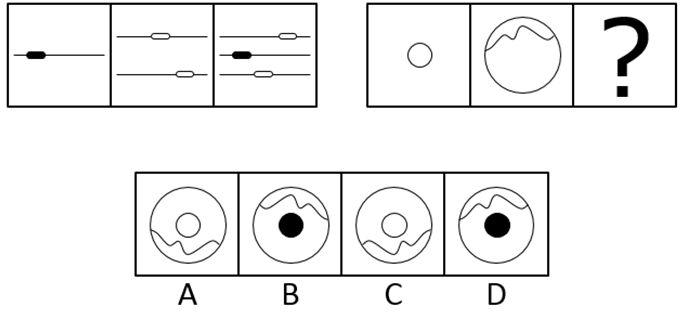

# 样式规律-叠加（求同存异-直接相加）与位置规律-上下翻转的复合考查

考点：[[20-考点/判断推理/图形推理/样式规律-叠加（求同存异-直接相加）与位置规律-上下翻转的复合考查|图形推理 / 样式规律-叠加（求同存异/直接相加）与位置规律-上下翻转的复合考查]]

**问法模型**：两组图类比型问法（前3图找规律、后3图应用）→ 优先验证'位置变换（翻转）+样式叠加'的复合规律

## 推理链
1. 第1步：第一组图中，图1为'一条横线+黑色实心胶囊'，图2为'两条横线+两个白色空心胶囊'，图3为'三条横线+一黑两白胶囊'，元素组成相似
2. 第2步：验证规律——将图2上下翻转，两条横线位置对调、胶囊黑白属性不变，再与图1直接叠加（相加），恰好得到图3的三条线与三个胶囊
3. 第3步：第二组应用规律——图2为'大圆+顶部波浪线'，上下翻转后波浪线移至底部，且波浪的峰谷方向随之颠倒
4. 第4步：将翻转后的图形与图1'中心白色小圆'叠加，应得'大圆+底部（峰谷颠倒的）波浪线+中心白色小圆'
5. 第5步：逐项对照——B、D波浪线仍在顶部，说明未翻转，排除；B、D内部为黑色实心圆，与图1的白色小圆不符，排除
6. 第6步：对比A、C——C的波浪仅是整体下移、峰谷方向未随上下翻转改变，A的波浪形状与图2上下翻转后的镜像一致，且中心为白色小圆，故选A

**最快解法**：⚡ 复合规律口诀'第二图先翻身、再与第一图拼'——先抓最显眼特征'波浪线位置'：翻转后必在下方，秒排B、D；再辨A、C：上下翻转会使波浪峰谷颠倒，A符合翻转后的形状（C只是平移未翻转），锁定A

## 易错点
- ⚠ 只做叠加忽略翻转：直接把图2与图1叠加会误选波浪在顶部的B或D
- ⚠ 忽略翻转的细节含义：上下翻转不仅改变位置，还会使波浪峰谷颠倒，C项波浪未镜像，易误选C
- ⚠ 误把黑白当作'黑白相加变色'规律：本题叠加时黑白属性保持不变（第一组黑胶囊仍为黑）

## 母题抽象
> 🧩 当两组图元素组成相似、图3明显比图1图2'元素更多'时，优先验证'位置变换（翻转/旋转）+直接叠加'的复合规律，并注意翻转/旋转后线条弯曲方向、峰谷朝向也要同步镜像

**同类特征**：两组图3+3类比、元素组成相似、图3元素数量多于图1图2、上下翻转后叠加、小元素黑白属性保持、波浪线/胶囊等曲线小元素提供辨析细节

## 相关题
- [[10-真题/判断推理/图形推理/10204610 样式规律-加减同异（去同存异），九宫格列规律|10204610]]（辽宁 2024，相关度1）
- [[10-真题/判断推理/图形推理/10297349 样式规律-黑白运算|10297349]]（浙江 2025，相关度1）
- [[10-真题/判断推理/图形推理/10297407 样式规律-黑白运算（定义叠加）|10297407]]（四川 2025，相关度1）
- [[10-真题/判断推理/图形推理/11226895 图形推理-样式规律（叠加求同-保留相同部分）|11226895]]（上海 2025，相关度1）
- [[10-真题/判断推理/图形推理/11226896 样式规律-加减同异（分区域：上圆内部求异+下椭圆内部求同）|11226896]]（上海 2025，相关度1）

---

### 题干

从所给的四个选项中，选择最合适的一个填入问号处，使之呈现一定的规律性：

### 选项
- A. A　✅
- B. B
- C. C
- D. D

### 官方解析
元素组成相似，优先考虑样式规律。观察发现，第一组图中，第二个图上下翻转后与第一个图相加得到第三个图。第二组图应用规律，第二个图上下翻转后与第一个图相加，得到A项图形。
故正确答案为A。

### 给定材料
（无）
