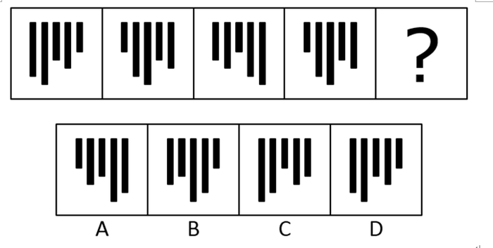

# 位置规律-平移（平移步数递增）

考点：[[20-考点/判断推理/图形推理/位置规律-平移（平移步数递增）|图形推理 / 位置规律-平移（平移步数递增）]]

**问法模型**：问号处填入最合适图形使之呈现规律性 → 元素组成相同优先看位置规律，锁定'平移方向＋步数递增'模型

## 推理链
1. 第1步：题干四幅图均由4根长短不一的黑色柱子构成，柱子高度不变、元素组成完全相同，只有横向位置在变
2. 第2步：组成相同优先考虑位置规律；对比相邻图形，柱子整体逐幅向右平移，步数依次为1步、2步、3步，呈等差递增规律
3. 第3步：按递增规律，问号处应再向右平移4步（官方口径：在第三个图形基础上向右平移4步所得）
4. 第4步：逐项对照柱子的横向落点：A、B、C的柱子排布与再右移4步后的位置不符，予以排除
5. 第5步：D项各柱子的横向位置恰为按规律平移4步后的落点，对应D

**最快解法**：⚡ 口诀'组成相同看位置'＋步数递增：盯住最左侧（或最长）一根柱子作标记，数出相邻图间右移1、2、3步，推出问号处再右移4步，直接在选项中锁定柱子落点吻合的D

## 易错点
- ⚠ 误盯柱子长短高低往数量类/样式类规律想，忽略'高度不变、只动位置'的平移本质
- ⚠ 按'每图恒移1步'的等步数思维验证选项，漏掉1、2、3、4递增规律而选错
- ⚠ 数步数时基准图找错（未统一以相邻前一图为基准），导致落点计算错位

## 母题抽象
> 🧩 当多幅图元素组成完全相同、仅位置变化，且相邻图间同一元素平移步数呈1、2、3递增时，问号处按'再平移4步'在选项中锁定落点。

**同类特征**：元素组成相同、柱状/条状小元素、仅位置变化、平移步数1、2、3递增、连续递推求问号

## 相关题
- [[10-真题/判断推理/图形推理/19181440 位置规律-平移（分格框架内多元素分别平移，步长不同）|19181440]]（吉林 2024，相关度2）
- [[10-真题/判断推理/图形推理/2172768 位置规律（旋转-翻转）|2172768]]（海南 2021，相关度1）
- [[10-真题/判断推理/图形推理/10204458 位置规律-平移（特征交点沿内圈循环平移）|10204458]]（甘肃 2024，相关度1）
- [[10-真题/判断推理/图形推理/10204614 图形推理-位置规律（旋转+翻转交替循环）|10204614]]（黑龙江 2024，相关度1）
- [[10-真题/判断推理/图形推理/10297399 位置规律—平移（多黑块分组循环平移）|10297399]]（四川 2025，相关度1）

---

### 题干

从所给的四个选项中，选择最合适的一个填入问号处，使之呈现一定的规律性：

### 选项
- A. A
- B. B
- C. C
- D. D　✅

### 官方解析
元素组成相同，优先考虑位置规律。观察发现，每个柱子依次向右平移1、2、3、？步，故？处应选择一个在第三个图形基础上向右平移4步得到的图形，对应D项。
故正确答案为D。

### 给定材料
（无）

> [!warning] 疑点（官方解析可能有误，待人工复核）
> 官方解析'依次向右平移1、2、3、？步'与'在第三个图形基础上向右平移4步'口径不一致：若按相邻图间1、2、3、4步递推，基准应为第四个图形，疑为解析表述笔误；不影响正确答案为D。
