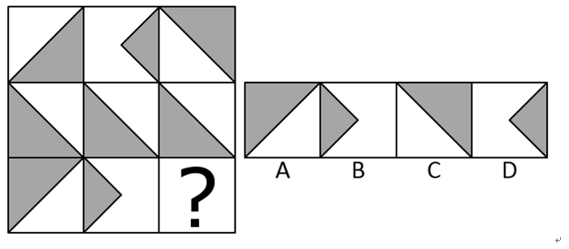

# 样式规律-求同（去异存同）

考点：[[20-考点/判断推理/图形推理/样式规律-求同（去异存同）|图形推理 / 样式规律-求同（去异存同）]]

**问法模型**：九宫格'选择最合适的一个填入问号使之呈现规律性'且元素组成相似 → 横行观察，找'两图求同'规律，再逆向代入问号处验证选项

## 推理链
1. 第1步：题干为3×3九宫格，各格均由白色方形底＋灰色阴影（大三角形或小风筝形）构成，元素组成相似，优先考虑样式规律，九宫格优先横行看
2. 第2步：第一行中，图1（对角线大灰色三角形）与图3（右上角灰色三角形）重叠求同、去异存同，共同保留的阴影恰为中部偏左的小风筝形，即图2
3. 第3步：第二行验证：图1与图3求同后同样得到图2的小风筝形，确认规律为'图1∩图3=图2'（求同结果处于中间位置）
4. 第4步：第三行应用规律：问号处为图3，须满足'第三行图1∩问号处图形=第三行图2'，即选项中与图1重叠的阴影必须恰好等于图2的小风筝形
5. 第5步：逐项对照：A、C为单个大三角形，与图1求同后仍为大三角形的一部分，得不到小风筝形，排除；D项阴影位置与图2对不上，求同后无法得到图2，排除
6. 第6步：B项与第三行图1求同后恰好得到图2的小风筝形，符合规律，故选B

**最快解法**：⚡ 求同法＋逆向代入：横行一眼看出图2是图1与图3的'重叠阴影'（去异存同），第二行验证后，直接拿第三行图1当'筛子'与选项逐一求同，能筛出图2风筝形的只有B

## 易错点
- ⚠ 求同对象搞错：本题是'图1与图3求同得到图2'（结果在中间位置），易误按'图1与图2求同得图3'或'图1＋图3直接叠加'处理
- ⚠ 只看外框轮廓、忽略灰色阴影：求同针对的是灰色阴影部分，若把白色底也当作图形元素会看错规律
- ⚠ 问号在图3位置，需用'选项∩图1=图2'逆向验证，直接拿选项外形与图2对比，易误选形状相近的D项

## 母题抽象
> 🧩 当九宫格各图由同类阴影块组成、且中间图明显是两侧两图阴影的重叠缩小时，优先用'图1∩图3=图2'的求同规律，第三行以'选项∩图1=图2'逆向锁定答案

**同类特征**：九宫格、元素组成相似、灰色阴影三角形/风筝形、求同（去异存同）、横行看、两行验证一行应用、问号位于第三行末格

## 相关题
- [[10-真题/判断推理/图形推理/4651805 样式规律-黑白运算（黑白叠加）|4651805]]（江苏 2022，相关度3）
- [[10-真题/判断推理/图形推理/10204610 样式规律-加减同异（去同存异），九宫格列规律|10204610]]（辽宁 2024，相关度2）
- [[10-真题/判断推理/图形推理/10297349 样式规律-黑白运算|10297349]]（浙江 2025，相关度2）
- [[10-真题/判断推理/图形推理/10297407 样式规律-黑白运算（定义叠加）|10297407]]（四川 2025，相关度2）
- [[10-真题/判断推理/图形推理/12019768 样式规律-加减同异（求同）与位置旋转的复合规律|12019768]]（浙江 2026，相关度2）

---

### 题干

从所给的四个选项中，选择最合适的一个填入问号处，使之呈现一定的规律性：

### 选项
- A. A
- B. B　✅
- C. C
- D. D

### 官方解析
元素组成相似，优先考虑样式规律。九宫格优先横行看，第一行图形中，第一个图形和第三个图形求同得到第二个图形；经验证，第二行也满足此规律；第三行应用规律，只有B项符合规律。
故正确答案为B。

### 给定材料
（无）
