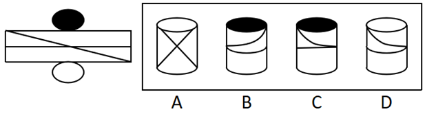

# 空间重构-立体折叠（圆柱体曲面展开图）

考点：[[20-考点/判断推理/图形推理/空间重构-立体折叠（圆柱体曲面展开图）|图形推理 / 空间重构-立体折叠（圆柱体曲面展开图）]]

**问法模型**：『右边哪一项能由它折叠而成』→ 圆柱展开图折叠题：先定椭圆面与矩形边的贴合关系（顶/底面颜色），再将矩形上的横线、斜线按卷曲规律投影为弧线，比对弧线形状与走向逐项排除

## 推理链
1. 第1步：展开图为圆柱体——矩形侧面（含一条中位横线与对角斜线）、上方黑色椭圆、下方白色椭圆，黑椭圆贴矩形上边、白椭圆贴矩形下边
2. 第2步：折叠规律——矩形卷成圆柱侧面，横线卷成与上下边平行的圆弧（环形线），斜线在柱面上卷成螺旋弧线，方向按『靠近顶面处左上到右下』读取
3. 第3步：A项侧面为交叉X形线条，而展开图线条折叠后应含一条与上下边平行的弧线，线形不符，排除
4. 第4步：B项顶面为黑色，展开图中黑色顶面到标红交点之间竖向弧线方向为左上到右下，B项线条方向不一致，排除
5. 第5步：C项中横线折叠后应为与上下边平行的弧线，C项所示线条与之不符，排除
6. 第6步：D项顶面为白色，展开图中白色顶面到标红交点之间竖向弧线方向为左上到右下，与D项线条方向一致，当选

**最快解法**：⚡ 线条投影排除法：先记『横线→平行于上下边的弧、斜线→螺旋弧』排除A/C的线形错误，再看顶面颜色处（黑顶B/白顶D）斜线卷成弧线的走向是否为『左上到右下』，排除B、锁定D

## 易错点
- ⚠ 把矩形上的斜直线误认为折叠后仍是直线，忽略柱面上斜线卷成螺旋弧线
- ⚠ 忽略中位横线折叠后应成为与上下边平行的环形弧线，误选C
- ⚠ 弧线螺旋方向（左上到右下/右上到左下）看反，混淆B与D
- ⚠ 忽略黑椭圆、白椭圆与矩形上、下边的对应关系，弄错顶面颜色

## 母题抽象
> 🧩 当展开图为『矩形侧面+上下椭圆面+横线/斜线』的圆柱体时，先用椭圆与矩形边的贴合定顶底面，再按『横线卷成平行弧、斜线卷成螺旋弧并读走向』比对选项弧线形状与方向排除

**同类特征**：圆柱体展开图、矩形侧面+椭圆面、黑色椭圆/白色椭圆顶底面、斜线折叠成弧线、中位横线卷成平行弧、问哪项能折叠而成

## 相关题
- [[10-真题/判断推理/图形推理/2578740 空间重构-六面体折纸盒（相对面排除+相邻面公共边定位）|2578740]]（四川 2020，相关度1）
- [[10-真题/判断推理/图形推理/5911304 空间重构-六面体折叠（公共边法＋公共点法）|5911304]]（浙江 2024，相关度1）

---

### 题干

左边给定的是纸盒的外表面，右边哪一项能由它折叠而成？

### 选项
- A. A
- B. B
- C. C
- D. D　✅

### 官方解析

将原图标注如下图，逐一进行分析

A项：根据展开图所示的线条，折叠后应有一条与上下边平行的弧线，与A项所示线条不一致，错误，排除；

B项：如上图所示，展开图中黑色顶面到标红交点之间竖向弧线的方向为左上到右下，与B项所示线条方向不一致，错误，排除；

C项：根据展开图所示的线条，横线折叠后应为一条与上下边平行的弧线，与C项所示线条不一致，错误，排除；

D项：如上图所示，展开图中白色顶面到标红交点之间竖向弧线的方向为左上到右下，与D项所示线条方向一致，正确，当选。

故正确答案为D。

### 给定材料
（无）
