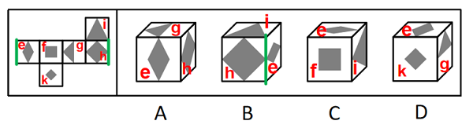

# 空间重构-六面体折叠（相对面排除+公共边定位）

考点：[[20-考点/判断推理/图形推理/空间重构-六面体折叠（相对面排除+公共边定位）|图形推理 / 空间重构-六面体折叠（相对面排除+公共边定位）]]

**问法模型**：“展开图能折叠成哪一项”→ 先用相对面规则排除含相对面的选项，剩余项再用相邻面公共边与图案的位置关系验证

## 推理链
1. 第1步：展开图为“一行四格+上下各一格”结构，六个面均带黑色图案（三角形、菱形、小正方形），按官方标注记为面e、f、g、h、i、k
2. 第2步：由折叠结构定位相对面：面e与面g为相对面；结合官方解析可推知另两组相对面为f-h、i-k（C项e、f、i可同现，B项e、h、i未被相对面规则排除）
3. 第3步：A项同时出现面e、面g、面h——e与g为相对面，折叠后不能相邻同时出现，排除
4. 第4步：D项同时出现面e、面g、面k——同样违反“相对面不相邻”，排除
5. 第5步：B项出现面e、h、i，无相对面冲突，改用公共边法：选项中面e与面h的公共边紧挨面e的黑色部分，而题干展开图中这两个面的公共边并不挨着面e黑色部分，图案与边的相对位置不符，排除
6. 第6步：C项出现面e、f、i，无相对面冲突，相邻关系及图案位置与题干一致，当选

**最快解法**：⚡ 相对面排除法优先+公共边法收尾：先扫四个选项是否同时含相对面，A、D均含“e+g”秒杀排除；剩余B、C用公共边贴图特征（黑色图案是否紧贴两相邻面的公共边）比对，B不符、C相符，定C

## 易错点
- ⚠ 只顾拼图案、不做相对面排除，在A、D上浪费时间逐面画折叠
- ⚠ 判定B时未把选项中的面旋转回展开图方向就对公共边，误判图案是否贴边
- ⚠ 小正方形与小菱形等相似黑色图案辨认混淆，导致认错对应面

## 母题抽象
> 🧩 当题干出现“正方体展开图+各面黑色图案”的折纸盒题时，先用相对面规则（同行隔一面、Z字两端）排除同时出现相对面的选项，再用公共边法（图案是否紧贴公共边、指向是否一致）验证剩余选项

**同类特征**：正方体外表面展开图、各面含黑色几何图案（三角形/菱形/小正方形）、问“哪一项能折叠而成”、相对面不能同时出现、公共边与图案位置关系、排除法为主

## 相关题
- [[10-真题/判断推理/图形推理/2136764 空间重构-六面体折叠（相对面排除+公共边画边法）|2136764]]（河南 2017，相关度2）
- [[10-真题/判断推理/图形推理/10297111 空间重构-展开图拼合（碎片旋转组合）|10297111]]（天津 2025，相关度1）
- [[10-真题/判断推理/图形推理/11367779 空间重构-六面体折叠（相对面排除＋公共边特征验证）|11367779]]（江苏 2025，相关度1）
- [[10-真题/判断推理/图形推理/12019707 空间折叠（六面体折纸盒）——相对面排除＋公共边画边法-公共点引线法|12019707]]（广东 2026，相关度1）
- [[10-真题/判断推理/图形推理/12304871 空间重构-六面体折叠（相对面排除+共顶点相邻面）|12304871]]（江苏 2024，相关度1）

---

### 题干

左边给定的是正方体的外表面展开图，下面哪一项能由它折叠而成？

### 选项
- A. A
- B. B
- C. C　✅
- D. D

### 官方解析

将展开图的面均标上序号，如下图。

逐一分析选项：  A项：选项出现了面e、面g和面h，而题干中面e和面g为相对面，不能同时出现，选项与题干不一致，排除；  B项：选项出现了面e、面h和面i，面e和面h的公共边挨着面e的黑色部分，而题干中这两个面的公共边（如图）没有挨着面e的黑色部分，选项与题干不一致，排除；  C项：选项出现了面e、面f和面i，与题干一致，当选；  D项：选项出现了面e、面g和面k，而题干中面e和面g为相对面，不能同时出现，选项与题干不一致，排除。  故正确答案为C。

### 给定材料
（无）
