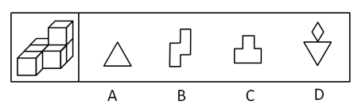
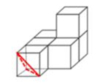
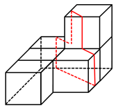

# 图形推理-截面图（立体截取）

考点：[[20-考点/判断推理/图形推理/图形推理-截面图（立体截取）|图形推理 / 图形推理-截面图（立体截取）]]

**问法模型**：'以下哪一项不可能是该多面体的截面'（选非问法）→ 用正方体截面规律逐项构造截法，排除可截出的三项，锁定不可截出的一项

## 推理链
1. 第1步：题干为6个相同小正方体组合的多面体，结构上既有底层平铺相邻的正方体，又有右上方上下叠放两层形成的台阶/层叠结构
2. 第2步：调用正方体截面规律：垂直于面切得矩形，斜切过同一正方体三个相邻面得三角形，斜切与四条棱相交得菱形，沿台阶纵向切过多个相邻面得凹凸组合形
3. 第3步：A项三角形——平面斜切底层单个正方体的一个角（穿过三个相邻面）即可截得，可截出
4. 第4步：B项阶梯形——平面沿上下两层错位的台阶处纵向切过相邻正方体的侧面，截得'之字'阶梯轮廓，可截出
5. 第5步：C项凸字形——平面垂直切过叠放的正方体及其下方相邻正方体，上部窄下部宽呈'凸'字，可截出
6. 第6步：D项需同一平面同时截出菱形（须斜穿某正方体、与四条棱相交于中段）与倒三角形（须斜切另一正方体的角），两种截取对平面角度和位置的要求在该多面体结构中无法同时满足，即无法同时截出菱形和三角形
7. 第7步：选非题，A、B、C均可截出，D不可截出，故选D

**最快解法**：⚡ 截面口诀法+排除法：'横切矩形、斜切三角、过棱切梯形/菱形、台阶纵切组合形'。先快速确认A（斜切单个正方体的角）、B（沿台阶纵向切）、C（垂直切层叠处）均可截出；D要求菱形与倒三角同平面同现，但菱形与三角形所需的切割角度无法由同一平面兼顾，直接选D

## 易错点
- ⚠ 忽略同一平面截多个正方体时切割角度的一致性，误以为菱形与三角形可分属平面不同区域拼在同一截面中
- ⚠ B项阶梯形易误判为不可截，实际沿上下层错位台阶纵向切即可截出
- ⚠ 选非题看错问法，把'不可能的截面'当成'可能的截面'而误选A/B/C

## 母题抽象
> 🧩 当题干为若干相同小正方体的组合体且问'不可能的截面'时，用截面口诀（横切矩形、斜切三角/梯形/菱形、台阶纵向切组合形）逐项构造截法并排除，凡要求同一平面同时呈现两种需不同切法的特殊图形（如菱形+三角形同框）的选项通常为不可截项

**同类特征**：6个相同小正方体组合、从任一面剖开、不可能的截面（选非）、层叠与台阶结构、斜切得三角形、菱形与三角形同框

## 相关题
- [[10-真题/判断推理/图形推理/10942400 截面图-台体挖圆柱孔的剖切判断（选非）|10942400]]（浙江 2022，相关度1）
- [[10-真题/判断推理/图形推理/1746878 立体图形-截面图（剖切形状判断）|1746878]]（国考 2016，相关度1）
- [[10-真题/判断推理/图形推理/2444725 截面图-正方体组合体的剖切面截取（选非）|2444725]]（四川 2019，相关度1）
- [[10-真题/判断推理/图形推理/2662246 截面图（剖切面与立体表面交线的重构）|2662246]]（新疆 2020，相关度1）
- [[10-真题/判断推理/图形推理/2741626 空间重构-截面图（剖切面判断，选非题）|2741626]]（山东 2021，相关度1）

---

### 题干

左图为6个相同小正方体组合成的多面体，将其从任一面剖开，以下哪一项<b>不可能</b>是该多面体的截面？

### 选项
- A. A
- B. B
- C. C
- D. D　✅

### 官方解析

本题考查截面图，逐一分析选项。

如下图所示，A、B、C项均可截出，该立体图形无法同时截出D项的菱形和三角形。

A项：

B项：

C项：

D项：无法切出，当选。

本题为选非题，故正确答案为D。

### 给定材料
（无）
