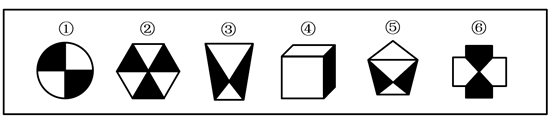

# 图形推理-阴影属性（黑白面积-黑白形状关系）分组分类

考点：[[20-考点/判断推理/图形推理/图形推理-阴影属性（黑白面积-黑白形状关系）分组分类|图形推理 / 图形推理-阴影属性（黑白面积/黑白形状关系）分组分类]]

**问法模型**：六个图形分为两类、每类各有共同规律 → 分组分类题，逐图比较黑白两部分的属性（面积、形状、位置），按二元差异分成两组

## 推理链
1. 第1步：观察题干，六幅图均由黑白（阴影与非阴影）两部分组成，特征统一，优先考虑黑白部分自身的属性差异
2. 第2步：分组分类中黑白图形常用规律为：黑白面积是否相等、黑白部分形状是否相同、黑白位置关系（相邻/相对）等
3. 第3步：图①圆被十字分为四份，黑白各占两份，黑白面积相等、形状相同；图②正六边形分为六个三角形，黑白各三个，黑白面积相等、形状相同；图⑥十字形中黑白部分面积相等、形状相同
4. 第4步：图③倒梯形中黑色沙漏形仅为局部，白色部分面积明显大于黑色；图④正方体仅一个侧面为黑色，白色面面积大于黑色面；图⑤五边形中黑色沙漏形面积小于两个白色三角形之和，白大于黑
5. 第5步：据此①②⑥为一组（黑白面积相等且形状相同），③④⑤为一组（白色面积大于黑色且黑白形状不同）
6. 第6步：与选项对照，①②⑥、③④⑤对应B项

**最快解法**：⚡ 阴影面积目测法：直接比较每幅图黑白占比——①②⑥黑白各占一半，③④⑤白多黑少，即锁定①②⑥一组、③④⑤一组，选B

## 易错点
- ⚠ 只盯黑白图形的位置或对称性，忽略'面积占比'这一核心规律
- ⚠ 图④为立体图，易被线条结构带偏去数面数，而忽略黑白阴影面的比较
- ⚠ 图⑥十字形结构特殊，易误判黑白面积不相等或形状不同而错分

## 母题抽象
> 🧩 当分组分类题中每幅图都由黑白两部分组成时，先比较黑白面积是否相等、黑白形状是否相同，按'黑白等量同形'与'黑白不等量异形'分为两组

**同类特征**：黑白阴影组成、分组分类问法、①②⑥黑白面积相等、③④⑤白色面积大于黑色、黑白部分形状对照、含立体图形④

## 相关题
- [[10-真题/判断推理/图形推理/10297098 功能元素-黑点标记交点的发射线数|10297098]]（天津 2025，相关度1）
- [[10-真题/判断推理/图形推理/10297262 数量规律-面的形状种类（封闭面种类数分组）|10297262]]（浙江 2025，相关度1）
- [[10-真题/判断推理/图形推理/12019737 数量规律-相同元素的位置关系（相对-相邻）分组|12019737]]（浙江 2026，相关度1）
- [[10-真题/判断推理/图形推理/12536392 数量规律-黑色区域面积（宫格面积折算）|12536392]]（四川 2024，相关度1）
- [[10-真题/判断推理/图形推理/12882156 图形推理-对称性（仅轴对称 vs 既轴对称又中心对称）|12882156]]（黑龙江 2025，相关度1）

---

### 题干

把下面的六个图形分为两类，使每一类图形都有各自的共同特征或规律，分类正确的一项是：

### 选项
- A. ①②③，④⑤⑥
- B. ①②⑥，③④⑤　✅
- C. ①④⑥，②③⑤
- D. ①③④，②⑤⑥

### 官方解析
解析一：本题为分组分类题目。每幅图中都由黑白两部分组成，观察发现图①②⑥中白色部分和黑色部分的面积都是相同的，而图③④⑤中白色部分的面积都大于黑色部分的面积，故图①②⑥为一组，图③④⑤为一组。
故正确答案为B。
解析二：本题为分组分类题目。每幅图中都由黑白两部分组成，观察发现图①②⑥中白色部分和黑色部分面的形状都是相同的，而图③④⑤中白色部分面的形状和黑色部分不相同，故图①②⑥为一组，图③④⑤为一组。
故正确答案为B。

### 给定材料
（无）
