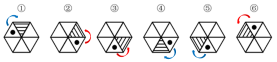
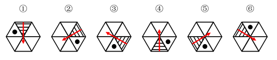

# 分组分类-位置规律（旋转-时针方向）+功能元素相对位置

考点：[[20-考点/判断推理/图形推理/分组分类-位置规律（旋转-时针方向）+功能元素相对位置|图形推理 / 分组分类-位置规律（旋转/时针方向）+功能元素相对位置]]

**问法模型**：‘六个图形分为两类，使每一类都有共同特征’→元素组成相同的分组分类题，优先用位置规律（旋转/时针方向）或功能元素与指向性面的相对位置分组

## 推理链
1. 第1步：六幅图均为正六边形被三条对角线分成6个三角形，每图都含1个阴影三角形和1个小黑点，元素组成相同，优先考虑位置规律
2. 第2步：阴影三角形具有指向性，小黑点可视为功能元素，规律方向定为‘点与阴影面的相对位置关系’（解析一用就近时针法，解析二用定向箭头法）
3. 第3步：解析一：从每幅图的小黑点向阴影三角形方向就近画时针，图①④⑤均为顺时针
4. 第4步：同法检验图②③⑥，从黑点向阴影三角形就近画时针均为逆时针
5. 第5步：解析二验证：以阴影三角形底边向中心画箭头、箭头指向为‘上’，则①④⑤中小黑点都在阴影三角形右侧，②③⑥中小黑点都在左侧，即①④⑤为同一图形旋转所得，②③⑥为另一图形旋转所得
6. 第6步：两组划分一致：①④⑤一组、②③⑥一组，对应A项

**最快解法**：⚡ 时针法（就近画时针）：从每图小黑点向阴影三角形方向就近画时针，①④⑤顺时针、②③⑥逆时针，直接分两组选A；等价快捷法——以阴影三角形底边中点向中心画箭头定向，看黑点在其右侧还是左侧

## 易错点
- ⚠ 阴影三角形内排线（条纹）方向各图不同，易误把排线方向当规律而误分
- ⚠ 时针方向画反（从三角形向黑点画而非从黑点向三角形画），会导致两组颠倒而误选C或D
- ⚠ 忽略旋转等价性，只看黑点或阴影所在三角形的绝对位置（上下左右）而误判分组

## 母题抽象
> 🧩 当分组分类题各图元素组成相同、且含一个有指向性的面（如阴影三角形、箭头形）加一个小功能元素（黑点/小图形）时，用‘时针法’或‘定向箭头法’判断小元素与该面的相对位置（顺逆时针、左右同侧异侧），据此分成两类。

**同类特征**：元素组成相同、正六边形分割为6个三角形、每图含一个阴影三角形和一个小黑点、分组分类题、旋转等价、时针方向顺逆分组

## 相关题
- [[10-真题/判断推理/图形推理/2172768 位置规律（旋转-翻转）|2172768]]（海南 2021，相关度1）
- [[10-真题/判断推理/图形推理/10204458 位置规律-平移（特征交点沿内圈循环平移）|10204458]]（甘肃 2024，相关度1）
- [[10-真题/判断推理/图形推理/10204614 图形推理-位置规律（旋转+翻转交替循环）|10204614]]（黑龙江 2024，相关度1）
- [[10-真题/判断推理/图形推理/10297399 位置规律—平移（多黑块分组循环平移）|10297399]]（四川 2025，相关度1）
- [[10-真题/判断推理/图形推理/11226892 位置规律-九宫格小元素沿固定循环链移动|11226892]]（上海 2025，相关度1）

---

### 题干

把下面的六个图形分为两类，使每一类图形都有各自的共同特征或规律，分类正确的一项是：

### 选项
- A. ①④⑤，②③⑥　✅
- B. ①②⑤，③④⑥
- C. ①④⑥，②③⑤
- D. ①③④，②⑤⑥

### 官方解析

解析一：

 

本题为分组分类题目。观察发现元素组成相同，优先考虑位置规律。观察小黑点和阴影三角形的位置关系，可从小黑点向三角形方向就近画时针，发现图①④⑤为顺时针，②③⑥为逆时针。即图①④⑤为同一个图形进行旋转得到，图②③⑥为同一个图形进行旋转得到。故①④⑤为一组，②③⑥为一组。

故正确答案为A。

解析二：

本题为分组分类题目。观察发现题干每幅图形均有小黑点，考虑功能元素。观察小黑点和阴影三角形的位置关系，由于三角形具有指向性，可从阴影三角形的底边向中心画出一个箭头，以箭头指向的方向为上，观察发现图①④⑤小黑点都在阴影三角形的右侧，②③⑥小黑点都在阴影三角形的左侧。故①④⑤为一组，②③⑥为一组。

故正确答案为A。

### 给定材料
（无）
