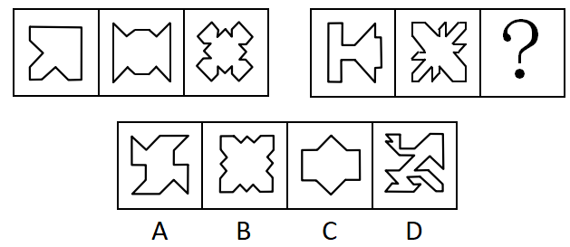

# 属性规律-对称性（对称轴数量递推）

考点：[[20-考点/判断推理/图形推理/属性规律-对称性（对称轴数量递推）|图形推理 / 属性规律-对称性（对称轴数量递推）]]

**问法模型**：两套图形'最大相似性+自身特征'问法 → 先归纳第一组属性规律（数对称轴数量），再按同规律映射第二组确定问号处

## 推理链
1. 第1步：两组图形元素组成不同、形状各异，但轮廓均由规整折线构成，无明显数量或位置规律特征
2. 第2步：元素组成不同优先考虑属性规律，观察发现第一组三个图形均为轴对称图形，转而数对称轴数量
3. 第3步：第一组对称轴数量依次为1、2、4（第一图仅1条轴，第二图横竖2条轴，第三图雪花状含横、竖及两条对角线共4条轴），构成'1、2、4'的递推规律
4. 第4步：第二组前两图也均为轴对称图形，对称轴数量分别为1、2，与第一组规律对应，故？处应填对称轴数量为4的图形
5. 第5步：逐项检验对称轴：A项仅是中心对称图形、无对称轴，排除；B项有横、竖、两条对角线共4条对称轴，符合；C项仅2条对称轴，排除；D项不对称，排除
6. 第6步：只有B项满足'4条对称轴'，且使第二组呈现与第一组一致的1、2、4数量特征，故选B

**最快解法**：⚡ 数对称轴法：第一组数出1、2、4，第二组已给出1、2，直接锁定'?处=4条对称轴'，快速排除A（无轴）、C（2轴）、D（不对称），唯一4轴的B当选

## 易错点
- ⚠ 只验证'是否轴对称'而忽略对称轴的'数量'递推规律（1→2→4），误选同为轴对称但仅2条轴的C项
- ⚠ 第一组第三图和第二组第二图为复杂凹凸雪花状，对角线方向的对称轴易漏数，误判其只有2条轴
- ⚠ A项是中心对称图形，易与轴对称混淆而误选

## 母题抽象
> 🧩 当两套图形元素组成不同但整体规整对称时，数'对称轴数量'找递推规律（如1、2、4），再按同规律排除选项定答案

**同类特征**：两套图形对照求同存异、元素组成不同、均为轴对称图形、对称轴数量1、2、4递推、凹凸折线/雪花状轮廓、问号补全第二组规律

## 相关题
- [[10-真题/判断推理/图形推理/16095265 属性规律-对称性（轴对称+对称轴方向旋转）|16095265]]（江苏 2024，相关度2）
- [[10-真题/判断推理/图形推理/2031008 属性规律（轴对称+对称轴旋转）与数量规律（直线数）综合考查|2031008]]（北京 2017，相关度2）
- [[10-真题/判断推理/图形推理/2045700 属性规律（轴对称、曲直性）+数量规律（面数量等差递增）综合|2045700]]（广州市考 2017，相关度2）
- [[10-真题/判断推理/图形推理/2049850 属性规律-对称性（对称轴与图形线条的 重合-不重合）|2049850]]（山东 2017，相关度2）
- [[10-真题/判断推理/图形推理/2136980 属性规律-轴对称（对称轴数量+对称轴与图形中线条重合的二级辨析）|2136980]]（北京 2018，相关度2）

---

### 题干

此题包含两套图形和可供选择的4个图形。这两套图形具有某种相似性，也存在某种差异。要求你从四个选项中选择最适合取代问号的一个。正确的答案应不仅使两套图形表现出最大的相似性，而且使第二套图形也表现出自己的特征。

### 选项
- A. A
- B. B　✅
- C. C
- D. D

### 官方解析
元素组成不同，优先考虑属性规律。第一组图中均为轴对称图形，对称轴的数量分别为1、2、4；第二组图前两个图也均为轴对称图形，对称轴的数量分别为1、2，因此？处应选4条对称轴的图形。A项为中心对称图形无对称轴，排除；B项4条对称轴，当选；C项2条对称轴，排除；D项不是对称图形，排除。
故正确答案为B。

### 给定材料
（无）
