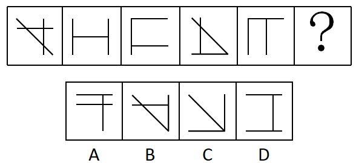
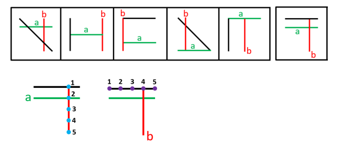

# 位置规律-平移（横线与竖线分开追踪、逐幅移动1格）

考点：[[20-考点/判断推理/图形推理/位置规律-平移（横线与竖线分开追踪、逐幅移动1格）|图形推理 / 位置规律-平移（横线与竖线分开追踪、逐幅移动1格）]]

**问法模型**：『填在问号处使图形呈现规律性』→ 数量规律失效后，按线条类型（横线/竖线）分别标记并追踪其逐幅平移的轨迹与终点

## 推理链
1. 第1步：题干5幅图元素组成不同，且无对称、封闭等属性规律，考虑数量规律
2. 第2步：数直线发现题干各图均为3条直线，但选项也都是3条，数量选不出唯一答案；进一步发现每图均至少含1条横线和1条竖线，转入位置规律
3. 第3步：单独追踪图1的横线（a）：依次向下移动1格，移到？处应位于竖向第2格（中部高度），C项横线在底部、D项横线在上下两端，均无中部横线，排除C、D
4. 第4步：再单独追踪图1的竖线（b）：依次向右移动1格，移到？处应位于横向第4格（最右一列）
5. 第5步：对照剩余A、B两项，只有A项竖线落在最右第4格且含第2行的横线，B项不符合竖线终点位置，故选A

**最快解法**：⚡ 分线追踪法（拆线定位）：把图1中的横线（a）、竖线（b）分别做标记，横线逐幅下移1格、竖线逐幅右移1格；先用横线终点（第2行）排除C、D，再用竖线终点（第4列）锁定A

## 易错点
- ⚠ 只数出『都是3条直线』就认定数量规律无效而放弃，未进一步按横线/竖线分线型追踪位置
- ⚠ 把三条线当整体看形状相似度，被图1、图4中的斜线干扰，忽略『同一根线』逐幅移动的轨迹
- ⚠ 用横线位置排除C、D后不再验证竖线终点，凭图形相似感觉误选B

## 母题抽象
> 🧩 当各图线条数量相同且属性规律失效时，按线条类型（横线/竖线/斜线）分别标记，追踪其逐幅平移的方向与步长，用两条线的终点位置双重验证选项

**同类特征**：每幅图均为3条直线、每图至少含1条横线和1条竖线、数量规律无法排除选项、横线逐幅向下移动1格、竖线逐幅向右移动1格、图中含斜线干扰元素

## 相关题
- [[10-真题/判断推理/图形推理/2045692 数量规律＋位置规律复合（黑块数量递增＋图形逆时针旋转叠加新增元素）|2045692]]（广州市考 2017，相关度1）

---

### 题干

请从四个选项中选出最恰当的一项填在问号处，使图形呈现一定的规律性： 

### 选项
- A. A　✅
- B. B
- C. C
- D. D

### 官方解析

元素组成不同，无明显属性规律，考虑数量规律，题干都有3条直线，但选项也都有3条直线，选不出唯一答案，并且没有其他数量规律。继续观察发现，题干和选项均有3条直线，并且其中均至少有1条横线和1条竖线，考虑位置规律。如下图所示，图1的横线（a）依次向下移动1格，则？处应该移动到竖线的位置2，排除C、D项。图1的竖线（b）依次向右移动1格，则？处应该移动到横线的位置4，只有A项符合。

故正确答案为A。

### 给定材料
（无）

> [!warning] 疑点（官方解析可能有误，待人工复核）
> 官方解析只交代了横线a与竖线b的移动规律，未说明图1、图4中第三条斜线在后续图形中的位置或去向，规律对第三条线未完全闭合；但由a、b两线的终点位置已足以唯一锁定A，不影响答案判定

<!-- CODEX-ANSWER-REVIEW:BEGIN -->
### 本次独立复核

**复核状态：** `confirmed`（独立复算确认答案）

**计分答案：** A（可计分）

**复核解析：**

将官方标注图中两条可连续追踪的线分别编号。横线a在连续图格中逐格下移，问号处应位于第2行；竖线b逐格向右移动，问号处应位于最右第4列。C、D不满足横线位置；B虽满足横线条件，但竖线不在第4列；只有A同时满足两项独立位置条件。第三条斜线在原解析中没有给出完整变化规律，因此不把它当作判定依据；两条已标注直线的终点条件已足以在四个选项中唯一锁定A。

**相关信息：**

判断推理—图形平移规律；对同一图形中的多条线分别编号并追踪位置，组合约束可比整体轮廓更稳定。

**题源依据：** [固定版本原题](https://github.com/Mentat-Uran/kaogongzhentizhengliu/blob/84ab93d4b64b61d897bece8a1c0a5bab06b4feb2/10-%E7%9C%9F%E9%A2%98/%E5%88%A4%E6%96%AD%E6%8E%A8%E7%90%86/%E5%9B%BE%E5%BD%A2%E6%8E%A8%E7%90%86/2274549%20%E4%BD%8D%E7%BD%AE%E8%A7%84%E5%BE%8B-%E5%B9%B3%E7%A7%BB%EF%BC%88%E6%A8%AA%E7%BA%BF%E4%B8%8E%E7%AB%96%E7%BA%BF%E5%88%86%E5%BC%80%E8%BF%BD%E8%B8%AA%E3%80%81%E9%80%90%E5%B9%85%E7%A7%BB%E5%8A%A81%E6%A0%BC%EF%BC%89.md)；固定内容 commit `84ab93d4b64b61d897bece8a1c0a5bab06b4feb2`，Markdown blob `4c37b7565cacb7bd27a95a1efaed12ec2fdc62c9`。
<!-- CODEX-ANSWER-REVIEW:END -->
