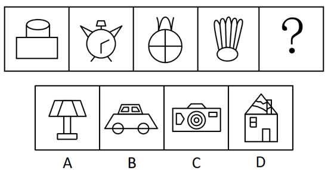

# 数量规律-面数量（封闭区域数）

考点：[[20-考点/判断推理/图形推理/数量规律-面数量（封闭区域数）|图形推理 / 数量规律-面数量（封闭区域数）]]

**问法模型**：“选择最合适的一个填入问号处使之呈现一定的规律性”→ 元素组成不同且属性无规律时，数封闭区域（面）的数量，找数量递变规律。

## 推理链
1. 第1步：题干五幅图分别为礼帽状、闹钟、圆加十字分割、羽毛球状图形，元素组成不同，对称、曲直、开闭等属性无统一规律。
2. 第2步：题干图形“窟窿”多，按解题模型优先考虑数面（封闭区域数）。
3. 第3步：逐图数面：第1幅图3个面、第2幅图4个面、第3幅图5个面、第4幅图6个面，面数量构成等差数列3、4、5、6、？。
4. 第4步：由等差规律推定问号处图形应含7个面。
5. 第5步：逐项数面：A项台灯5个面，B项小汽车8个面，C项照相机7个面，D项房屋11个面。
6. 第6步：只有C项面数为7，与3、4、5、6、7的递增规律吻合，故选C。

**最快解法**：⚡ 数面法：见“窟窿”多数面——题干面数3、4、5、6呈等差，直接在选项中数出7个封闭区域者即为答案，只有C项照相机为7个面。

## 易错点
- ⚠ 漏数线条交叠分割出的小封闭区域（如闹钟表盘被指针分割、照相机同心圆环之间的环状面），导致面数计数不准。
- ⚠ 元素组成不同时仍执着于找对称、曲直等属性规律，未及时转向数量规律而浪费时间。
- ⚠ 数选项面数时把未封闭的线条（如台灯支架、房屋烟囱、闹钟提手外露线条）误当作面。

## 母题抽象
> 🧩 当图形元素组成不同、属性无统一规律且封闭区域（窟窿）明显较多时，优先数面数量；若面数呈等差或常数规律，则直接选面数吻合的选项。

**同类特征**：元素组成不同、无明显属性规律、图形窟窿（封闭区域）多、面数量依次3、4、5、6递增、等差数列求下一项、选项按面数区分

## 相关题
- [[10-真题/判断推理/图形推理/12100999 数量规律-面数量（封闭区域数）|12100999]]（江苏 2025，相关度4）
- [[10-真题/判断推理/图形推理/2097182 数量规律-面数量（封闭区域数）|2097182]]（四川 2017，相关度4）
- [[10-真题/判断推理/图形推理/2255600 数量规律-面数量（封闭区域数）|2255600]]（江西 2016，相关度4）
- [[10-真题/判断推理/图形推理/2387641 数量规律-面数量（封闭区域数）|2387641]]（浙江 2019，相关度4）
- [[10-真题/判断推理/图形推理/2452827 数量规律-面数量（封闭区域数）|2452827]]（河南 2019，相关度4）

---

### 题干

从所给的选项中，选择最合适的一个填入问号处，使之呈现一定的规律性：

### 选项
- A. A
- B. B
- C. C　✅
- D. D

### 官方解析
图形元素组成不同，无明显属性规律，考虑数量规律。观察发现，题干图形“窟窿”比较多，优先考虑数面，数量依次是3、4、5、6、？，则问号处应选一个含有7个面的选项。A项5个面，B项8个面，C项7个面，D项11个面，只有C项符合。
 故正确答案为C。

### 给定材料
（无）
