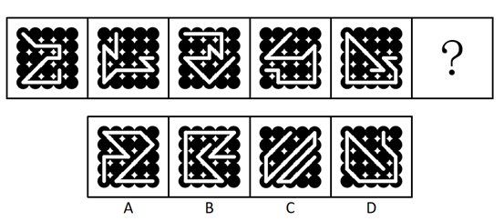

# 数量规律-线穿小黑球个数（线点相交计数）

考点：[[20-考点/判断推理/图形推理/数量规律-线穿小黑球个数（线点相交计数）|图形推理 / 数量规律-线穿小黑球个数（线点相交计数）]]

**问法模型**：问号处填入使之呈现规律性 → 元素组成不同且无属性规律时，统计每幅图中'白线穿过小黑球'的数量，找等差递增规律

## 推理链
1. 第1步：观察题干五幅图，均由规则排布的小黑球点阵与一条贯穿其中的白色折线组成，元素组成不同
2. 第2步：逐图检验对称、封闭区域、曲直等属性规律均不明显，转向数量规律
3. 第3步：发现五幅图的共同结构特征是'白线均穿过小黑球'，确定计数对象为'线穿过的小黑球个数'而非黑球总数或线段数
4. 第4步：依次点数：图一至图五线穿过小黑球的数量分别为12、13、14、15、16，构成公差为1的等差递增数列
5. 第5步：依规律推定，问号处图形的白线应恰好穿过17个小黑球
6. 第6步：逐项数A、B、C、D中白线穿过的小黑球数量，仅A项为17，B、C、D均不符
7. 第7步：与选项对照，确定答案为A

**最快解法**：⚡ 线穿点计数法+等差验证：直接逐图点数白线压住/穿过的小黑球个数，发现12→13→14→15→16依次加1，只需在选项中数出'穿过17个黑球'的一项即为A，其余选项可快速排除

## 易错点
- ⚠ 盯着白线的迷宫式走向找样式或位置规律（旋转、拼接等），漏掉'线穿黑点数量'这一核心数量对象
- ⚠ 计数时误将白线仅贴边相切、未穿过的黑球计入，或漏数被粗白线遮挡覆盖的黑球，导致数列断档
- ⚠ 误数每幅图黑点总数（各图点阵总数相同，无区分度），或数成白线拐角数、线段数，找错计数维度

## 母题抽象
> 🧩 当题干图形由'点阵+贯穿线条'组成、元素组成不同且属性无规律时，找图形间的共同'作用关系'（线穿过点），统计被穿过点的数量，验证是否构成等差数列并代入选项计数验证

**同类特征**：小黑球点阵、白色粗折线贯穿图形、元素组成不同、无明显属性规律、线与点存在穿过关系、数量公差为1递增

## 相关题
- [[10-真题/判断推理/图形推理/10204454 数量规律-部分数（黑白球连通区域数做和）|10204454]]（甘肃 2024，相关度2）
- [[10-真题/判断推理/图形推理/10297050 数量规律-特殊计数（线条穿过小白球的数量）|10297050]]（天津 2025，相关度2）
- [[10-真题/判断推理/图形推理/10297262 数量规律-面的形状种类（封闭面种类数分组）|10297262]]（浙江 2025，相关度2）
- [[10-真题/判断推理/图形推理/10297314 数量规律-交点数（曲直交点）|10297314]]（浙江 2025，相关度2）
- [[10-真题/判断推理/图形推理/11454020 数量规律-小元素按行排布（每行个数自上而下递增1）|11454020]]（选调 2024，相关度2）

---

### 题干

从所给的选项中，选择最合适的一个填入问号处，使之呈现一定的规律性：

### 选项
- A. A　✅
- B. B
- C. C
- D. D

### 官方解析
图形元素组成不同，且无明显属性规律，考虑数量规律，观察发现，每幅图都有线穿过小黑球，考虑线穿过小黑球的数量，从图一到图五线穿过小黑球的数量分别为12、13、14、15、16，因此问号处应选择一个线条穿过17个小黑球的图形，只有A项符合。
故正确答案为A。

### 给定材料
（无）

> [!warning] 疑点（官方解析可能有误，待人工复核）
> 官方解析仅给出题干五图的计数与A项结论，未逐一列出B、C、D穿过黑球的具体数量以完成完整排除，属解析略简，但计数规律（12~16递增）与A项结论本身无矛盾，不影响答案

<!-- CODEX-ANSWER-REVIEW:BEGIN -->
### 本次独立复核

**复核状态：** `confirmed`（独立复算确认答案）

**计分答案：** A（可计分）

**复核解析：**

逐幅按图中穿过的实心黑球计数，题干依次为12、13、14、15、16，故下一图必须有17个被线穿过的黑球。按固定题图逐线核对，只有A满足17；B、C、D均未达到该数。不要把交汇处的球只按“球的总数”统计，应看每条线是否实际穿过球。

**相关信息：**

数量规律—线与点相交计数；交汇处若被多条不同线穿过，按题目口径逐线判断。

**题源依据：** [固定版本原题](https://github.com/Mentat-Uran/kaogongzhentizhengliu/blob/84ab93d4b64b61d897bece8a1c0a5bab06b4feb2/10-%E7%9C%9F%E9%A2%98/%E5%88%A4%E6%96%AD%E6%8E%A8%E7%90%86/%E5%9B%BE%E5%BD%A2%E6%8E%A8%E7%90%86/2280987%20%E6%95%B0%E9%87%8F%E8%A7%84%E5%BE%8B-%E7%BA%BF%E7%A9%BF%E5%B0%8F%E9%BB%91%E7%90%83%E4%B8%AA%E6%95%B0%EF%BC%88%E7%BA%BF%E7%82%B9%E7%9B%B8%E4%BA%A4%E8%AE%A1%E6%95%B0%EF%BC%89.md)；固定内容 commit `84ab93d4b64b61d897bece8a1c0a5bab06b4feb2`，Markdown blob `00d107893b7f694b675e648158a26f2bb43762be`。
<!-- CODEX-ANSWER-REVIEW:END -->
