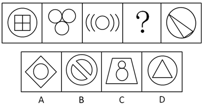

# 属性规律-对称性（对称轴数量呈等差递减）

考点：[[20-考点/判断推理/图形推理/属性规律-对称性（对称轴数量呈等差递减）|图形推理 / 属性规律-对称性（对称轴数量呈等差递减）]]

**问法模型**：『符合所给图形的变化规律』且元素组成不同、图形整体规整 → 优先数每幅图对称轴条数，按数量规律外推问号处

## 推理链
1. 第1步：题干五幅图元素组成各不相同（圆内十字方格、三圆品字排列、圆两侧弧线、问号、圆内斜三角形），且整体均较规整，符合属性规律的考查特征
2. 第2步：元素组成不同优先考虑属性规律，图形规整优先考虑对称性，逐图数对称轴条数
3. 第3步：图1圆内十字方格有4条对称轴；图2三圆呈等边三角状排列有3条对称轴；图3『(((O)))』结构仅横、竖2条对称轴；图5圆内斜置三角形无对称轴，为0条
4. 第4步：对称轴数量依次为4、3、2、？、0，构成公差为-1的递减等差数列，故问号处图形应恰有1条对称轴
5. 第5步：逐项对照：A项菱形内含圆有2条对称轴，B项圆内斜杠有2条对称轴，D项圆内三角形有3条对称轴，均不符合
6. 第6步：C项等腰梯形内两圆竖直排列，仅有一条竖直对称轴，符合『1条』的规律，故选C

**最快解法**：⚡ 对称轴计数法：一眼数出题干对称轴为4、3、2、？、0的递减数列，锁定『1条对称轴』，直接排除A（2条）、B（2条）、D（3条），秒选C

## 易错点
- ⚠ 解法二干扰：数曲线得1、3、5、？、1的『数字对称』规律会指向B项，本题官方已注明出题不严谨并倾向对称轴递减规律，勿被曲线数带偏
- ⚠ 对称轴数错：图3须注意只有横、竖2条对称轴而非4条；图5含斜线三角形极易误判为轴对称
- ⚠ 选项误判：B项斜杠套圆看似只有1条对称轴，实则沿斜杠方向和垂直方向共有2条，易错选B

## 母题抽象
> 🧩 当题干图形元素组成不同且整体规整时，优先数对称轴数量；若各图对称轴数呈等差递增/递减，则按数列外推问号处图形应有的对称轴条数并逐项排除

**同类特征**：元素组成不同、图形整体规整、轴对称属性明显、对称轴数量4、3、2、？、0、问号处于数列中间、等差递减规律

## 相关题
- [[10-真题/判断推理/图形推理/12304868 属性规律-对称性（斜轴对称→横轴对称→仅中心对称递变）＋数量规律-黑球个数等差递增（双规律验证）|12304868]]（江苏 2024，相关度2）
- [[10-真题/判断推理/图形推理/2187814 图形推理-属性规律-对称性（轴对称与中心对称的复合判断）|2187814]]（山东 2018，相关度2）
- [[10-真题/判断推理/图形推理/10204454 数量规律-部分数（黑白球连通区域数做和）|10204454]]（甘肃 2024，相关度1）
- [[10-真题/判断推理/图形推理/10204604 数量规律-线数量（汉字横线数）|10204604]]（辽宁 2024，相关度1）
- [[10-真题/判断推理/图形推理/10297050 数量规律-特殊计数（线条穿过小白球的数量）|10297050]]（天津 2025，相关度1）

---

### 题干

下列选项中，符合所给图形的变化规律的是<u>      </u>。

### 选项
- A. A
- B. B
- C. C　✅
- D. D

### 官方解析
解法一：元素组成不同，优先考虑属性规律。图形整体比较规整，优先考虑对称性。观察可知，题干图形对称轴的数量依次为4、3、2、？、0，故问号处应填入有1条对称轴的轴对称图形，只有C项符合。
故正确答案为C。
解法二：观察发现题干图形出现了单一曲线和圆，考虑数曲线。题干曲线数量分别是1、3、5、？、1。故根据数字对称的规律，问号处应选择有3条曲线的图形，只有B项符合。
故正确答案为B。
注：本题有两种解法，出题不严谨，但粉笔倾向于解法一。因为数字对称的规律近几年公考题目中几乎没有出现，说明不是命题人想考查的方向，而对称轴的数量却呈现了依次递减的规律，这比数字对称的规律更加严谨、更加符合最新的出题趋势。

### 给定材料
（无）

> [!warning] 疑点（官方解析可能有误，待人工复核）
> 官方解析自身给出解法二（曲线数1、3、5、？、1的『数字对称』规律）可推出B项，与正确答案C存在冲突，官方已注明『出题不严谨』并倾向解法一（对称轴递减更符合命题趋势）；依铁律以C为唯一正确答案，此处仅记录解析内部的逻辑分歧。

<!-- CODEX-ANSWER-REVIEW:BEGIN -->
### 本次独立复核

**复核状态：** `resolved`（答案与解析已核定）

**计分答案：** C（可计分）

**复核解析：**

固定题源还列出曲线数量的数字对称规律，可得到B，因此原题有两种自洽规则。本修订版明确只数对称轴：4、3、2、1、0，公差为−1。选项C有1条对称轴，符合问号位置，故修订版答案C。

**修订题干：**

【修订版：仅按对称轴数量】只统计每幅图形的对称轴条数，题干图形依次为4、3、2、?、0条，按相邻项公差相同的等差规律补全问号。

**相关信息：**

图形推理—对称轴数量；限定对象为对称轴，避免曲线数等其他数量特征产生竞争规律。

**题源依据：** [固定版本原题](https://github.com/Mentat-Uran/kaogongzhentizhengliu/blob/84ab93d4b64b61d897bece8a1c0a5bab06b4feb2/10-%E7%9C%9F%E9%A2%98/%E5%88%A4%E6%96%AD%E6%8E%A8%E7%90%86/%E5%9B%BE%E5%BD%A2%E6%8E%A8%E7%90%86/2295535%20%E5%B1%9E%E6%80%A7%E8%A7%84%E5%BE%8B-%E5%AF%B9%E7%A7%B0%E6%80%A7%EF%BC%88%E5%AF%B9%E7%A7%B0%E8%BD%B4%E6%95%B0%E9%87%8F%E5%91%88%E7%AD%89%E5%B7%AE%E9%80%92%E5%87%8F%EF%BC%89.md)；固定内容 commit `84ab93d4b64b61d897bece8a1c0a5bab06b4feb2`，Markdown blob `1eead3a0ce452a693d4a62a410906171bbd35f9d`。
<!-- CODEX-ANSWER-REVIEW:END -->
