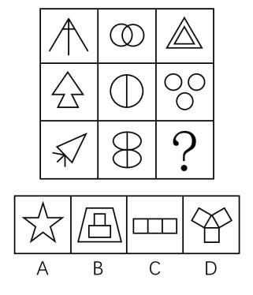

# 图形推理-对称性（对称轴数量规律）

考点：[[20-考点/判断推理/图形推理/图形推理-对称性（对称轴数量规律）|图形推理 / 图形推理-对称性（对称轴数量规律）]]

**问法模型**：九宫格'符合图形变化规律'的问法 → 按行逐图判定属性（轴对称）并数对称轴条数，验证行内递增规律后选对应数量的选项

## 推理链
1. 第1步：九宫格各图元素组成不同，且图形整体规整，按'元素组成不同优先考虑属性规律'的思路，优先分析对称性
2. 第2步：第一横行逐图数对称轴：飞机箭头图仅1条竖轴，双圆相交图有横竖2条对称轴，双重等边三角形有3条对称轴，呈'1、2、3'递增
3. 第3步：用第二横行验证规律：树形箭头1条轴，竖线分割圆2条轴，三圆品字排列3条轴，同样满足'1、2、3'
4. 第4步：第三横行前两图：纸飞机1条轴，8字双椭圆2条轴，故问号处应填入有3条对称轴的轴对称图形
5. 第5步：逐项数对称轴：A五角星为5条，B屋形（梯形内嵌正方形）仅1条竖轴，C三连正方形为横竖2条轴
6. 第6步：D项三个正方形绕中心呈120°放射排列，恰好有3条对称轴，与'？处3条对称轴'的要求吻合，故选D

**最快解法**：⚡ 数轴法（对称轴数量口诀）：逐行数每图对称轴条数，发现'1、2、3'规律后直接在选项中数轴——A为5条、B为1条、C为2条、D为3条，秒选D

## 易错点
- ⚠ 只判断'是否轴对称'而不数'对称轴条数'，误以为五个选项都轴对称而无从排除，或错选轴对称的A/B/C
- ⚠ 忽略九宫格'按行'找规律的优先顺序，误按列或全图整体找规律，无法形成'1、2、3'序列
- ⚠ 误把C项三连正方形当成3条对称轴（实为2条：横向中轴与竖向中轴），漏数或多数导致错选C

## 母题抽象
> 🧩 当九宫格图形元素组成不同且整体规整时，先判定轴对称属性，再逐行数每图对称轴条数，若某行呈等差（如1、2、3）则用其余行验证，最后选对称轴数量匹配的选项

**同类特征**：九宫格图形、元素组成不同、图形规整、均为轴对称图形、对称轴数量1、2、3递增、问号处求缺项

## 相关题
- [[10-真题/判断推理/图形推理/2448498 属性规律-对称性（对称轴与图形要素的关系：穿线 vs 穿点）|2448498]]（国考 2020，相关度3）
- [[10-真题/判断推理/图形推理/11367775 属性规律-对称性（对称轴数量等差递减）|11367775]]（江苏 2025，相关度2）
- [[10-真题/判断推理/图形推理/13504598 数量规律-交点数（每行不同计数维度呈3、2、1递减）|13504598]]（辽宁 2025，相关度2）
- [[10-真题/判断推理/图形推理/15833781 属性规律-对称性（轴对称与中心对称组合分组）|15833781]]（内蒙古 2026，相关度2）
- [[10-真题/判断推理/图形推理/16095265 属性规律-对称性（轴对称+对称轴方向旋转）|16095265]]（江苏 2024，相关度2）

---

### 题干

下列选项中，符合所给图形的变化规律的是（    ）。

### 选项
- A. A
- B. B
- C. C
- D. D　✅

### 官方解析
元素组成不同，优先考虑属性规律。图形整体比较规整，优先考虑对称性。第一横行，图形均为轴对称图形，且对称轴数量依次为1、2、3；经验证，第二横行满足此规律；第三横行，前两个图形的对称轴数量依次为1、2，故？处应填入有3条对称轴的轴对称图形，只有D项符合。
故正确选项为D。

### 给定材料
（无）
