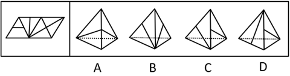

# 空间重构-四面体折叠（公共点-公共边定位+画边法）

考点：[[20-考点/判断推理/图形推理/空间重构-四面体折叠（公共点-公共边定位+画边法）|图形推理 / 空间重构-四面体折叠（公共点/公共边定位+画边法）]]

**问法模型**：选非问法'不能由展开图折叠而成的是' → 先按公共点/公共边特征锁定每个选项可见两面在展开图中的身份，再用画边法验证公共边两侧邻边顺序，不一致者即答案

## 推理链
1. 第1步：题干为四面体展开图，四个面分别标为a、b、c、d，各面图案相似、靠内部线条（竖线）与公共边/公共点的交点关系区分，问法为选非（找不能折成的）。
2. 第2步：方法：四面体视图只能看到两个面，先用'竖线交于哪个公共点/公共边'的特征确定选项两面身份，再对面d用画边法（描边定序）验证公共边两侧对应关系。
3. 第3步：逐项对照：A项两面特征与面c、面d一致，排除；B项与面b、面c一致，排除；C项与面b、面d一致，排除。
4. 第4步：D项身份判定：题干中面b与面c的竖线交于黄色公共点，选项与此不符，故D不是面b+面c；题干中面c与面d的竖线交于绿色公共点，选项亦不符，故D不是面c+面d；因此D只能是面b和面d的组合。
5. 第5步：由于四面体中构成直线的为同一条边，题干标蓝色的边为同一条公共边；题干面b的竖线交于该蓝色公共边，而选项中右侧面有竖线交于公共边，故选项右侧面为面b，左侧面为面d。
6. 第6步：对面d进行画边定序：题干中边3对应的是面b，而选项中边1对应的是面b，公共边两侧的邻边顺序与展开图不一致，故D不能由展开图折叠而成，当选。

**最快解法**：⚡ 公共点/公共边定位法＋画边法：先用'竖线交于公共点还是公共边'快速锁定A/B/C三选项的两面身份并排除，剩下D只能是面b+面d，再对面d描边定序，比对公共边两侧邻边对应面，顺序错即选D

## 易错点
- ⚠ 只看两面图案形状相同就判定'可折成'，忽略四面体同一对相邻面存在左右互换的两种视角，必须用公共点/公共边定方向
- ⚠ 混淆'竖线交于公共点'与'竖线交于公共边'两类特征，导致面b、c、d身份判定错位
- ⚠ 画边法起点或绕行方向标错，使边序与邻面对应关系比对出错

## 母题抽象
> 🧩 当四面体展开图各面图案相近、仅靠线条与公共边/公共点的交点关系区分时，先由公共点、公共边特征确定选项可见两面的身份，再用画边法验证公共边两侧邻边顺序，顺序不对应者即为不能折成的选项

**同类特征**：四面体展开图折叠、选非题（问不能折成）、各面图案相似仅线条交点不同、公共点/公共边定位、画边法（描边定序）、两面组合视图

## 相关题
- [[10-真题/判断推理/图形推理/2172440 空间重构-四面体展开图折叠（画边法-相邻面相对位置）|2172440]]（江苏 2018，相关度1）

---

### 题干

右边选项中，不能由展开图折叠而成的是<u>      </u>。

### 选项
- A. A
- B. B
- C. C
- D. D　✅

### 官方解析

将题干展开图标号如下图：

A项：由面c和面d组成，选项与题干一致，排除；

B项：由面b和面c组成，选项与题干一致，排除；

C项：由面b和面d组成，选项与题干一致，排除；

D项：如上图，题干中面b和面c中竖线交于黄色公共点，选项和题干不一致，故该项不是面b和面c；题干中面c和面d中竖线交于绿色公共点，选项和题干不一致，故该项不是面c和面d；所以该项只能是面b和面d。由于四面体中，构成直线的是同一条边，所以题干中标蓝色的为同一条边。又因为题干面b中竖线交于蓝色公共边，而选项中右侧面有竖线交于公共边，所以选项右侧面为面b，而左侧面为面d。

对面d进行画边，如上图所示，题干中边3对应的是面b，选项中边1对应的是面b，选项与题干不一致，当选。

本题为选非题，故正确答案为D。

### 给定材料
（无）
