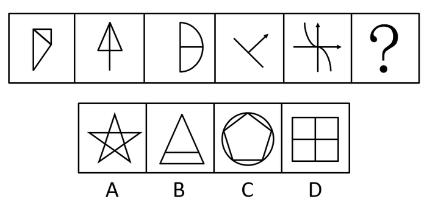

# 图形推理-数量规律（直角的存在性）

考点：[[20-考点/判断推理/图形推理/图形推理-数量规律（直角的存在性）|图形推理 / 图形推理-数量规律（直角的存在性）]]

**问法模型**：『填入问号处使之呈现一定规律性』且五图元素组成不同、无属性规律 → 采用『逐图找共同几何特征』模型，锁定每图均含直角

## 推理链
1. 第1步：题干五幅图元素组成各不相同（三角形分割图、『小树』形、半圆加竖线、带箭头交叉线、坐标轴加曲线），先看属性：无统一对称、曲直、开闭规律
2. 第2步：转入数量规律，逐图扫描线条相交方式：图1底边与竖边垂直、图2竖线与三角形底边垂直、图3竖线与横线垂直相交、图4两线垂直相交（一线带箭头）、图5横纵坐标轴互相垂直
3. 第3步：归纳共性规律——每幅图都包含直角，故问号处图形也应包含直角
4. 第4步：逐项对照：A五角星五尖均为锐/钝角无直角，B三角形内加横线无直角，C圆内接正五边形内角108°无直角，D『田』字格四个小方格每个角都是直角
5. 第5步：仅D含直角，与规律吻合，故选D

**最快解法**：⚡ 特征排除法：口诀『组成不同找数量，见垂直线条想直角』——快速确认题干五图均有垂直相交线条（含直角），扫一眼选项：A五角星、B三角形、C圆内五边形均无直角，直接锁定D『田』字格

## 易错点
- ⚠ 误把『直角』当数量等差规律去数每图直角个数，发现个数不成序列而卡壳；本题考的是『直角存在性』这一最少化数量规律
- ⚠ 图4带箭头的斜线组合易被看成锐角交叉，漏判其垂直关系而以为规律不成立
- ⚠ C项圆内接五边形顶点处弧线与边的关系易误判为垂直；B项三角形内横线易误以为与边垂直

## 母题抽象
> 🧩 当题干图形元素组成不同且对称/曲直/开闭等属性规律均不成立时，优先扫描每图是否都含某种特殊角或交点特征（如直角），验证『特征存在性』规律后选同样含该特征的选项

**同类特征**：元素组成不同、无明显属性规律、每图含垂直相交线条、直角、数量规律、直角存在性

## 相关题
- [[10-真题/判断推理/图形推理/4651720 数量规律-部分数（生活化图形数部分）|4651720]]（江苏 2022，相关度3）
- [[10-真题/判断推理/图形推理/10204454 数量规律-部分数（黑白球连通区域数做和）|10204454]]（甘肃 2024，相关度2）
- [[10-真题/判断推理/图形推理/10297050 数量规律-特殊计数（线条穿过小白球的数量）|10297050]]（天津 2025，相关度2）
- [[10-真题/判断推理/图形推理/10297262 数量规律-面的形状种类（封闭面种类数分组）|10297262]]（浙江 2025，相关度2）
- [[10-真题/判断推理/图形推理/10297314 数量规律-交点数（曲直交点）|10297314]]（浙江 2025，相关度2）

---

### 题干

从所给的四个选项中，选择最合适的一个填入问号处，使之呈现一定的规律性：

### 选项
- A. A
- B. B
- C. C
- D. D　✅

### 官方解析
元素组成不同，且无明显属性规律，优先考虑数量规律。观察发现，题干每幅图形都包含直角，因此问号处应选包含直角的图形，只有D项包含直角。
故正确答案为D。

### 给定材料
（无）
