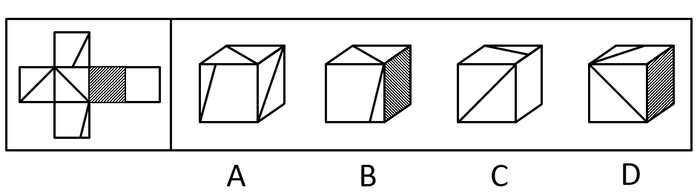

# 空间重构-六面体折叠（相对面排除＋公共点-公共边定位法）

考点：[[20-考点/判断推理/图形推理/空间重构-六面体折叠（相对面排除＋公共点-公共边定位法）|图形推理 / 空间重构-六面体折叠（相对面排除＋公共点/公共边定位法）]]

**问法模型**：'左边给定正方体外表面展开图，右边哪一项能由它折叠而成'的立体折叠问法 → 采用'相对面排除定面＋相邻面细节验证（公共点引线、特征边贴邻）'模型逐项排查

## 推理链
1. 第1步：将展开图六个面标记为a—f，题干面特征：面b含直角三角形（有短边）、面a/c/d含对角线线条、另有阴影面与空白面，选项均展示三个相邻面的组合
2. 第2步：先用相对面规则定面：由解析可得'面c与面f为相对面''面e与面a为相对面'，进而推出'面b与面d为相对面'，相对面不能在同一立体图中相邻出现
3. 第3步：A项由面a、c、d组成，看公共点：展开图中三面公共点没有引出线条，而A项中该公共点引出一条线，公共点特征不符，排除
4. 第4步：C项右侧面为面f，因面c与面f相对，故前面只能为面a，该选项由面a、b、f组成；展开图中'面b中直角三角形的短边挨着面c'，而C项中面b的短边挨着面f，相邻边关系不符，排除
5. 第5步：D项右侧面为面e，因面e与面a相对，故前面为面c，该选项由面b、c、e组成；展开图中面b的短边挨着面c，而D项中面b的短边没有挨着面c，排除
6. 第6步：B项由面c、d、e组成，三面相邻关系及公共点、公共边上的线条特征均与展开图一致，当选

**最快解法**：⚡ 公共点法（画点法）＋相对面排除：先在展开图各面交汇顶点画点，A项公共点'引出一条线'与题干'没有引出线条'矛盾，秒杀排除；再对C、D用'先定右面→相对面推前面→检查三角形短边贴哪个面'验证；剩下B直接锁定

## 易错点
- ⚠ 相对面判定错误：只有同行/同列隔一个面才相对，定错相对面会导致C、D项前面/右面整体定错
- ⚠ 忽略公共点引线细节：A项公共点是否引出线条是唯一区分点，最易被视觉忽略
- ⚠ 混淆直角三角形的短边与长边所贴邻面：C、D项均依赖'短边挨着面c'这一特征边关系，长短边看反即误判

## 母题抽象
> 🧩 当展开图中存在带线条、直角三角形、阴影等特征面时，先用相对面排除含相对面的选项，再用'公共点是否引线＋特征边（三角形短边）贴邻哪个面'逐项验证剩余选项

**同类特征**：正方体外表面展开图、折叠还原立体图、面内含对角线/直角三角形线条、含阴影面、公共点引线辨析、特征边（三角形短边）与邻面相贴关系

## 相关题
- [[10-真题/判断推理/图形推理/10297111 空间重构-展开图拼合（碎片旋转组合）|10297111]]（天津 2025，相关度1）
- [[10-真题/判断推理/图形推理/12304871 空间重构-六面体折叠（相对面排除+共顶点相邻面）|12304871]]（江苏 2024，相关度1）
- [[10-真题/判断推理/图形推理/13504536 空间重构-展开图拆分拼合（黑白图案旋转复原）|13504536]]（河南 2025，相关度1）
- [[10-真题/判断推理/图形推理/15419026 六面体展开图-展开图等同性判定（画边法-时针方向法）|15419026]]（湖北 2025，相关度1）
- [[10-真题/判断推理/图形推理/17097750 空间重构-相对面关系（展开图折纸盒）|17097750]]（山西 2024，相关度1）

---

### 题干

左边给定的是正方体的外表面展开图，右边哪一项能由它折叠而成？

### 选项
- A. A
- B. B　✅
- C. C
- D. D

### 官方解析

将原展开图标记序号如下图，逐一进行分析。

A项：选项由面a、c、d组成，展开图中面a、c、d的公共点（如图圆点）没有引出线条，选项中三个面的公共点（如图圆点）引出一条线，选项与题干不一致，排除；

B项：选项由面c、d、e组成，选项与题干一致，当选；

C项：右侧面为面f，面c与面f为相对面，因此前面为面a，选项由面a、b、f组成。展开图中面b中直角三角形的短边挨着面c，而选项中面b中直角三角形的短边挨着面f，选项与题干不一致，排除；

D项：右侧面为面e，面e与面a为相对面，因此前面为面c，选项由面b、c、e组成。展开图中面b的直角三角形的短边挨着面c，而选项中面b的直角三角形的短边没有挨着面c，选项与题干不一致，排除。

故正确答案为B。

### 给定材料
（无）
