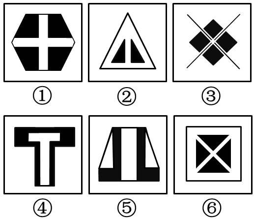

# 属性规律-对称性（轴对称与中心对称的组合辨析）

考点：[[20-考点/判断推理/图形推理/属性规律-对称性（轴对称与中心对称的组合辨析）|图形推理 / 属性规律-对称性（轴对称与中心对称的组合辨析）]]

**问法模型**：六个图形分为两类、每类有共同规律 → 元素组成不同时优先属性规律，图中出现等腰三角形等特征图形时优先从对称性入手，按对称类型二分

## 推理链
1. 第1步：六图元素组成各不相同（六边形、三角形、菱形、T形、梯形、方框），符合'元素组成不同，优先考虑属性规律'的切入点，且图②出现等腰三角形这一对称特征图形，提示优先检验对称性
2. 第2步：对每个图形依次做两项检验：①是否存在对称轴（轴对称）；②绕中心旋转180°后是否与原图重合（中心对称）
3. 第3步：图①（长六边形被十字分割，横竖对称且旋转180°重合）、图③（菱形四瓣结构加交叉对角线，沿对角线成轴且旋转180°重合）、图⑥（正方形框内对角分割，横竖对称且旋转180°重合）均为'既轴对称又中心对称'图形
4. 第4步：图②（等腰三角形内嵌两个小三角形，仅有一条竖直对称轴，旋转180°后尖角朝下不重合）、图④（'T'字形，仅竖直对称轴，倒置后不重合）、图⑤（梯形桥形结构，仅竖直对称轴，倒置后不重合）均为'仅轴对称'图形
5. 第5步：据此分组为①③⑥一组（双对称）、②④⑤一组（仅轴对称），与选项C一致

**最快解法**：⚡ 对称性两级判别法：第一级找对称轴——六图均有竖直对称轴（轴对称无法分组）；第二级测中心对称——旋转180°看是否重合：①③⑥重合（既轴又中心），②④⑤倒置不重合（仅轴对称），秒选C

## 易错点
- ⚠ 第一级止步于'都是轴对称'便放弃，漏掉中心对称这一二级辨析维度，导致无法分组
- ⚠ 中心对称误判：图③菱形带交叉线、图⑥方框内X形结构看似复杂，需整体旋转180°验证而非只看局部色块
- ⚠ 被黑白填充干扰，纠结黑白色块的数量或位置规律，忽视整体轮廓的对称属性

## 母题抽象
> 🧩 当图形分类题中各图均明显轴对称、且某图出现等腰三角形/T形等'仅有一条对称轴'的标志性图形时，用'轴对称+旋转180°'双级检验，按'既轴又中心对称'与'仅轴对称'分成两类

**同类特征**：元素组成不同、出现等腰三角形、黑白填充图形、各图均有明显竖直对称轴、需二级辨析对称类型、一组双对称、一组仅轴对称

## 相关题
- [[10-真题/判断推理/图形推理/10204454 数量规律-部分数（黑白球连通区域数做和）|10204454]]（甘肃 2024，相关度1）
- [[10-真题/判断推理/图形推理/10204604 数量规律-线数量（汉字横线数）|10204604]]（辽宁 2024，相关度1）
- [[10-真题/判断推理/图形推理/10297050 数量规律-特殊计数（线条穿过小白球的数量）|10297050]]（天津 2025，相关度1）
- [[10-真题/判断推理/图形推理/10297127 图形间关系-相交图形中不相交边数量（黑白图形相交）|10297127]]（天津 2025，相关度1）
- [[10-真题/判断推理/图形推理/10297148 数量规律-线的细化（端点连线穿过线条数；备选：平行线组数）|10297148]]（天津 2025，相关度1）

---

### 题干

请将下面六个图形分为两类，使每一类图形都有各自的共同特征或规律，分类正确的一项是：

 

### 选项
- A. ①②⑤，③④⑥
- B. ①④⑤，②③⑥
- C. ①③⑥，②④⑤　✅
- D. ①②③，④⑤⑥

### 官方解析
元素组成不同，优先考虑属性规律。图2出现等腰三角形，可优先考虑对称性，图①③⑥是既轴对称又中心对称图形，图②④⑤为轴对称图形，故图①③⑥一组，图②④⑤一组。
故正确答案为C。

### 给定材料
（无）
