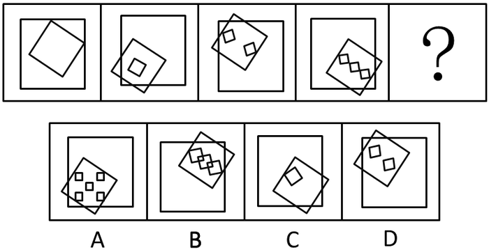
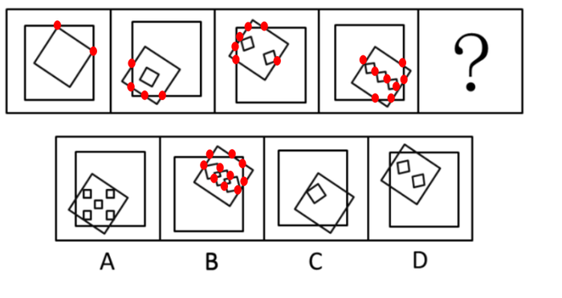

# 图形推理-数量类-交点数（图形相交产生的交点计数，不含图形自身顶点）

考点：[[20-考点/判断推理/图形推理/图形推理-数量类-交点数（图形相交产生的交点计数，不含图形自身顶点）|图形推理 / 图形推理-数量类-交点数（图形相交产生的交点计数，不含图形自身顶点）]]

**问法模型**：『选择最合适的一个填入问号处使之呈现规律性』→ 数量类规律推理：逐图提取可数要素（元素个数→相交交点数）寻找等差规律并对照选项

## 推理链
1. 第1步：观察题干五格图，每幅图元素构成一致——均由一个大正方形、一个中正方形（倾斜）和若干小正方形组成，且倾斜正方形与外框正方形边线相交
2. 第2步：先数小正方形个数：图1=0、图2=1、图3=2、图4=3，呈等差但延续到？应为4个，四个选项中无小正方形为4个的图（A为5个、D为2个、C为1个、B为相扣2~3个），说明个数非最终考点，需换计数对象
3. 第3步：改数『正方形与正方形相交产生的交点数』，并明确规则：只数相交交点，不计正方形自身的顶点
4. 第4步：逐图计数：图1有2个交点、图2有4个交点、图3有6个交点、图4有8个交点，构成公差为2的等差数列
5. 第5步：问号处图形应有10个正方形相交交点，逐项对照：仅B项各正方形相交产生10个交点，A、C、D交点数均不符，故选B

**最快解法**：⚡ 换数法（元素个数无选项→改数相交交点）：先数小正方形0/1/2/3发现无对应选项，立即转数正方形相交的交点数2/4/6/8，公差2推出？处为10个交点，锁定B

## 易错点
- ⚠ 陷入『小正方形数量0/1/2/3』的一级规律，硬凑个数相近的选项（如D的2个或A的5个），忽略『无对应选项』提示应换计数对象
- ⚠ 数交点时误将正方形自身的顶点一并计入，导致每幅图多出数个点、等差规律被打乱
- ⚠ 数交点时只关注倾斜中正方形与大正方形的交点，漏数小正方形与中/大正方形之间相交产生的交点（图3、图4尤为明显）

## 母题抽象
> 🧩 当题干图形由同类元素构成、某要素个数呈等差却无对应选项时，应转向数图形之间相交产生的交点数（不计图形自身顶点），验证等差规律后对照选项

**同类特征**：每幅图均含大、中、小三种正方形、中正方形倾斜放置且与外框正方形相交、小正方形数量0/1/2/3递增但无对应选项、相交交点数2/4/6/8呈公差2等差、同类元素多图对比型数量规律

## 相关题
（暂无）

---

### 题干

从下列所给四个选项中选择最合适的一个填入问号处，使之呈现一定的规律性。

 

### 选项
- A. A
- B. B　✅
- C. C
- D. D

### 官方解析

观察题干图形，每幅图均由一个大正方形，一个中正方形，若干个小正方形组成。小正方形的数量依次为0、1、2、3、？，有规律但无对应选项。再次观察发现，每个图形中的正方形都产生了相交，考虑数正方形与正方形相交产生的交点个数（无需数正方形本身的顶点）， 图1有2个交点，图2有4个交点，图3有6个，图4有8个，？处应该有10个交点，对应B项。

故正确答案为B。

### 给定材料
（无）
