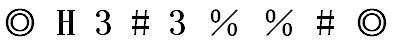
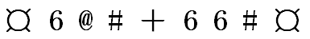
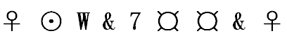
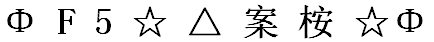

# 位置规律-相同符号位置对应（符号序列同构）

考点：[[20-考点/判断推理/图形推理/位置规律-相同符号位置对应（符号序列同构）|图形推理 / 位置规律-相同符号位置对应（符号序列同构）]]

**问法模型**：题干给出一串纯符号序列、要求选出符号排列规律相同的一项 → 忽略符号本身含义，提取'相同符号出现的位置编号'作为结构指纹，逐项比对重复位置是否一致。

## 推理链
1. 第1步：题干共9个符号，逐位编号：①Φ、②ʃ、③△、④%、⑤λ、⑥Ж、⑦Ж、⑧%、⑨Φ。
2. 第2步：提取重复位置对：第4、8位同为'%'，第6、7位同为'Ж'（首尾①⑨同为'Φ'），其余位置符号互不相同——'哪些位置重复'就是该序列的唯一结构特征。
3. 第3步：确立比对规则：符号的长短曲直、种类名称无关紧要，选项只需在相同位置编号上呈现'重复/不重复'完全一致的结构，即视为规律相同。
4. 第4步：A项位置4、8、6、7的重复与题干一致，但第3、5位符号相同——题干并无'3=5'这对重复，属多余重复，排除。
5. 第5步：B项第2、6、7位符号相同——题干第2位应独立无重复，位置错位，排除。
6. 第6步：C项重复位置恰为4=8、6=7，无多余、无缺失，与题干结构完全同构，保留。
7. 第7步：D项第6、7位符号不同，缺失题干必有的'6=7'重复对，排除。
8. 第8步：结论：唯一与题干相同符号位置吻合的是C，故选C。

**最快解法**：⚡ 位置编号比对法（排除法）：先给题干9个符号标位置号，圈出重复位置对（4=8、6=7，首尾另有1=9），再快速扫四个选项只盯这些位置——A多出3=5、B错在2=6=7、D缺6=7，唯一吻合即C，约10秒定答案。

## 易错点
- ⚠ 只核对题干已有的重复位置、漏查选项是否'多出'重复对：A项3=5、B项2=6=7都是多余重复，极易误选A或B
- ⚠ 只数'有两组重复'不看具体位置编号：B、C重复组数相近，必须逐位对号，防止错位当同构
- ⚠ 被符号的具体形状、数量或顺序含义干扰，把字符位置题误当数量规律/样式遍历来做

## 母题抽象
> 🧩 当题干出现一串无语义的符号/字符且问'规律相同'的选项时，不看符号长相，只提取'相同符号出现的位置编号对'，正确项必须重复位置不多、不少、不错位。

**同类特征**：纯符号序列（无文字语义）、9个符号等长排列、存在重复出现的符号、考查重复符号的位置编号而非符号本身、选项为等长符号序列逐一比对、适合排除法快速秒杀

## 相关题
- [[10-真题/判断推理/图形推理/2367933 样式规律-相同符号位置对应（元素重复位置关系一致）|2367933]]（江苏 2019，相关度1）

---

### 题干
（空）

### 选项
- A. 

- B. 

- C. 

　✅
- D. 

### 官方解析
第一步：分析题干符号间关系。
从相同符号的位置入手：位置4、8的符号相同；位置6、7的符号相同。
第二步：判断选项符号间关系。
A项：相同位置与题干一致，但位置3、5的符号相同，与题干不一致，排除；
B项：相同位置与题干一致，但位置2、6、7的符号相同，与题干不一致，排除；
C项：位置4、8的符号相同，位置6、7的符号相同，与题干一致，当选；
D项：位置6、7的符号不相同，与题干不一致，排除。
故正确答案为C。

### 给定材料
（无）

> [!warning] 疑点（官方解析可能有误，待人工复核）
> 官方解析仅列出'4=8、6=7'两组重复位置，但题干首尾第1、9位同为'Φ'（1=9）实际也是一组重复，解析表述有遗漏，严谨做法是要求选项同时满足1=9、4=8、6=7；由于A、B、D已因多余重复或缺失重复被独立排除，该遗漏不影响C为正确答案的结论，答案仍以官方C为准。
