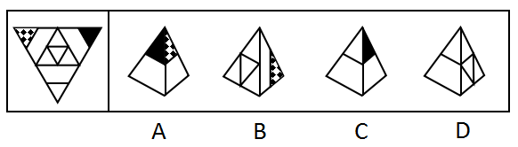
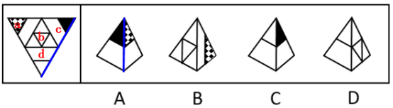

# 空间折叠-四面体展开图（相邻面相对位置与图案细节验证）

考点：[[20-考点/判断推理/图形推理/空间折叠-四面体展开图（相邻面相对位置与图案细节验证）|图形推理 / 空间折叠-四面体展开图（相邻面相对位置与图案细节验证）]]

**问法模型**：给定展开图选可折叠成的立体图 → 面标注法+相邻面位置关系与图案细节逐一排除

## 推理链
1. 第1步：展开图为大三角形分成4个小三角形的四面体展开图，将四个面标注为面a、b、c、d，各面图案分别为：面a含黑白菱形格图案、面b含小三角形轮廓、面c含黑色实心小三角形、面d含一条短线
2. 第2步：四面体折叠后每两项画面均由两个面构成，验证方法为：确认选项所含两个面是否为展开图中的相邻面，并核对公共边两侧图案的相对位置关系
3. 第3步：A项由面a和面c构成，选项中面c的右侧是面a，而展开图中面c的右侧是面d，相邻位置不一致，排除
4. 第4步：B项由面a和面b构成，两面的相邻位置关系与展开图一致，保留
5. 第5步：C项由面c和面d构成，选项中面c的左侧是面d，而展开图中面c的左侧是面a，相邻位置不一致，排除
6. 第6步：D项由面b和面d构成，选项中面d的短线与面b的三角形有交点，而展开图中二者无交点，图案细节不一致，排除
7. 第7步：只有B项与展开图完全一致，故正确答案为B

**最快解法**：⚡ 相邻面排除法：先按图案特征给四面四个面命名（格纹面a、轮廓三角面b、黑三角面c、短线面d），再对每个选项核对'由哪两面构成+公共边两侧的左右邻接关系+图案有无交点'，B项邻接关系与展开图吻合直接锁定

## 易错点
- ⚠ 四面体折叠后各面可绕顶点旋转，只看出现哪两个面而不核对公共边两侧图案的相对方位，会误选C项
- ⚠ 忽略图案交点这一细节：D项短线与三角形是否相交才是真正的判别点，粗看两面构成相同会误判
- ⚠ 展开图中围绕同一顶点的三个面折叠后邻接顺序易看混，把面c的左侧邻面（面a）误当成面d或面b

## 母题抽象
> 🧩 当题干给出四面体（三棱锥）展开图求折叠图时，先按图案特征标注四个面，再用'选项两面的公共边邻接关系+图案细节（旋转方向、交点有无）'逐项排除，与展开图完全吻合者即为答案

**同类特征**：四面体展开图（大三角形分四小三角形）、每面图案各不相同（格纹/黑三角/轮廓三角/短线）、选项均为立体图且只呈现两个面、需核对相邻面左右位置关系、需核对图案是否相交

## 相关题
（暂无）

---

### 题干

左边给定的是纸盒外表面的展开图，右边哪一项能由它折叠而成？请把它找出来。

### 选项
- A. A
- B. B　✅
- C. C
- D. D

### 官方解析

将题干展开图中的面依次标注为面a、b、c、d，如下图所示：

A项：该项由面a和面c构成，选项面c的右侧是面a，而在展开图中面c的右侧是面d，选项与题干展开图不一致，排除；

B项：由面a和面b构成，与题干展开图一致，当选；

C项：该项由面c和面d构成，选项面c的左侧是面d，而展开图中面c的左侧是面a，选项与题干展开图不一致，排除；

D项：该项由面b和面d构成，选项面d中的短线与面b中的三角形有交点，而展开图中无交点，选项与题干展开图不一致，排除。

故正确答案为B。

### 给定材料
（无）
