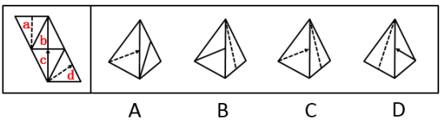

# 空间重构-四面体折叠（相邻面公共边与特征线-箭头指向检验）

考点：[[20-考点/判断推理/图形推理/空间重构-四面体折叠（相邻面公共边与特征线-箭头指向检验）|图形推理 / 空间重构-四面体折叠（相邻面公共边与特征线/箭头指向检验）]]

**问法模型**：题干给四面体展开图、问'哪一项能由它折叠而成'→锁定每个选项中两两相邻面的公共边，检验面内特征线与公共边的角度关系及箭头指向，逐项排除。

## 推理链
1. 第1步：从展开图提取各面特征：面a含虚线、面b含实线、面c与面d各含一个箭头，特征线与公共边的角度及箭头指向是折叠判别的核心信息。
2. 第2步：解题规则——折叠后相邻两面必有一条公共边，将选项中相邻两面的公共边与展开图中对应公共边对照，检验特征线是否垂直/平行于公共边、箭头指向哪个面。
3. 第3步：B项由面a和面b组成：展开图中面b的实线不垂直于面a与面b的公共边，而B项中面b直线垂直于公共边，特征线角度不符，排除B。
4. 第4步：C项由面a和面d组成：展开图中面d的箭头指向面b，而C项中面d箭头指向面a，箭头指向不符，排除C。
5. 第5步：D项由面a和面c组成：展开图中面c的箭头指向面b，而D项中面c箭头指向面a，箭头指向不符，排除D。
6. 第6步：A项中各面的特征线角度与箭头指向均与展开图折叠后的相邻关系一致，与题干一致，故选A。

**最快解法**：⚡ 公共边法+箭头指向检验：每个选项均为三面共顶点视图，先以面a为基准面，对B项查'b面直线与a、b公共边是否垂直'（不垂直排除），再对C、D项查'箭头指向哪个相邻面'（展开图中d、c箭头均指向面b，选项指向面a即排除），剩余A项当选。

## 易错点
- ⚠ 只确认选项中'出现过哪些面'，忽略特征线与公共边的角度关系（垂直/不垂直），导致B项误选
- ⚠ 折叠后箭头指向的相邻面发生视角翻转，凭直觉平移展开图方向而看错箭头实际指向，导致C、D项误判
- ⚠ 四面体展开图折叠存在镜像关系，直接以平面展开图的上下左右判断指向而未结合公共边定位

## 母题抽象
> 🧩 当四面体展开图各面含特征线或箭头时，锁定选项中相邻两面的公共边，依次检验'特征线与公共边的角度'和'箭头指向的面'，与展开图不一致的直接排除，全部吻合者即为答案。

**同类特征**：四面体展开图、面内含虚线/实线特征线、面内含箭头、问'哪一项能由它折叠而成'、选项为三面共顶点的立体视图、需检验公共边与特征线关系

## 相关题
- [[10-真题/判断推理/图形推理/2367988 空间重构-四面体展开图折叠（公共边法）|2367988]]（江苏 2019，相关度2）
- [[10-真题/判断推理/图形推理/2452689 空间重构-四面体折叠（公共边法）|2452689]]（江苏 2020，相关度2）
- [[10-真题/判断推理/图形推理/1789614 空间重构-四面体展开图（画边法-唯一点法）|1789614]]（江苏 2016，相关度1）
- [[10-真题/判断推理/图形推理/1805286 空间重构-立体折叠（五棱柱展开图，相邻面黑白关系排除）|1805286]]（上海 2016，相关度1）
- [[10-真题/判断推理/图形推理/2042116 空间重构-四面体折叠（相邻面公共边+箭头法）|2042116]]（江苏 2017，相关度1）

---

### 题干

左边给定的是纸盒外表面的展开图，右边哪一项能由它折叠而成？请把它找出来。

### 选项
- A. A　✅
- B. B
- C. C
- D. D

### 官方解析

将题干展开图中的面依次标注为面a、b、c、d，如下图所示：

A项：与题干一致，当选；

B项：该项由面a和面b组成，在展开图中面b中的直线不垂直于面a和面b的公共边，而选项面b中的直线垂直于面a和面b的公共边，选项与题干不一致，排除；

C项：该项由面a和面d组成，在展开图中面d中的箭头指向的是面b，而选项中面d的箭头指向的是面a，选项与题干不一致，排除；

D项：该项由面a和面c组成，在展开图中面c中的箭头指向面b，而选项中面c中的箭头指向的是面a，选项与题干不一致，排除。

故正确答案为A。

### 给定材料
（无）
