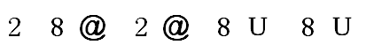
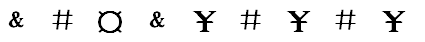

# 样式规律-相同符号位置对应（元素重复位置关系一致）

考点：[[20-考点/判断推理/图形推理/样式规律-相同符号位置对应（元素重复位置关系一致）|图形推理 / 样式规律-相同符号位置对应（元素重复位置关系一致）]]

**问法模型**：题干给出一串符号，问哪个选项与题干'逻辑关系一致' → 提取相同符号出现的位置组合，逐项比对选项的位置组合是否与题干完全一致

## 推理链
1. 第1步：从题干9个符号中提取重复关系：位置1、4符号相同（Ɔ形符号），位置2、6、8符号相同（∞），位置7、9符号相同（Σ）
2. 第2步：归纳隐含条件——位置3（¥）和位置5（&）各自独立，不与任何其他位置重复；'逻辑关系一致'即相同符号的位置组合结构必须完全相同
3. 第3步：逐项对照——A项{1,4}、{2,6,8}与题干一致，但位置3、5符号相同，多出一组题干不存在的重复，排除
4. 第4步：C项位置5、7、9符号相同，而题干位置5与7符号不相同，位置组合错位，排除
5. 第5步：D项位置7、9符号不相同，缺失题干{7,9}这组重复关系，排除
6. 第6步：B项{1,4}、{2,6,8}、{7,9}三组重复位置与题干完全一致，且位置3、5不重复，当选

**最快解法**：⚡ 位置标记法+排除法——先记牢题干重复位置组合{1,4}、{2,6,8}、{7,9}（注意3、5不重复），直接扫选项：D缺{7,9}、C多{5,7,9}、A多{3,5}，仅B完全吻合

## 易错点
- ⚠ 只看选项'也有重复符号'而不核对具体位置组合，误选C（其重复位置5、7、9与题干错位）
- ⚠ 忽略题干位置3、5符号互不相同的隐含条件，漏看A项多出的{3,5}重复而误选A
- ⚠ 把'逻辑关系一致'误解为符号种类数量相同，而非相同符号的位置结构一致

## 母题抽象
> 🧩 当题干出现一串符号/图形且问'与题干逻辑关系一致'时，先标出相同元素出现的位置组合（含哪些位置不重复），再逐项核对选项：既不能缺组，也不能多组

**同类特征**：一串9个符号排成一行、存在重复出现的符号、重复位置组合为{1,4}、{2,6,8}、{7,9}、位置3、5符号互不重复、问法为'与题干逻辑关系一致'、答案靠位置结构而非符号种类判定

## 相关题
- [[10-真题/判断推理/图形推理/2367789 位置规律-相同符号位置对应（符号序列同构）|2367789]]（江苏 2019，相关度1）

---

### 题干
（空）

### 选项
- A. 

- B. 

　✅
- C. 

- D. 

### 官方解析
第一步：分析题干符号间关系。
从相同符号的位置入手：位置1、4的符号相同；位置2、6、8符号相同；位置7、9符号相同。
第二步：判断选项符号关系。
A项：相同位置与题干一致，但位置3、5符号相同，而题干3、5符号不相同，与题干逻辑关系不一致，排除；
B项：位置1、4的符号相同；位置2、6、8符号相同；位置7、9符号相同，与题干逻辑关系一致，当选；
C项：位置5、7、9符号相同，而题干5、7符号不相同，与题干逻辑关系不一致，排除；
D项：位置7、9符号不相同，与题干逻辑关系不一致，排除。
故正确答案为B。

### 给定材料
（无）
