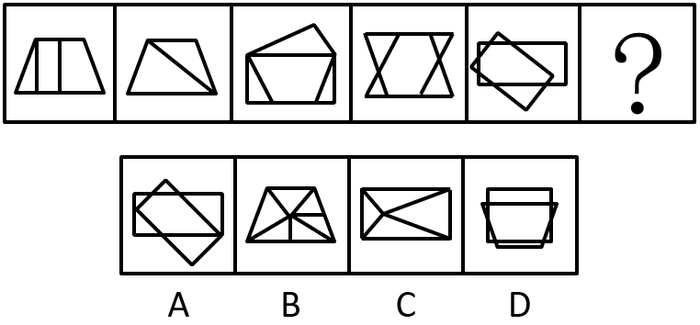

# 数量规律-面数量（细分：三角形面个数递增）

考点：[[20-考点/判断推理/图形推理/数量规律-面数量（细分：三角形面个数递增）|图形推理 / 数量规律-面数量（细分：三角形面个数递增）]]

**问法模型**：填入问号处使其呈现规律性 → 元素组成不同且属性无规律时，优先数面；整体数面无规律则细数'特征形状面'（三角形面）的数量

## 推理链
1. 第1步：题干5幅图元素组成不同，对称、曲直、开闭等属性无明显统一规律，转向数量规律
2. 第2步：各图封闭面明显，先整体数面，但面总数不构成等差或常数规律，需换细分角度
3. 第3步：观察到题干图形中'三角形面'特征突出，逐图计数：图1（梯形内两竖线，左侧切出1个三角面）=1、图2（梯形一条对角线分成2个三角形）=2、图3=3、图4（上下横线与交叉斜线构成沙漏状）=4、图5（矩形与三角形相交）=5，呈公差为1的递增数列
4. 第4步：依此规律，问号处应选择含6个三角形面的图形
5. 第5步：逐项数三角形面：A项相交图形三角面明显少于6，B项由内部放射线分割出6个三角形面，C项约4个，D项矩形与梯形嵌套约3个
6. 第6步：只有B项满足'6个三角形面'，与1、2、3、4、5、(6)的等差规律衔接，故选B

**最快解法**：⚡ 特征面计数法：题干五图三角形面依次为1、2、3、4、5，直接在选项中数三角形面个数，含6个三角形面的即为B

## 易错点
- ⚠ 只停留在大特征'封闭面明显'而整体数面，因面总数无规律陷入僵局，未想到细分到'三角形面'
- ⚠ 漏数相交/嵌套图形（如图5矩形与三角形交叠、图4交叉斜线）中被分割出的小三角形面，导致数列中断
- ⚠ 把三角形'线段或轮廓'误当封闭的三角形'面'来数，或将非三角形区域误计入

## 母题抽象
> 🧩 当图形封闭面明显但整体数面无规律、且某类形状（如三角形）特征突出时，改数'特定形状面'的数量，验证是否成等差数列，再到选项中找对应数量的那一项

**同类特征**：元素组成不同、属性无规律、封闭面明显、整体数面无规律、三角形面特征突出、数量1、2、3、4、5等差递增

## 相关题
- [[10-真题/判断推理/图形推理/10297262 数量规律-面的形状种类（封闭面种类数分组）|10297262]]（浙江 2025，相关度2）
- [[10-真题/判断推理/图形推理/11367791 属性类-对称性（对称轴方向与条数、轴对称+中心对称）＋数量类-面数量（九宫格横行复合规律）|11367791]]（江苏 2025，相关度2）
- [[10-真题/判断推理/图形推理/19283847 数量规律-面-最大面的属性（轴对称性）|19283847]]（国考 2025，相关度2）
- [[10-真题/判断推理/图形推理/19591590 数量规律-面数量+细化规律（面的形状与外框轮廓相似）|19591590]]（选调 2025，相关度2）
- [[10-真题/判断推理/图形推理/2029964 数量规律-数面（封闭区域数）纵向求和|2029964]]（四川 2016，相关度2）

---

### 题干

从四个图中选出唯一的一项，填入问号处，使其呈现一定的规律性:

### 选项
- A. A
- B. B　✅
- C. C
- D. D

### 官方解析
元素组成不同，且无明显属性规律，优先考虑数量规律。观察发现，题干图形封闭面明显，优先考虑数面，但整体数面无规律。再观察发现题干图形的三角形面较多，三角形面数量依次是：1、2、3、4、5、？，问号处应填写一个三角形面数量为6的图形，只有B项符合。
故正确答案为B。

### 给定材料
（无）
