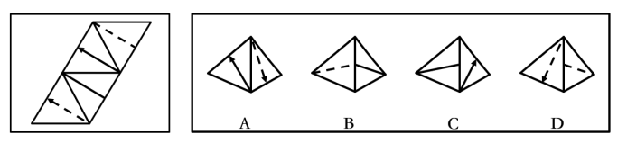
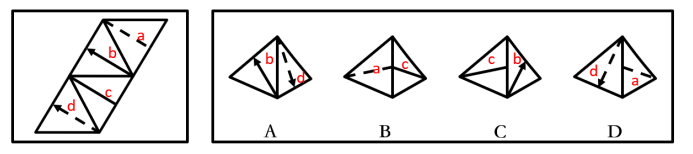
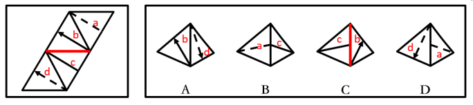
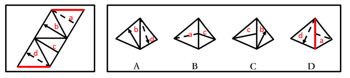

# 空间重构-四面体折纸盒（相邻面公共边法）

考点：[[20-考点/判断推理/图形推理/空间重构-四面体折纸盒（相邻面公共边法）|图形推理 / 空间重构-四面体折纸盒（相邻面公共边法）]]

**问法模型**：给出纸盒外表面展开图，问哪一项能由它折叠而成 → 用公共边法：锁定选项中相邻两面的公共边，比对面上线条/箭头与公共边的关系（指向、交点位置）逐一排除

## 推理链
1. 第1步：展开图为平行四边形条带上的4个三角形面，依次标为面a（含虚线）、面b（含箭头）、面c（含实线）、面d（含虚线），折叠成四面体后任意两面恰有一条公共边
2. 第2步：采用公共边法——先确认每个选项可见的两个面，再到展开图中找到这对面的公共边，检查面上线条与公共边交于顶点还是中点、箭头是否指向公共边
3. 第3步：A项由面b和面d构成：展开图中面b箭头所指的边正是b、d的公共边，而A项中箭头指向的边不是两面公共边，排除
4. 第4步：C项由面b和面c构成：展开图中b、c公共边与面c内实线交于面c的一个顶点，而C项中交于公共边的中点，排除
5. 第5步：D项由面a和面d构成：展开图中a、d公共边与面a内虚线交于面a的一个顶点，而D项中交于公共边的中点，排除
6. 第6步：B项由面a和面c构成，两面图案及线条与公共边的关系均与展开图一致，当选

**最快解法**：⚡ 公共边法+排除法：先辨认每个选项可见的两个面，在展开图中定位该两面公共边，比对『箭头是否指向公共边』『线条与公共边交于顶点还是中点』，三错一正快速锁定B

## 易错点
- ⚠ 只看到选项中两面的图案（虚线/实线/箭头）都出现就判定正确，忽略线条与公共边的交点位置差异（顶点vs中点）
- ⚠ 面a与面d都含虚线，易混淆两条虚线的端点归属与公共边关系而错选D
- ⚠ 忽略箭头具有方向性这一特征，未核对箭头是否指向公共边而误选A

## 母题抽象
> 🧩 当展开图为四面体（4个三角形面）且各面带线条或箭头时，用公共边法：在展开图与选项中锁定同一对面的公共边，验证线上元素与公共边的交点位置及箭头指向是否一致

**同类特征**：四面体外表面展开图、四个三角形面呈平行四边形条带排列、面内含实线/虚线/箭头图案、问法'哪一项能由它折叠而成'、相邻面公共边、线条与公共边交点位置（顶点/中点）

## 相关题
- [[10-真题/判断推理/图形推理/16593173 空间重构-展开图折叠（相邻面公共边特征）|16593173]]（海南 2024，相关度1）
- [[10-真题/判断推理/图形推理/1791642 空间重构-四面体折叠（相邻面公共边法）|1791642]]（江苏 2016，相关度1）
- [[10-真题/判断推理/图形推理/2042114 空间重构-四面体折叠（画箭头法-相邻面相对位置）|2042114]]（江苏 2017，相关度1）
- [[10-真题/判断推理/图形推理/2042116 空间重构-四面体折叠（相邻面公共边+箭头法）|2042116]]（江苏 2017，相关度1）
- [[10-真题/判断推理/图形推理/2172562 空间重构-四面体折叠（相邻面线条位置关系）|2172562]]（江苏 2018，相关度1）

---

### 题干

左边给定的是纸盒外表面的展开图，右边哪一项能由它折叠而成？请把它找出来。

### 选项
- A. A
- B. B　✅
- C. C
- D. D

### 官方解析

将题干展开图中的面依次标注为面a、b、c、d，如下图：

A项：选项由面b和面d构成，题干展开图中面b和面d的箭头指向的边是两个面的公共边，选项中箭头指向的边不是两个面的公共边，选项与题干不一致，排除；

B项：选项由面a和面c构成，与题干一致，当选；

C项：选项由面b和面c构成，题干展开图中面b和面c的公共边与面c内的直线相交于面c的一个顶点，选项中面b和面c的公共边与面c内的直线相交于公共边的中点，选项与题干不一致，排除；

D项：选项由面a和面d构成，题干展开图中面a和面d的公共边与面a内的虚线相交于面a的一个顶点，选项中面a和面d的公共边与面a内的虚线相交于公共边的中点，选项与题干不一致，排除。

故正确答案为B。

### 给定材料
（无）
