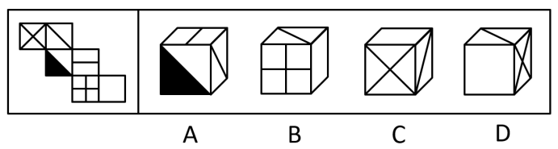
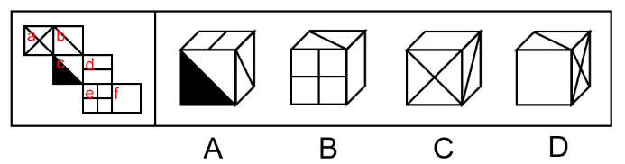
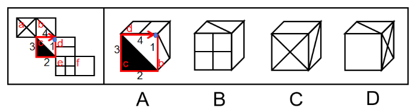
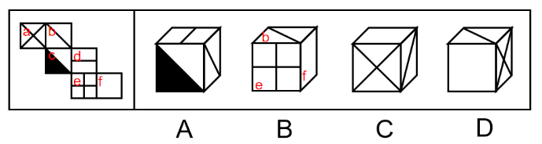
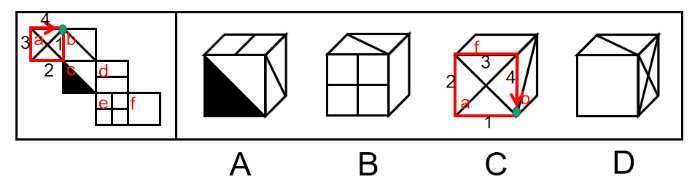

# 空间重构-六面体折叠（相对面排除＋画边法验证相邻面指向）

考点：[[20-考点/判断推理/图形推理/空间重构-六面体折叠（相对面排除＋画边法验证相邻面指向）|图形推理 / 空间重构-六面体折叠（相对面排除＋画边法验证相邻面指向）]]

**问法模型**：‘左边展开图，右边哪一项能由它折叠而成’→ 空间重构题：先用相对面排除，再用画边法（时针描边）核对相邻面指向

## 推理链
1. 第1步：将展开图六个面依次标号a–f，提取各面图案特征：a面带对角线（X形）、b面带单条对角线、c面含白色直角与黑色三角形，其余面为横竖分割线图案。
2. 第2步：确立两条规则：①展开图中‘间隔一格/Z字两端’的面为相对面，折叠后不能同时出现；②相邻面用画边法检验——以某特征点为起点在面内顺时针给四条边编号，题干与选项中同序号边正对的面必须一致。
3. 第3步：B项由面b、e、f构成，题干中面b与面e是相对面，相对面不能同时可见，排除B。
4. 第4步：A项由面b、c、d构成，以面c白色直角为起点在面c中顺时针画边，题干第4条边对着面b，选项第4条边对着面d，指向不一致，排除A。
5. 第5步：C项由面a、b、f构成，以面a和面b的对角线的交点为起点在面a内顺时针画边，题干顺时针第1条边对着面b，选项顺时针第4条边对着面b，指向不一致，排除C。
6. 第6步：D项三个面的图案及相邻边的指向均与展开图一致，当选。

**最快解法**：⚡ 相对面排除＋画边法：先扫一眼四个选项，B项含面b与面e（相对面）直接秒杀排除；再对A、C各取一个带方向性图案的面（A取c面白色直角为起点，C取a、b对角线交点为起点）顺时针画边，比对‘第几条边正对哪个面’，与题干不符即排除，剩余D即为答案。

## 易错点
- ⚠ 只比对三个面上的图案能否拼在一起，忽略‘相对面不能同时出现’这一秒杀条件（易误选B）。
- ⚠ 画边时起点选错或时针方向数错，导致‘第几条边’编号错位，把相邻面位置关系判反（A、C项的坑）。
- ⚠ 对角线、黑白直角三角形等有方向性的图案折叠后会发生旋转/镜像，须以公共边、顶点为锚定点核对，不能凭图案相似直接认定一致。

## 母题抽象
> 🧩 当六面体展开图各面带有对角线、三角形等方向性图案时，先用‘间隔一格/Z字两端’找相对面排除，再以特征图案面（如直角顶点、对角线交点）为起点顺时针画边，逐一比对‘第n条边正对的面’是否与题干一致，即可锁定唯一正确折叠项。

**同类特征**：左边给展开图右边选折叠图、六面体空间重构、面内有对角线/黑白三角形等方向性图案、展开图为阶梯状排布、需判断相邻面相对位置、画边法（时针描边）适用

## 相关题
- [[10-真题/判断推理/图形推理/2042734 空间重构-六面体折叠（画边法+相对面排除）|2042734]]（江苏 2017，相关度1）
- [[10-真题/判断推理/图形推理/2049840 图形推理-六面体空间重构（折纸盒-画边法-公共边相邻关系）|2049840]]（山东 2017，相关度1）
- [[10-真题/判断推理/图形推理/2443009 空间重构-折纸盒（画边法+公共边法判断相邻面相对位置）|2443009]]（辽宁 2019，相关度1）

---

### 题干

左边给定的是纸盒外表面的展开图，右边哪一项能由它折叠而成？请把它找出来。

### 选项
- A. A
- B. B
- C. C
- D. D　✅

### 官方解析

将题干展开图中的面依次标号，如下图：

A项：选项由面b、c、d构成，以面c白色直角为起点在面c中顺时针画边，题干中第4条边对着面b，选项中第4条边对着面d，选项与题干不一致，排除；

B项：选项由面b、e、f构成，题干中面b和面e是相对面，不能同时出现，选项与题干不一致，排除；

C项：选项由面a、b、f构成，以面a和面b的对角线的交点为起点在面a内顺时针画边，题干中顺时针第1条边对着面b，选项中顺时针第4条边对着面b，选项与题干不一致，排除；

D项：选项与题干一致，当选。

故正确答案为D。

### 给定材料
（无）
