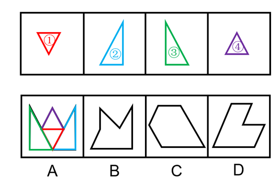

# 平面拼合（平行且等长相消法）

考点：[[20-考点/判断推理/图形推理/平面拼合（平行且等长相消法）|图形推理 / 平面拼合（平行且等长相消法）]]

**问法模型**：问'哪个选项可由题干四个图形仅通过平移拼合而成'→ 采用平行且等长相消法：内部公共边两两消去，剩余外轮廓与选项比对。

## 推理链
1. 第1步：提取题干四个碎块特征——均为三角形：①倒置三角形（顶边水平、尖朝下）；②斜边在左、竖直边在右的直角三角形；③竖直边在左、斜边在右的直角三角形；④正置小三角形（底边水平、尖朝上）。
2. 第2步：题干限定'只能通过上、下、左、右平移'，故各碎块边的方向与长度均不可改变；拼合时相贴的公共边必须'平行且等长'，消去后剩余部分即外轮廓。
3. 第3步：使两个直角三角形的竖直边相贴、倒置三角形与正置三角形沿各自水平边相贴，把平行且等长的竖直边、水平边作为内部线段两两消去。
4. 第4步：消去内部公共边后，剩余轮廓为：底部一条长水平边，上部由各三角形的斜边交替向外构成锯齿，呈'方形底+三峰两谷（W形顶）'的皇冠状。
5. 第5步：逐项对照——A为方形底、顶部W形锯齿，与相消后的轮廓完全吻合；B仅两峰且左下斜边走向不符；C为六边形轮廓、顶部无锯齿；D为带缺口的凹多边形，均无法由四个三角形的斜边组合出。
6. 第6步：与选项对照，只有A符合拼合轮廓，故正确答案为A。

**最快解法**：⚡ 平行且等长相消法+排除法：先把碎块中平行且等长的边（竖直边对竖直边、水平边对水平边）相贴消去，得'平底+W形锯齿顶'轮廓；再排除——C、D顶部无锯齿，B锯齿峰数与斜边方向不符，直接锁定A。

## 易错点
- ⚠ 误对碎块进行旋转或翻转后拼合——题干只允许上下左右平移，斜边倾斜方向不可改变
- ⚠ 相消时忽略'平行'与'等长'两条件缺一不可，误把方向不同或长度不等的边消去
- ⚠ A与B轮廓相近（均带锯齿），未逐段核对峰数及斜边倾斜方向而误选B

## 母题抽象
> 🧩 当题干给出若干碎块且限定'只能平移拼合'时，用平行且等长相消法：等长平行边两两相贴作为内部边消去，剩余外轮廓与选项逐段比对（峰数、斜边方向、直边位置）即得答案。

**同类特征**：平面拼合、只能平移（不可旋转翻转）、四个三角形碎块、平行且等长相消、外轮廓对照、锯齿形拼合轮廓

## 相关题
- [[10-真题/判断推理/图形推理/2452762 平面拼合（平行且等长相消法）|2452762]]（江苏 2020，相关度4）
- [[10-真题/判断推理/图形推理/5408660 平面拼合（平行且等长相消法）|5408660]]（四川 2022，相关度4）
- [[10-真题/判断推理/图形推理/2172310 平面拼合（平移拼合-平行且等长相消）|2172310]]（江苏 2018，相关度3）
- [[10-真题/判断推理/图形推理/2172553 平面拼合-平行且等长相消法（仅平移拼图）|2172553]]（江苏 2018，相关度3）
- [[10-真题/判断推理/图形推理/2172557 平面拼合（平行且等长相消法）|2172557]]（江苏 2018，相关度3）

---

### 题干

选项四个图形中，只有一个是由题干的四个图形拼合（只能通过上、下、左、右平移）而成的，请把它找出来。

### 选项
- A. A　✅
- B. B
- C. C
- D. D

### 官方解析

本题考查平面拼合，可采用平行且等长相消的方式解题。消去平行且等长的线段后进行组合即可得到轮廓图，即为A项。平行且等长相消的方式如下图所示：

故正确答案为A。

### 给定材料
（无）
