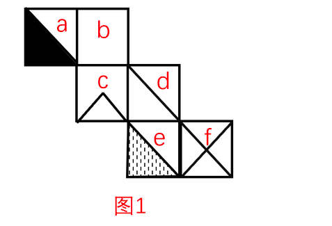

# 空间重构-六面体折叠（相对面排除＋相邻面特征边验证）

考点：[[20-考点/判断推理/图形推理/空间重构-六面体折叠（相对面排除＋相邻面特征边验证）|图形推理 / 空间重构-六面体折叠（相对面排除＋相邻面特征边验证）]]

**问法模型**：给出纸盒外表面展开图，问折叠后是哪一项 → 空间重构模型：先用'相对面不能同时出现'排除，再用相邻面的公共边/特征边（图案指向）验证

## 推理链
1. 第1步：对展开图六面标号（解析图1）：面a为黑色直角三角形面，且其黑色直角边与面c相邻；面a与面d为相对面、面b与面e为相对面（阶梯形展开图，另一对为面c与面f）
2. 第2步：规则一（相对面不同现）：折叠成立方体后，相对面不可能成为相邻面同时被看到，凡选项让一对相对面相邻出现的直接排除
3. 第3步：B项中面a（黑色直角三角形）与面d相邻同时出现，与'a、d为相对面'矛盾，排除
4. 第4步：D项中面b与面e相邻同时出现，与'b、e为相对面'矛盾，排除
5. 第5步：规则二（相邻面特征边）：展开图中面a黑色三角形的黑色直角边应挨着面c，这是面a与其相邻面的方向性约束
6. 第6步：A项顶面虽是面a，但其黑色直角边并未与面c相邻，图案指向与展开图不符，排除
7. 第7步：C项各面的图案组合与相邻边指向均与展开图一致，当选

**最快解法**：⚡ 相对面排除法＋特征边法：先按阶梯形展开图定出相对面a-d、b-e，B（a与d相邻）、D（b与e相邻）秒杀；再验A：面a黑三角的黑色直角边应贴着面c而未贴，排除A，锁定C，全程无需完整折叠

## 易错点
- ⚠ 只核对图案'有没有出现'，忽略图案的方向性——A项正错在黑三角黑色直角边与面c的相邻关系上
- ⚠ 阶梯形（2-2-2）展开图找相对面时误用'同行隔一个'，应按Z字形两端或折叠路径判定（a-d、b-e、c-f）
- ⚠ 把'︿'小三角形面与黑色直角三角面混为同一图案，误判B项图案组合可行

## 母题抽象
> 🧩 当展开图呈阶梯（2-2-2）排布且面内图案有指向性特征时，先用相对面不同现原则排除明显矛盾项，再用公共边上的图案特征（直角边、尖角朝向）验证剩余项

**同类特征**：纸盒外表面展开图折叠、阶梯式（2-2-2）排布、面内含方向性图案（黑三角直角边、'︿'尖角、阴影三角）、含空白面、问'哪一项能由它折叠而成'、相对面不能同时出现

## 相关题
- [[10-真题/判断推理/图形推理/2172154 空间重构-六面体折纸盒（相对面排除＋公共点法）|2172154]]（广州市考 2018，相关度3）
- [[10-真题/判断推理/图形推理/12561915 空间重构-六面体折叠（相对面排除+公共点法）|12561915]]（浙江 2024，相关度2）
- [[10-真题/判断推理/图形推理/1746880 空间重构-六面体折叠（相对面排除+画边法）|1746880]]（国考 2016，相关度2）
- [[10-真题/判断推理/图形推理/4928010 空间重构-折纸盒（相对面排除+公共边-公共点法）|4928010]]（选调 2022，相关度2）
- [[10-真题/判断推理/图形推理/5911304 空间重构-六面体折叠（公共边法＋公共点法）|5911304]]（浙江 2024，相关度2）

---

### 题干

左边给定的是纸盒外表面的展开图，右边哪一项能由它折叠而成？请把它找出来。

### 选项
- A. A
- B. B
- C. C　✅
- D. D

### 官方解析

本题考查六面体的空间重构。将平面图中的各面进行标号，如图1所示：

A项：展开图中，面a黑色三角形的黑色直角边挨着面c，而选项中面a黑色三角形的黑色直角边没有挨着面c，选项与题干不一致，排除；

B项：展开图中，面a和面d是相对面，相对面不能同时出现，但选项中两个面是相邻面，选项与题干不一致，排除；

C项：与题干展开图一致，当选；

D项：展开图中，面b和面e是相对面，相对面不能同时出现，而选项中二个面是相邻面，选项与题干不一致，排除。

故正确答案为C。

### 给定材料
（无）
