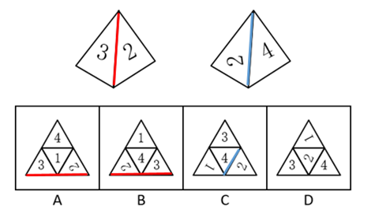

# 空间重构-四面体展开图（相邻面公共棱+图案朝向判定）

考点：[[20-考点/判断推理/图形推理/空间重构-四面体展开图（相邻面公共棱+图案朝向判定）|图形推理 / 空间重构-四面体展开图（相邻面公共棱+图案朝向判定）]]

**问法模型**：同一正四面体两个角度视图→选正确展开图：以带方向性的数字面为锚点，核对数字与公共棱的相对方位逐项排除

## 推理链
1. 第1步：提取左视图规律：可见面'3'与面'2'相邻，其公共棱（红线）紧贴数字'3'的背部（数字上端一侧）
2. 第2步：提取右视图规律：可见面'2'与面'4'相邻，其公共棱（蓝线）紧贴数字'2'的底部
3. 第3步：所用规则：数字1/2/3/4具有唯一方向性，展开图折叠还原后，数字相对公共棱的方位必须与视图完全一致（相邻边+图案朝向法）
4. 第4步：检验A项：数字'3'的底部紧邻与面'2'的公共边，与题干'背部紧邻'不符，排除
5. 第5步：检验B项：数字'3'同样为底部紧邻公共边，与题干不符，排除
6. 第6步：检验C项：数字'2'的上部紧邻与面'4'的公共边，与题干'底部紧邻（蓝线）'不符，排除
7. 第7步：检验D项：数字'2'底部贴棱、'3''4'与公共棱的方位均与两视图吻合，且'1'占剩余面，全部一致，当选

**最快解法**：⚡ 锚点排除法（公共边+数字朝向）：锁定视图中最具方向性的两个锚点——数字'3'（背部贴棱）和数字'2'（底部贴棱）；在展开图中只查这两处：A、B项数字3均为底部贴棱直接排除，C项数字2为上部贴棱排除，剩余D无需完整折叠即为答案

## 易错点
- ⚠ 只验证数字相邻关系、忽略数字自身的方向性（如认为3和2相邻即可），导致误选A/B/C
- ⚠ 视图中面倾斜使数字视觉上发生旋转（右图中'2''4'呈横倒状），误判数字与公共棱的原始方位关系
- ⚠ 在大三角形展开图上凭直觉整体折叠，未以'公共棱'为基准逐面还原相对位置，易看错面间朝向

## 母题抽象
> 🧩 当题干出现'同一多面体两个视角视图+展开图选配'特征时，选带方向性的图案（数字/箭头）作锚点，先确定图案与公共棱的相对方位（背部/底部贴棱），再逐项在展开图中核对该方位排除

**同类特征**：正四面体、两个不同角度视图、面上为数字1/2/3/4、数字具有方向性（背部/底部紧邻公共棱）、展开图为大三角形含四个小三角形、相邻面公共棱判定

## 相关题
- [[10-真题/判断推理/图形推理/2374827 空间重构-四面体展开图（相邻面公共边与面上数字朝向对应）|2374827]]（广东 2019，相关度1）

---

### 题干

如图所示是从两个不同角度观察到的同一个正四面体的外表面，将该四面体展开，可能得到的图形是（    ）。

### 选项
- A. A
- B. B
- C. C
- D. D　✅

### 官方解析

本题为空间重构类，逐一分析选项。

A项：题干中数字3的背部紧邻公共边（如上图红线所示），而选项中数字3的底部紧邻公共边，选项与题干不一致，排除； 

B项：题干中数字3的背部紧邻公共边（如上图红线所示），而选项中数字3的底部紧邻公共边，选项与题干不一致，排除；

C项：题干中数字2的底部紧邻公共边（如上图蓝线所示），而选项中数字2的上部紧邻公共边，选项与题干不一致，排除；

D项：选项与题干一致，当选。

故正确答案为D。

### 给定材料
（无）
