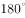

# 立体图形-空间旋转（小方块组合体旋转重合·选非题）

考点：[[20-考点/判断推理/图形推理/立体图形-空间旋转（小方块组合体旋转重合·选非题）|图形推理 / 立体图形-空间旋转（小方块组合体旋转重合·选非题）]]

**问法模型**：问法'与所给立体图形不同的是'（选非题）→ 对各选项逐一尝试纯旋转还原：能仅靠旋转与原图重合者排除，需镜像翻转或特征块方位矛盾者当选

## 推理链
1. 第1步：题干立体图形由带'直角'的方块主体加一个'多出来的小方块'（自平面层向下伸出）组成；本题为选非题，要找不能由旋转得到的选项
2. 第2步：规则——立体图形只作整体旋转（任意轴转动、不镜像翻转），旋转不改变各小方块之间的相对位置关系
3. 第3步：A项：将题干图形逆时针旋转，各块相对位置不变即可得到，与原图相同，排除
4. 第4步：B项：把图形旋转到'直角处位置朝外'的姿态时，按原结构'多出来的小方块'应位于下方，而B中该小方块出现在上方一侧，相对方位矛盾，无法由旋转得到
5. 第5步：C项：将题干图形逆时针旋转即可得到，与原图相同，排除
6. 第6步：D项：将题干图形水平向后旋转、再顺时针旋转即可得到，与原图相同，排除
7. 第7步：本题为选非题，仅B不能通过旋转与原图重合，故选B

**最快解法**：⚡ 特征块锚定法：只盯'多出来的小方块'与'直角处'的相对方位——原图旋转到直角朝外时该方块必在下方；逐项把图形摆到直角朝外的姿态核对，A、C、D均吻合，B中该块跑到上方（实为镜像关系），直接锁定B

## 易错点
- ⚠ 把'翻转（镜像）'误当'旋转'：B与原图块数相同、形似镜像错位，必须翻转才能重合，纯旋转不可得
- ⚠ 只数小方块数量不核对相对位置：各选项块数一致，靠数量无法排除B，必须检验特征块方位
- ⚠ 忽略选非题要求：误把能旋转重合的A/C/D当成答案

## 母题抽象
> 🧩 当题干出现小方块组合立体图形且问'与所给图形不同的是'时，先数块数排除增减块，再锁定特征块（多出/突出的小方块）与主体特征（直角、长边）的相对方位，逐项纯旋转验证；凡需翻转（镜像）才能重合或特征块方位矛盾者即为答案

**同类特征**：选非题'不同的是'、小方块组合立体图形、整体旋转不翻转、直角处朝外的特征姿态、多出来的小方块方位、顺/逆时针旋转还原

## 相关题
（暂无）

---

### 题干

下列选项，与所给立体图形不同的是（    ）。

### 选项
- A. A
- B. B　✅
- C. C
- D. D

### 官方解析

本题考查立体图形在空间中的旋转。

A项：题干图形逆时针旋转即可得到，与题干立体图形相同，排除；

B项：如上图所示，当题干图形旋转到直角处位置朝外的时候，多出来的小方块应该在下方，与题干立体图形不同，当选；

C项：题干图形逆时针旋转即可得到，与题干立体图形相同，排除；

D项：题干图形水平向后旋转，再顺时针旋转即可得到，与题干立体图形相同，排除。

本题为选非题，故正确答案为B。

### 给定材料
（无）
