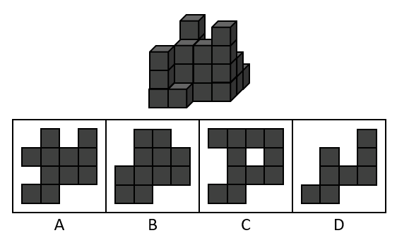

# 三视图-立体图形俯视图（选非题）

考点：[[20-考点/判断推理/图形推理/三视图-立体图形俯视图（选非题）|图形推理 / 三视图-立体图形俯视图（选非题）]]

**问法模型**：问'俯视图不可能是'（选非）→ 按'有方块的位置俯视投影必为实心格'还原俯视轮廓，排除可行项，锁定与特征方块矛盾的一项

## 推理链
1. 第1步：题干给出小正方体搭成的立体图，问'俯视图不可能是'，属选非题，需找出不能作为俯视图的选项
2. 第2步：按官方解析将物体拆为'从前往后4排小正方体'，俯视图即所有小正方体在水平面上的投影，与方块层数高低无关
3. 第3步：锁定特征位置——'右上角最后一排从侧面看到已有小正方体存在'，该位置虽可能被前排方块部分遮挡，但俯视投影必须存在
4. 第4步：由第3步得规则：俯视图右上角必须为实心小正方形，'不可能缺了一个小正方形'
5. 第5步：逐项对照：A、C、D的轮廓右上角均为实心（C中部白格对应中部无方块的空位），均可作为俯视图
6. 第6步：B项右上角缺一个小正方形，与'最后一排右上有方块'直接矛盾，结合选非题得出答案为B

**最快解法**：⚡ 特征位置排除法：只验证'右上角'一处——立体图最后一排右侧有方块⇒俯视图右上角必须实心；B右上角缺格，直接选B，无需逐格还原整个俯视图

## 易错点
- ⚠ 忽略被遮挡方块：右上角最后一排的小正方体从正面看被前排挡住，漏数导致误判右上角可空
- ⚠ 选非题审题出错：误去找'正确的俯视图'而错选A/C/D
- ⚠ 误以为俯视图要体现方块层数高低，或对C中部的白格空位产生怀疑而错判

## 母题抽象
> 🧩 当立体图形考'不可能的视图'时，先锁定角落/边缘特征方块的有无，用'有方块⇒投影实心格'逐项核对视图轮廓的缺角，选非题中与特征矛盾者即为答案

**同类特征**：俯视图、选非题（不可能）、小正方体组合体、从前往后多排分布、被遮挡的方块（侧面可见）、角落特征位置

## 相关题
- [[10-真题/判断推理/图形推理/12881941 三视图-俯视图（正投影规律）|12881941]]（广东 2025，相关度1）
- [[10-真题/判断推理/图形推理/2133602 三视图-视图方向辨析（选非题）|2133602]]（国考 2018，相关度1）
- [[10-真题/判断推理/图形推理/2261750 三视图规律（立体图-俯视图-主视图对应，正投影画法）|2261750]]（选调 2017，相关度1）

---

### 题干

如图所示，所给物体的俯视图不可能是（    ）。

### 选项
- A. A
- B. B　✅
- C. C
- D. D

### 官方解析

给定物体可看作由从前往后4排小正方体组成，且右上角最后一排从侧面看到已有小正方体存在，所以在俯视图上，右上角不可能缺了一个小正方形，如下图所示。

本题为选非题，故正确答案为B。

### 给定材料
（无）
