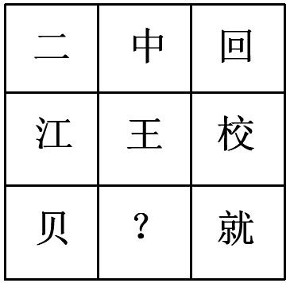

# 数量规律-汉字笔画数（行内加和规律）

考点：[[20-考点/判断推理/图形推理/数量规律-汉字笔画数（行内加和规律）|图形推理 / 数量规律-汉字笔画数（行内加和规律）]]

**问法模型**：九宫格问'最合适的一个填入问号处使之呈现规律性'→ 元素为汉字且属性无规律时，横行数笔画找运算规律

## 推理链
1. 第1步：元素组成不同且无明显属性规律，九宫格中九个图形均为汉字，优先考虑数量规律中的笔画数
2. 第2步：九宫格优先横行看，数第一行'二、中、回'的笔画数为2、4、6，发现2+4=6
3. 第3步：数第二行'江、王、校'的笔画数为6、4、10，验证6+4=10，确认规律为'每行前两幅笔画数相加等于第三幅'
4. 第4步：第三行'贝、？、就'笔画数为4、？、12，代入规律得？=12-4=8，问号处应为8笔画汉字
5. 第5步：逐项核对笔画数——A'金'8笔、B'令'5笔、C'书'4笔、D'无'4笔，仅A项为8笔画

**最快解法**：⚡ 笔画加和法——横行验证'图1笔画+图2笔画=图3笔画'（2+4=6、6+4=10），第三行12-4=8，直接锁定8笔画的'金'选A

## 易错点
- ⚠ 第一行2、4、6形似等差递增，若误判为等差规律则第三行会找6笔画字而无对应项，应看第二行6、4、10确认是加和规律
- ⚠ 汉字笔画数易错数：'金'易漏数8笔、'校'10笔、'就'12笔需细数
- ⚠ 受'数面'思路干扰误选C：'中'的面数判定有争议（通常仅口部1个封闭面），本题以笔画规律为准

## 母题抽象
> 🧩 当九宫格图形为汉字且对称、封闭等属性无规律时，横行数笔画验证'前两图相加=第三图'的加和关系，再计算问号处所需笔画数选答案

**同类特征**：九宫格、图形均为汉字、元素组成不同、无明显属性规律、横行笔画数加和、问号处求8笔画汉字

## 相关题
- [[10-真题/判断推理/图形推理/14993416 数量规律-点数量（黑点个数按行求和恒值）|14993416]]（选调 2024，相关度3）
- [[10-真题/判断推理/图形推理/17467550 数量规律-交点数（九宫格按行等差递增）|17467550]]（湖北 2026，相关度3）
- [[10-真题/判断推理/图形推理/19889518 数量规律-数面（封闭区域数）及行内加减运算|19889518]]（上海 2021，相关度3）
- [[10-真题/判断推理/图形推理/2139602 数量规律-面数量（封闭区域计数）|2139602]]（天津 2017，相关度3）
- [[10-真题/判断推理/图形推理/2144672 数量规律-汉字笔画数|2144672]]（新疆 2017，相关度3）

---

### 题干

从所给四个选项中，选择最合适的一个填入问号处，使之呈现一定的规律性

### 选项
- A. 金　✅
- B. 令
- C. 书
- D. 无

### 官方解析
解析一：元素组成不同，且无明显属性规律，考虑数量规律。图形均为汉字，优先考虑笔画数。九宫格优先横行看，第一横行笔画数依次为2、4、6；第二横行笔画数依次为6、4、10，即前两行均满足前两幅笔画数相加等于第三幅，沿用此规律，第三行笔画数依次为4、？、12，因此问号处应选择8笔画的汉字。A项8笔画，B项5笔画，C项4笔画，D项4笔画。
故正确答案为A。
解析二：元素组成不同，且无明显属性规律，考虑数量规律。图形均为汉字，且“中”“回”存在明显的封闭面，考虑数面。九宫格优先横行看，第一横行面数量依次为0、2、2；第二横行面数量依次为0、0、0，即前两行图形均满足前两幅面数量相加等于第三幅，沿用此规律，第三行面数量依次为0、？、1，因此问号处应选择1个面的汉字。A、B、D项均为0个面，只有C项为1个面。
故正确答案为C。
粉笔说明：两种思路均可通过严谨的数量规律得到答案，且数笔画和数面均为常见考法，故两种答案粉笔都认可。

### 给定材料
（无）

> [!note] 复核版本状态
> 原题不可计分（underdetermined；来源记录的答案键/竞争项：A、C）；仅当前明确标注的编辑版按答案A计分。
> 详细原题疑点、修订题面、解析和证据见下方独立复核记录。

<!-- CODEX-ANSWER-REVIEW:BEGIN -->
### 本次独立复核

**复核结论：** `resolved`（答案与解析已核定）

**原题计分状态：** 不计分（`underdetermined`：原题证据不足以唯一判定）。来源中记录的答案键/竞争项：A、C；这些记录不代表原题已核准答案。

**原题疑点与处理：**

吉林 2019 〔20-考点/判断推理/图形推理/数量规律-汉字笔画数（行内加和规律）〕 — 官方解析二按'面数量'得出C项，其中将'中'计为2个面存在争议（'中'通常仅口部1个封闭面，若按1面则第一行0+1≠2不满足加和）；粉笔说明虽认可双答案，但本题…

**当前计分版本：** 明确标注的编辑版；未列出的题干、材料或选项沿用固定题源。答案不回填为原题答案。

**计分答案：** A（可计分）

**复核解析：**

固定题图中前两行的规范笔画数分别为2+4=6、6+4=10，验证了题干明示的行内加法规则。第三行“贝”4画、“就”12画，缺项须为8画；A“金”为8画，B“令”为5画，C“书”和D“无”均为4画，故选A。原题另有数面的候选规律，修订版明确采用笔画数。

**修订题干：**

【编辑修订版】按每个汉字的规范笔画数，九宫格每行前两格笔画数之和等于第三格，选择问号处汉字。

**相关信息：**

汉字笔画按规范笔顺计数；字形题需把规范笔画数量与封闭面数量区别开。

**核对依据与来源边界：**

- 固定题源：[原题文件](https://github.com/Mentat-Uran/kaogongzhentizhengliu/blob/84ab93d4b64b61d897bece8a1c0a5bab06b4feb2/10-%E7%9C%9F%E9%A2%98/%E5%88%A4%E6%96%AD%E6%8E%A8%E7%90%86/%E5%9B%BE%E5%BD%A2%E6%8E%A8%E7%90%86/2376453%20%E6%95%B0%E9%87%8F%E8%A7%84%E5%BE%8B-%E6%B1%89%E5%AD%97%E7%AC%94%E7%94%BB%E6%95%B0%EF%BC%88%E8%A1%8C%E5%86%85%E5%8A%A0%E5%92%8C%E8%A7%84%E5%BE%8B%EF%BC%89.md)；内容版本 `84ab93d4b64b61d897bece8a1c0a5bab06b4feb2`，源 Markdown blob `da0688b34c37b7e540a85efe1b7aed73077d550d`.
- **核心依据：** 固定题图及原解析可核对各字笔画数；第一、二行验证行内加法，第三行唯一需要8画字。
- 固定题图/公式图：`90-图片/题目图/16a39ab2d3df22d.png`.

<!-- CODEX-ANSWER-REVIEW:END -->
