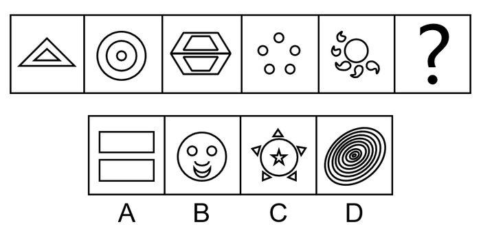

# 数量规律-面数量（封闭区域数等差递增）

考点：[[20-考点/判断推理/图形推理/数量规律-面数量（封闭区域数等差递增）|图形推理 / 数量规律-面数量（封闭区域数等差递增）]]

**问法模型**：‘选择最合适的一个填入问号处，使之呈现一定的规律性’→ 元素组成不同且无属性规律时，转向数量规律，优先数封闭区域（面）的数量找递增数列

## 推理链
1. 第1步：观察题干五幅图（嵌套三角形、同心圆、六边形内梯形、五个小圆、太阳形），元素组成不同，对称/曲直等属性无统一规律，转向数量规律
2. 第2步：图四为五个独立小圆、图五为中心圆加五个火焰瓣，封闭面特征明显，确定优先数面数量
3. 第3步：逐图数面：图一大三角内嵌小三角=2个面；图二三环同心圆=3个面；图三六边形内两个梯形分隔=4个面；图四五个小圆=5个面；图五中心圆+五个火焰瓣=6个面
4. 第4步：面数量构成等差数列2、3、4、5、6，故问号处图形应含7个面
5. 第5步：逐项数面：A仅两个矩形=2个面，排除；B为笑脸图形，面数不足7，排除；C为五个小三角加中心圆内嵌五角星，封闭区域共7个，符合
6. 第6步：D为多重同心椭圆，面数多于7个，排除；仅C面数量为7，与等差规律吻合，故选C

**最快解法**：⚡ 数面法+排除法：题干面数2→3→4→5、6呈等差递增，问号锁定7个面；快速数选项封闭区域，A=2、D明显超过7，直接锁定C

## 易错点
- ⚠ 误数元素个数（如数小圆、小三角的个数）而非封闭区域数，遗漏嵌套图形的封闭面
- ⚠ C项中心圆内嵌五角星，易漏数‘星形与外圈之间的区域’而误数成6个面
- ⚠ D项同心椭圆线条密集，易被线条数干扰或将面数数错而误选

## 母题抽象
> 🧩 当题干图形元素组成不同、无对称曲直等属性规律，且出现嵌套图形或多个小封闭区域（圆、三角组合）时，优先数封闭区域（面）数量，常呈等差递增规律，问号处取数列下一项

**同类特征**：元素组成不同、无明显属性规律、封闭面明显、面数量2/3/4/5/6递增、嵌套图形与小封闭区域组合、等差数列规律

## 相关题
- [[10-真题/判断推理/图形推理/2402399 数量规律-面数量（封闭区域数等差递增）|2402399]]（重庆 2018，相关度4）
- [[10-真题/判断推理/图形推理/4658458 数量规律-面数量（封闭区域数等差递增）|4658458]]（四川 2021，相关度4）
- [[10-真题/判断推理/图形推理/10297262 数量规律-面的形状种类（封闭面种类数分组）|10297262]]（浙江 2025，相关度3）
- [[10-真题/判断推理/图形推理/2247206 数量规律-面数量（封闭区域数等差递增）|2247206]]（新疆 2018，相关度3）
- [[10-真题/判断推理/图形推理/10204454 数量规律-部分数（黑白球连通区域数做和）|10204454]]（甘肃 2024，相关度2）

---

### 题干

从所给四个选项中，选择最合适的一个填入问号处，使之呈现一定的规律性：

### 选项
- A. A
- B. B
- C. C　✅
- D. D

### 官方解析
元素组成不同，且无明显属性规律，考虑数量规律。图四、图五封闭面明显，考虑面数量。面数量依次为2、3、4、5、6，则问号处图形面数量为7，只有C符合要求。
故正确答案为C。

### 给定材料
（无）
