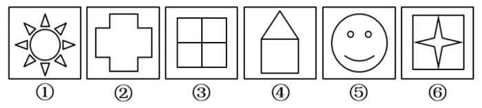

# 属性规律-对称性（按对称轴数量分组）

考点：[[20-考点/判断推理/图形推理/属性规律-对称性（按对称轴数量分组）|图形推理 / 属性规律-对称性（按对称轴数量分组）]]

**问法模型**：‘把六个图形分为两类，每类各有共同特征’→分组分类题，元素组成不同且图形规整，优先数对称轴条数找二级规律分组

## 推理链
1. 第1步：元素组成不同，且①太阳、②十字形、③‘田’字、④房形、⑤笑脸、⑥方框套四角星均很规整，优先考虑对称性属性规律
2. 第2步：逐图数对称轴——②十字形有横、竖及两条对角线共4条对称轴；③‘田’字同样有横、竖及两条对角线共4条对称轴
3. 第3步：⑥四角星的角顶落在正方形四边中点、凹点落在对角线上，横、竖、两条对角线均能使内外图形同时重合，共4条对称轴，与②③同数量
4. 第4步：①太阳为轴对称图形但对称轴数量不是4条；④房形（三角+矩形）仅有1条竖直对称轴；⑤笑脸仅有1条竖直对称轴
5. 第5步：按‘对称轴是否恰为4条’分组：②③⑥一组（均为4条），①④⑤一组（轴对称但对称轴不是4条）
6. 第6步：对照选项，②③⑥、①④⑤对应D；排除被‘田’字诱导的笔画数思路（①③⑤多笔画、②④⑥一笔画对应C），官方明确‘图形整齐优先考虑对称性’故倾向D

**最快解法**：⚡ 对称轴计数法（属性规律口诀：图形规整先数轴）：快速数出②③⑥均恰有4条对称轴，①④⑤轴对称但不是4条，直接锁定D

## 易错点
- ⚠ 只判断‘都是轴对称’就停步，六个图全轴对称无法分组，必须下沉到‘对称轴数量是否为4’的二级规律
- ⚠ ⑥为正方形与四角星的复合图形，易漏掉两条对角线对称轴（误认为只有横竖2条），或误判内外图形在对角线上不重合
- ⚠ 见到‘田’字变形就条件反射改做笔画数，得出①③⑤/②④⑥（C）的干扰分类；两规律并存时按官方倾向‘规整图形优先对称性’取D

## 母题抽象
> 🧩 当分组分类题元素组成不同且图形规整（含外框、十字、田字、星形等对称原型）时，先数各图对称轴条数，按‘某具体条数（如4条）vs 非该条数’分组；复合图形需同时验证内外图形的公共对称轴

**同类特征**：六个图形均为轴对称且规整、元素组成不同、十字形/田字/四角星等对称原型、对称轴数量4条与非4条的差异、田字变形诱导笔画数干扰、分组分类问法

## 相关题
- [[10-真题/判断推理/图形推理/10297262 数量规律-面的形状种类（封闭面种类数分组）|10297262]]（浙江 2025，相关度2）
- [[10-真题/判断推理/图形推理/12536392 数量规律-黑色区域面积（宫格面积折算）|12536392]]（四川 2024，相关度2）
- [[10-真题/判断推理/图形推理/12882156 图形推理-对称性（仅轴对称 vs 既轴对称又中心对称）|12882156]]（黑龙江 2025，相关度2）
- [[10-真题/判断推理/图形推理/15833781 属性规律-对称性（轴对称与中心对称组合分组）|15833781]]（内蒙古 2026，相关度2）
- [[10-真题/判断推理/图形推理/17097256 数量规律-交点数（交点数相同再比交点分布位置）|17097256]]（山西 2024，相关度2）

---

### 题干

把下面的六个图形分为两类，使每一类图形都有各自的共同特征或规律，分类正确的一组是

### 选项
- A. ①②③，④⑤⑥
- B. ②④⑤，①③⑥
- C. ①③⑤，②④⑥
- D. ②③⑥，①④⑤　✅

### 官方解析
思路一：
本题为分组分类题目。元素组成不同，且图形很整齐，优先考虑对称性。观察发现图②③⑥都具有4条对称轴，而①④⑤都是轴对称图形且对称轴不是4。
故正确答案为D。
思路二：
本题为分组分类题目。元素组成不同，出现“田”字及“日”字变形，优先考虑笔画数。观察发现图①③⑤为多笔画图形，图②④⑥为一笔画图形，因此①③⑤一组，②④⑥一组。
故正确答案为C。
因为本题图形都很整齐，所以粉笔更倾向第一种思路，选D。
注：在考查分组分类题目中，吉林省比较喜欢考查一组有相同规律，一组无相同规律。

### 给定材料
（无）
