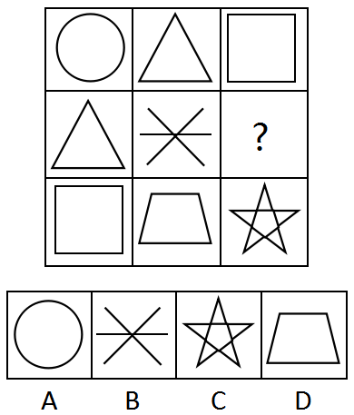

# 样式规律-遍历（九宫格行列对称-主对角线对称）

考点：[[20-考点/判断推理/图形推理/样式规律-遍历（九宫格行列对称-主对角线对称）|图形推理 / 样式规律-遍历（九宫格行列对称/主对角线对称）]]

**问法模型**：九宫格'填入问号使之呈现一定规律性'→ 元素不同但重复出现，按'第n行与第n列元素完全相同'的行列遍历（对称）模型求解

## 推理链
1. 第1步：提取九宫格图形——第一行：圆、三角形、正方形；第二行：三角形、米字交叉线、？；第三行：正方形、梯形、五角星
2. 第2步：元素组成不同但三角形、正方形等图形在行列间重复出现，优先考虑遍历规律；观察发现第一行（圆、三角、正方形）与第一列（圆、三角、正方形）完全相同，提示九宫格沿主对角线行列表里对称
3. 第3步：将规律推广：第二行应与第二列相同——第二列已有三角形（r1c2）、米字（r2c2）、梯形（r3c2），第二行已有三角形、米字，故？处应填梯形
4. 第4步：验证第三行与第三列：第三行为正方形、梯形、五角星，若？为梯形，第三列为正方形、梯形、五角星，完全一致，规律闭环
5. 第5步：逐项对照——A圆、B米字、C五角星均无法使第二行=第二列，只有D梯形满足行列对称遍历

**最快解法**：⚡ 行列对称口诀法：发现'第一行=第一列'后直接推出'？（r2c3）= r3c2 的梯形'，即问号处填其关于主对角线对称位置上的图形，秒选D

## 易错点
- ⚠ 只按行找规律，发现每行元素不同且无数量、属性规律后陷入僵局，忽略列的对比
- ⚠ 把规律误判为'每个图形出现次数相同'而去数频次，A/B/C/D均无法凑成统一频次，浪费考场时间
- ⚠ 误选C五角星：误以为'每行凑齐三个不同图形'即可，忽略第三行第三列本就是五角星，未做行列对称验证

## 母题抽象
> 🧩 当九宫格中元素组成不同但相同图形在行列间重复出现时，优先检验'第n行与第n列完全相同'的对角线对称遍历规律，问号处填其对称位置上的图形

**同类特征**：九宫格、元素组成不同、相同元素重复出现、第一行与第一列完全相同、问号位于非对角线位置、遍历/行列对称

## 相关题
- [[10-真题/判断推理/图形推理/11367791 属性类-对称性（对称轴方向与条数、轴对称+中心对称）＋数量类-面数量（九宫格横行复合规律）|11367791]]（江苏 2025，相关度2）
- [[10-真题/判断推理/图形推理/11881082 属性规律-对称性（对称轴方向）|11881082]]（黑龙江 2024，相关度2）
- [[10-真题/判断推理/图形推理/12881896 属性规律-曲直性（九宫格横行遍历）|12881896]]（新疆 2025，相关度2）
- [[10-真题/判断推理/图形推理/14993416 数量规律-点数量（黑点个数按行求和恒值）|14993416]]（选调 2024，相关度2）
- [[10-真题/判断推理/图形推理/17097275 图形间关系-点相交（点接触 vs 线接触）|17097275]]（山西 2024，相关度2）

---

### 题干

从所给四个选项中，选择最合适的一个填入问号处，使之呈现一定的规律性

### 选项
- A. A
- B. B
- C. C
- D. D　✅

### 官方解析
元素组成不同，相同的元素重复出现，优先考虑遍历。九宫格第一行的图形和第一列的图形完全相同，对比第二列的图形，“？”处应选择的图形为梯形，此时第二行和第二列的图形也完全相同，验证发现第三行和第三列也符合此规律。
故正确答案为D。

### 给定材料
（无）
