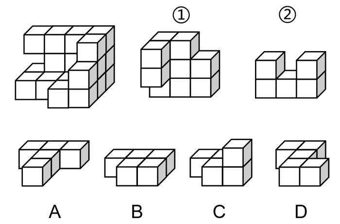
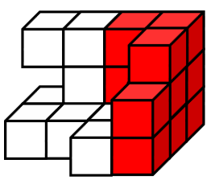
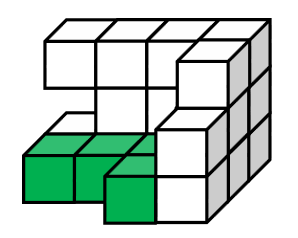

# 图形推理-立体拼合（小正方体组合，凹凸互补）

考点：[[20-考点/判断推理/图形推理/图形推理-立体拼合（小正方体组合，凹凸互补）|图形推理 / 图形推理-立体拼合（小正方体组合，凹凸互补）]]

**问法模型**：题干给出20个小正方体组成的多面体，问①、②与哪个选项可拼合成整体 → 采用立体拼合的凹凸互补法：先定位①②的嵌入位置，剩余空缺与选项对照

## 推理链
1. 第1步：目标多面体由20个一样的小正方体组成，需将①、②与四个选项之一拼合还原，可用'总数20=①+②+选项'做数量校验
2. 第2步：用凹凸互补原则——'凸出对凹陷、缺失对突出'，在目标多面体中寻找①、②各自独特的凹凸特征对应的位置
3. 第3步：观察图①：右上角缺少一块正方体、左边突出来两个正方体，这组凹凸特征与目标多面体中的对应阶梯状缺口/凸出结构一一咬合，锁定①的嵌入位置
4. 第4步：观察图②：上面一排正方体中间少一块（U形缺口），与目标多面体顶面中间的凹槽对应，锁定②的嵌入位置
5. 第5步：将①、②按确定位置嵌入后，逐一标记目标多面体中尚未被占据的小正方体位置，得到剩余空缺的立体连接形状
6. 第6步：逐项对照：A的方块连接方式与层数分布和剩余空缺完全吻合（考虑旋转后）；B为平铺条形、C偏小、D的连接位置与空缺形状不符，均排除
7. 第7步：故①、②与A可组合成原多面体，答案为A

**最快解法**：⚡ 凹凸互补定位法+排除法：先抓①'左边凸出两块'、②'上排中间缺一块'这两个最独特特征，在大图形中找到对应凹陷处快速锁定①②位置，再目测剩余空缺的立体形状与四选项比对，形状不符的直接排除

## 易错点
- ⚠ 只做小正方体数量守恒校验而不比较方块的连接方式与空间分布，误选数量相同但形状不符的选项
- ⚠ 忽视立体图形可旋转，未把剩余空缺与选项转到同一视角比对，导致错排正确项或误选镜像项
- ⚠ ①②嵌入方向判断错误（凸对凸、凹对凹），使剩余空缺形状判错而选B或D

## 母题抽象
> 🧩 当题干出现'由N个相同小正方体组合而成，问①②与哪个图形可拼成整体'时，用凹凸互补法：先以最独特的凸出/缺失特征定位已知块，再以剩余空缺的立体形状逐一对照选项

**同类特征**：20个一样的小正方体、多面体拼合还原、已知两块①和②、四选项立体图形、凹凸互补、可旋转比对

## 相关题
- [[10-真题/判断推理/图形推理/12881949 立体拼合-多块拼合正方体（凹凸互补+旋转）|12881949]]（广东 2025，相关度1）
- [[10-真题/判断推理/图形推理/18649987 立体拼合（多面体拆分组合+旋转匹配）|18649987]]（选调 2025，相关度1）
- [[10-真题/判断推理/图形推理/19526428 立体拼合（多块拼合·选非题）|19526428]]（国考 2026，相关度1）
- [[10-真题/判断推理/图形推理/2448540 立体拼合（多视图还原+组件拼合互补）|2448540]]（国考 2020，相关度1）
- [[10-真题/判断推理/图形推理/2719441 立体拼合（多面体切割重组，凹凸互补）|2719441]]（国考 2021，相关度1）

---

### 题干

下图所示的多面体为20个一样的小正方体组合而成，问①、②和以下哪个多面体可以组合成该多面体？

### 选项
- A. A　✅
- B. B
- C. C
- D. D

### 官方解析

观察图①，右上角缺少了一块正方体，且左边突出来两个正方体，故可确定图①在多面体中的位置如下图所示：

观察图②，上面一排正方体中间少了一块正方体,故可确定图②在多面体中的位置如下图所示：

因此,需要补充的图形如下图所示：

故正确答案为A。

### 给定材料
（无）
