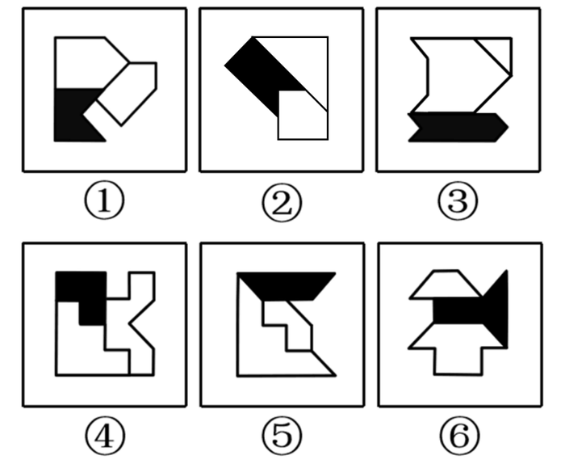

# 属性规律-对称性（小图形对称轴的方向关系）

考点：[[20-考点/判断推理/图形推理/属性规律-对称性（小图形对称轴的方向关系）|图形推理 / 属性规律-对称性（小图形对称轴的方向关系）]]

**问法模型**：'把六个图形分为两类'的分组分类问法 → 逐图找属性/数量规律，使每组内部各自呈现共同特征

## 推理链
1. 第1步：题干要求将①~⑥分为两类；每幅图由三个小图形（1个黑块+2个空白图形）拼合而成，元素组成不同，优先考虑属性规律
2. 第2步：观察发现每幅图整体均不对称，但图内三个小图形各自都是轴对称图形，故把对称性考察下沉到'小图形'层级，分别画出三个小图形的对称轴
3. 第3步：考察黑块对称轴与两个空白图形对称轴的方向关系，图①③④中黑块对称轴与其中一个空白图形的对称轴平行、与另一个空白图形的对称轴交叉
4. 第4步：图②⑤⑥中黑块对称轴与两个空白图形的对称轴均交叉，无平行关系
5. 第5步：据此①③④为一组（平行+交叉），②⑤⑥为一组（双交叉）
6. 第6步：与选项对照，①③④、②⑤⑥对应A项

**最快解法**：⚡ 对称轴法+分组验证：对每图的三个小图形各画一条对称轴，只比较黑块对称轴与两个空白图形对称轴的关系——出现'一条平行一条交叉'即归①③④组，'两条都交叉'即归②⑤⑥组，秒选A

## 易错点
- ⚠ 看到每幅图整体不对称就放弃对称规律，漏掉'局部小图形各自对称'这一考察层级
- ⚠ 把考察对象错放在整体轮廓或黑白面积、位置关系上，找不到分组依据
- ⚠ 黑块对称轴与空白图形对称轴的'平行/交叉'关系判断失误（尤其是斜向对称轴的图形如①②）

## 母题抽象
> 🧩 当题干出现'多个小图形拼合且整体不对称'的特征时，分别画出各小图形的对称轴，验证对称轴之间的方向关系（平行/交叉/重合/垂直）进行分组

**同类特征**：六个图形分类分组、每图由三个小图形拼合（一黑两白）、整体不对称、小图形均为轴对称图形、需画小图形对称轴、对称轴平行与交叉的关系

## 相关题
- [[10-真题/判断推理/图形推理/2172151 属性规律-对称性（轴对称与非轴对称分组）|2172151]]（广州市考 2018，相关度1）

---

### 题干

把下面的六个图形分为两类，使每一类图形都有各自的共同特征或规律，分类正确的一项是：

### 选项
- A. ①③④，②⑤⑥　✅
- B. ①③⑤，②④⑥
- C. ①②⑥，③④⑤
- D. ①④⑥，②③⑤

### 官方解析
元素组成不同，优先考虑属性规律。本题每个图形整体上来看虽然都不对称，但是每幅图中的三个小图形均为对称图形，因此，可以分别画出每幅图形中三个小图形的对称轴，发现图①③④黑块的对称轴和一个空白图形对称轴平行，和另一个空白图形对称轴交叉；图②⑤⑥黑块的对称轴和两个空白图形的对称轴都交叉，因此，①③④一组，②⑤⑥一组。
故正确答案为A。

### 给定材料
（无）
